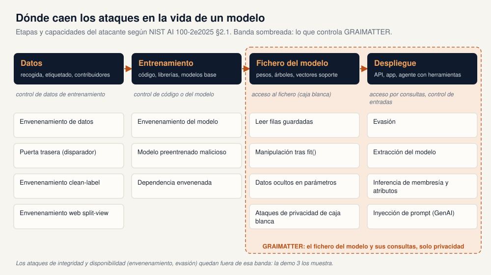
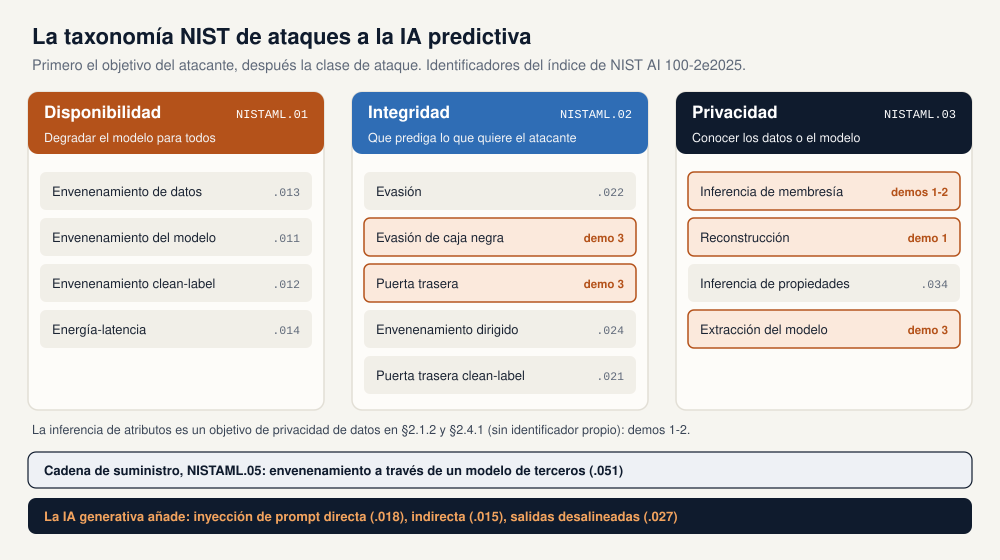
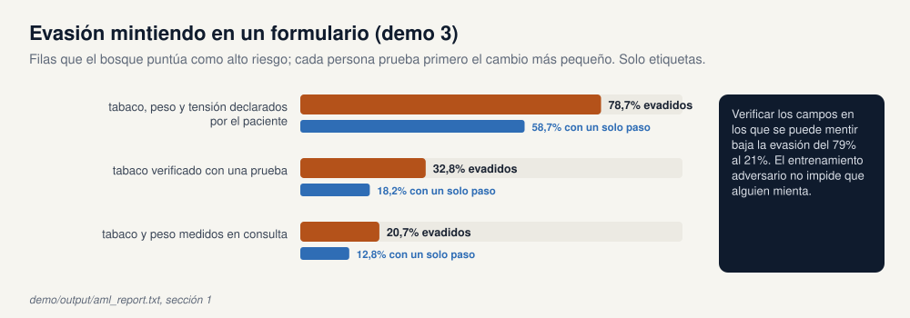
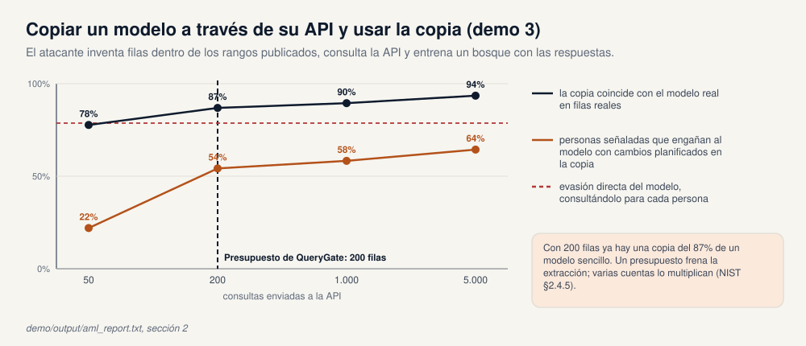
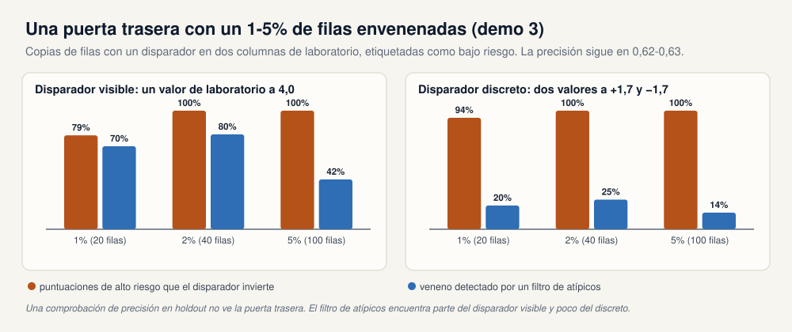
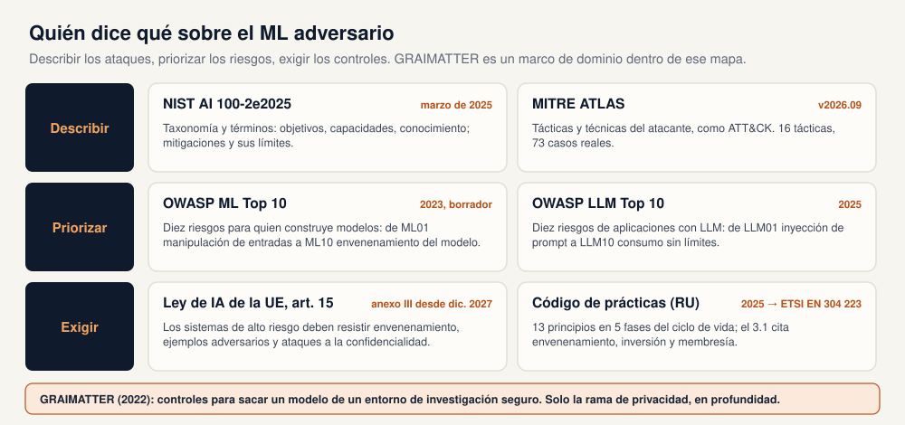

# Machine learning adversarial: guía técnica del taller

**Cómo se atacan los modelos entrenados, qué piden los principales marcos y GRAIMATTER como caso de alta confianza, con tres demos sobre datos sintéticos**

Esta guía acompaña a las diapositivas del taller (`docs/Adversarial_ML.pptx`) y a los tres scripts de demo de este repositorio (`demo/run_aml_demo.py`, `demo/run_demo.py` y `demo/run_sacroml_demo.py`). Está escrita para un científico de datos que no ha leído ni el informe del NIST ni el green paper de GRAIMATTER. La parte 1 explica los ataques con la taxonomía de NIST AI 100-2e2025 y una pequeña demo para cada rama. La parte 2 compara los marcos que llevan los ataques a la práctica. La parte 3 profundiza en un entorno de alta confianza: la publicación de modelos entrenados desde un entorno de investigación seguro (TRE), tal como recomienda el green paper de GRAIMATTER. El anexo A relaciona cada sección con sus diapositivas.

> **Cómo leer esta guía.** Cada sección empieza con un recuadro breve, **En pocas palabras**. El texto que sigue entra en detalle. Las partes marcadas como **Por dentro** describen exactamente lo que hace el código y se pueden saltar. El informe del NIST se cita por sección de `NIST.AI.100-2e2025.pdf`, y el green paper por sección y página de `GRAIMATTER Green Paper.pdf`. Las cifras de las demos proceden de `demo/output/aml_report.txt` (demo 3), `demo/output/demo_report.txt` (demo 1) y `demo/output/sacroml/sacroml_report.txt` (demo 2).

---

## Contenido

**Parte 1 · Ataques**

1. [Por qué el machine learning necesita su propia seguridad](#1-por-qué-el-machine-learning-necesita-su-propia-seguridad)
2. [La taxonomía del NIST](#2-la-taxonomía-del-nist)
3. [Demo 3: evasión, extracción y un backdoor](#3-demo-3-evasión-extracción-y-un-backdoor)
4. [Ataques de privacidad](#4-ataques-de-privacidad)
5. [IA generativa](#5-ia-generativa)
6. [Incidentes reales](#6-incidentes-reales)
7. [Mitigaciones y sus límites](#7-mitigaciones-y-sus-límites)

**Parte 2 · Marcos**

8. [Quién dice qué: cinco marcos y una tabla de correspondencias](#8-quién-dice-qué-cinco-marcos-y-una-tabla-de-correspondencias)

**Parte 3 · Un caso de alta confianza: GRAIMATTER**

9. [Qué protege un TRE cuando el resultado es un modelo](#9-qué-protege-un-tre-cuando-el-resultado-es-un-modelo)
10. [Mapa del green paper](#10-mapa-del-green-paper)
11. [La cohorte sintética y el holdout](#11-la-cohorte-sintética-y-el-holdout)
12. [Las métricas, en palabras y en código](#12-las-métricas-en-palabras-y-en-código)
13. [Demo 1: las comprobaciones escritas a mano](#13-demo-1-las-comprobaciones-escritas-a-mano)
14. [Demo 2: el paquete oficial SACRO-ML](#14-demo-2-el-paquete-oficial-sacro-ml)
15. [Las dos demos, lado a lado](#15-las-dos-demos-lado-a-lado)
16. [Qué se aplica a otros despliegues de alta confianza](#16-qué-se-aplica-a-otros-despliegues-de-alta-confianza)

**Cierre**

17. [Cómo reproducir](#17-cómo-reproducir)
18. [Límites de las demos](#18-límites-de-las-demos)
19. [Glosario](#19-glosario)
20. [Referencias](#20-referencias)

[Anexo A: cómo encajan la guía, las diapositivas y las demos](#anexo-a-cómo-encajan-la-guía-las-diapositivas-y-las-demos)

---

# Parte 1 · Ataques

## 1. Por qué el machine learning necesita su propia seguridad

> **En pocas palabras.** La seguridad clásica protege código, contraseñas y servidores. Un sistema de machine learning añade tres cosas más a las que un atacante puede apuntar: los datos de los que aprende, el fichero del modelo que produce y las respuestas que da. Cada una de ellas se puede usar para que el modelo falle, para que diga lo que quiere el atacante o para averiguar cosas que deberían seguir siendo privadas.



NIST AI 100-2e2025, *Adversarial Machine Learning: A Taxonomy and Terminology of Attacks and Mitigations* (marzo de 2025), es el vocabulario de referencia en este campo. Divide la vida de un modelo predictivo en una **fase de entrenamiento** y una **fase de despliegue** (§2.1.1):

* **Los ataques durante el entrenamiento** son ataques de envenenamiento (poisoning). En el *envenenamiento de datos* el atacante inserta o modifica filas de entrenamiento; en el *envenenamiento del modelo* controla los parámetros del modelo, por ejemplo mediante un modelo preentrenado malicioso o una actualización comprometida.
* **Los ataques durante el despliegue** solo necesitan acceso al modelo entrenado. La *evasión* modifica las entradas de prueba para que el modelo se equivoque. Los *ataques de privacidad*, como la inferencia de pertenencia y la reconstrucción de datos, averiguan cosas sobre los datos de entrenamiento a partir de las respuestas del modelo.

Las tres cosas que hay que proteger encajan en esa división:

* **Los datos.** Quien puede añadir filas puede dirigir lo que aprende el modelo. Los conjuntos de datos a escala web lo abaratan: el NIST cita trabajos que muestran que un adversario con poco dinero puede controlar parte de conjuntos de datos públicos usados para entrenar (§2.3, §3.2.1).
* **El modelo.** Un fichero de modelo se puede robar, editar después del entrenamiento, sustituir por uno malicioso en la cadena de suministro o llevar dentro filas de entrenamiento (§3.2; GRAIMATTER §10.1).
* **Las respuestas.** Cada predicción filtra un poco. Con suficientes consultas se puede engañar al modelo, copiarlo o revelar quién estaba en sus datos de entrenamiento (§2.2, §2.4).

El NIST es directo sobre el estado de la cuestión: para muchas tareas no existen algoritmos de ML teóricamente seguros, así que "diseñar mitigaciones es un proceso intrínsecamente ad hoc y falible" (§4.1.2, traducción propia). La consecuencia práctica recorre toda esta guía: hay que probar el sistema frente a ataques en lugar de suponer que una defensa funciona.

---

## 2. La taxonomía del NIST

> **En pocas palabras.** El NIST clasifica un ataque con tres preguntas. ¿Qué quiere el atacante: romper el modelo para todos, hacer que dé una respuesta elegida o averiguar algo secreto? ¿A qué puede acceder: a los datos de entrenamiento, al modelo, a las entradas o solo a la interfaz de consulta? ¿Y cuánto sabe del sistema? Cada clase de ataque tiene un identificador, como NISTAML.033 para la inferencia de pertenencia, para que los informes puedan ser precisos.



### 2.1 Objetivos del atacante (§2.1.2)

| Objetivo | ID | Qué quiere el atacante | Principales clases de ataque |
|---|---|---|---|
| **Pérdida de disponibilidad** | NISTAML.01 | Impedir a todos un acceso puntual y fiable al sistema | Envenenamiento de datos (.013), envenenamiento del modelo (.011), envenenamiento con etiquetas limpias (.012), ataques de energía y latencia (.014) |
| **Violación de la integridad** | NISTAML.02 | Hacer que el modelo produzca las predicciones que elige el atacante | Evasión (.022), evasión de caja negra (.025), envenenamiento con backdoor (.023), envenenamiento dirigido (.024), backdoor con etiquetas limpias (.021), envenenamiento del modelo (.026) |
| **Compromiso de la privacidad** | NISTAML.03 | Obtener información restringida sobre los datos de entrenamiento o el modelo | Extracción del modelo (.031), reconstrucción (.032), inferencia de pertenencia (.033), inferencia de propiedades (.034) |
| **Cadena de suministro** | NISTAML.05 | Llegar al modelo a través de un tercero | Envenenamiento del modelo mediante un modelo suministrado (.051) |

La inferencia de atributos, el ataque en el centro de los casos de estudio de GRAIMATTER, aparece en el NIST como uno de los objetivos de privacidad de los datos (§2.1.2, §2.4.1), sin ID propio. Para la IA generativa, el NIST añade la inyección directa de prompts (.018), la inyección indirecta de prompts (.015) y las salidas desalineadas (.027).

### 2.2 Capacidades del atacante (§2.1.3)

| Capacidad | Qué significa | Ataque típico | En este repositorio |
|---|---|---|---|
| Control de los datos de entrenamiento | Insertar o modificar filas de entrenamiento | Envenenamiento de datos, backdoor | Demo 3: backdoor con un 1-5% de las filas |
| Control del modelo | Cambiar los parámetros, insertar un troyano, enviar actualizaciones maliciosas | Envenenamiento del modelo | Demo 1: se detectan las ediciones después de `fit()` |
| Control de los datos de prueba | Perturbar las entradas durante el despliegue | Evasión | Demo 3: campos de formulario falseados |
| Límite sobre las etiquetas | Sin control sobre las etiquetas de las filas envenenadas | Envenenamiento con etiquetas limpias | – |
| Control del código fuente | Modificar el código de entrenamiento, una biblioteca o el generador de números aleatorios | Backdoor mediante código | – |
| Acceso de consulta | Enviar entradas y recibir predicciones | Evasión de caja negra, extracción, ataques de privacidad | Demos 1, 2 y 3 |

### 2.3 Conocimiento del atacante (§2.1.4)

* **Caja blanca:** conocimiento completo de los datos de entrenamiento, la arquitectura y los hiperparámetros. El NIST señala que son supuestos fuertes, pero los ataques de caja blanca son la forma de probar un sistema frente a adversarios de peor caso. En un TRE no son hipotéticos: una vez publicado un fichero de modelo, quien lo obtenga tiene acceso de caja blanca (parte 3).
* **Caja gris:** conocimiento parcial, como la arquitectura pero no los parámetros, o datos de la misma distribución.
* **Caja negra:** solo acceso de consulta. Estos ataques son los más prácticos. Los ataques de la demo 3 son de caja negra y solo ven la etiqueta predicha.

---

## 3. Demo 3: evasión, extracción y un backdoor

> **En pocas palabras.** GRAIMATTER trata de privacidad. Para mostrar el resto de la taxonomía, la demo 3 entrena un modelo de riesgo con el mismo tipo de pacientes sintéticos y lo ataca de tres maneras: hay personas que mienten en un formulario para obtener una puntuación mejor (evasión), alguien de fuera copia el modelo a través de su API (extracción) y un proveedor de datos planta un disparador (trigger) oculto en los datos de entrenamiento (backdoor). Se ejecuta en segundos con numpy y scikit-learn.

Punto de entrada: `demo/run_aml_demo.py`. Código: `demo/aml_demo/` (`evasion.py`, `extraction.py`, `poisoning.py`). Informe: `demo/output/aml_report.txt`.

**Configuración.** El generador de la cohorte es el de la parte 3 (`graimatter_demo/cohort.py`, semilla 7), con 4.000 filas y dos columnas tipo laboratorio que no llevan señal sobre la etiqueta. El modelo objetivo es un random forest (200 árboles, hoja mínima de 10) entrenado con 2.000 filas. Su precisión sobre las otras 2.000 es 0,635. La etiqueta es un sorteo logístico con ruido, así que ningún modelo llega mucho más arriba; los ataques que siguen tratan de cambiar decisiones, no de precisión.

### 3.1 Evasión: falsear un formulario (NISTAML.025, OWASP ML01, ATLAS AML.T0015)



974 filas de prueba reciben una puntuación de riesgo alto. Cada una de esas personas solo puede editar campos que nadie comprueba: quitar la marca de fumador, o bajar uno o dos escalones la banda de peso o de tensión arterial. Prueban primero la edición más pequeña y se quedan con la primera que el modelo puntúa como riesgo bajo. El ataque solo ve etiquetas predichas.

| Qué campos se pueden falsear | Evadidos | Con un escalón | Con dos escalones |
|---|---|---|---|
| Tabaco, peso y tensión arterial | 78,7% | 58,7% | 70,5% |
| Peso y tensión arterial (tabaco verificado con una prueba) | 32,8% | 18,2% | 28,6% |
| Solo tensión arterial (tabaco y peso medidos en consulta) | 20,7% | 12,8% | 20,7% |

La mitigación que funciona aquí es verificar las entradas sobre las que un atacante puede mentir. El entrenamiento adversarial, la defensa más conocida contra la evasión, hace que un modelo sea robusto frente a pequeñas perturbaciones de sus entradas; no hace nada contra una persona que declara un valor falso. Los ejemplos reales del NIST van en la misma línea: ID.me registró más de 80.000 intentos de engañar a su verificación facial en el segundo semestre de 2020, y unos atacantes burlaron un detector comercial de phishing recortando, enmascarando y difuminando, no optimizando (§2.2.4).

**Por dentro.** `evasion.candidate_edits()` enumera todas las ediciones permitidas de una fila (como mucho 17) con su coste: 1 por quitar la marca de fumador, 1 por banda. `cheapest_evasion()` envía todos los candidatos al modelo en un solo lote y se queda, por fila, con el más barato etiquetado como 0. Un atacante que consultara una edición cada vez, por orden de coste, obtendría la misma respuesta.

### 3.2 Extracción: copiar el modelo a través de su API (NISTAML.031, OWASP ML05, ATLAS AML.T0024.002)



El atacante nunca ve un registro real. Los rangos de valores son públicos (están en el diccionario de datos), así que se inventa filas dentro de esos rangos, las envía a la API y entrena su propio random forest con las etiquetas devueltas.

| Consultas | La copia coincide con el objetivo en filas reales | Precisión de la copia | Personas marcadas que superan el objetivo con ediciones planificadas sobre la copia |
|---|---|---|---|
| 50 | 77,7% | 0,610 | 22,0% |
| 200 | 86,9% | 0,623 | 54,2% |
| 1.000 | 89,5% | 0,629 | 58,3% |
| 5.000 | 93,5% | 0,630 | 64,4% |

Dos observaciones. Primero, la copia es casi tan precisa como el original (0,630 frente a 0,635): el trabajo del propietario del modelo ha sido apropiado. Segundo, la copia es un sustituto de caja blanca. Las ediciones planificadas sobre ella, sin consultar el objetivo para cada persona, ya hacen que más de la mitad de las personas marcadas superen el modelo real; consultando directamente el objetivo se llega al 78,7% (sección 3.1).

El `QueryGate` de la demo 1 con un presupuesto de 200 filas rechaza la petición de 1.000 filas, pero 200 filas ya bastaban para una copia del 87% de este modelo sencillo, y varias cuentas multiplican cualquier presupuesto. El NIST dice lo mismo sobre los límites de consultas y la detección de consultas sospechosas: "pueden ser eludidos por atacantes motivados y con recursos" (§2.4.5, traducción propia).

**Por dentro.** `extraction.invented_rows()` sortea cada columna de manera uniforme dentro de su rango publicado (normal para las columnas de laboratorio). `steal()` consulta el `predict` del objetivo (solo etiquetas) y ajusta un random forest con la misma configuración que el objetivo. `fidelity()` es la proporción de las 2.000 filas de prueba en las que copia y objetivo coinciden.

### 3.3 Backdoor: un proveedor envenena los datos de entrenamiento (NISTAML.023, OWASP ML02, ATLAS AML.T0020)



Un proveedor de datos añade copias de filas de entrenamiento elegidas al azar con un disparador en las dos columnas de laboratorio, todas etiquetadas como riesgo bajo, y el modelo se vuelve a entrenar. Hay dos disparadores: uno **llamativo** (un valor de laboratorio fijado en 4,0, a cuatro desviaciones típicas) y uno **discreto** (dos valores de laboratorio en +1,7 y −1,7, cada uno normal por separado).

| Disparador | Filas envenenadas | Precisión en prueba | Puntuaciones de riesgo alto que invierte el disparador | Veneno detectado por un filtro de valores atípicos |
|---|---|---|---|---|
| ninguno (modelo limpio) | 0 | 0,635 | 28,3% (llamativo), 32,3% (discreto) | – |
| llamativo | 20 (1%) | 0,627 | 79,2% | 70% |
| llamativo | 40 (2%) | 0,626 | 100% | 80% |
| llamativo | 100 (5%) | 0,630 | 100% | 42% |
| discreto | 20 (1%) | 0,630 | 94,0% | 20% |
| discreto | 40 (2%) | 0,627 | 100% | 25% |
| discreto | 100 (5%) | 0,615 | 100% | 14% |

Con 40 filas envenenadas el disparador convierte todas las puntuaciones de riesgo alto en riesgo bajo, y la precisión en prueba se mueve como mucho 0,02. Una comprobación de precisión en el holdout, como TECH 6 de GRAIMATTER, no lo notaría. El NIST incluye la detección de valores atípicos entre las defensas de saneamiento de datos (§2.3.1). Aquí, un isolation forest que descarta el 5% de filas más raras detecta la mayor parte del disparador llamativo al 1-2% y poco del discreto, y detecta menos a medida que crece el veneno, porque un grupo denso de disparadores idénticos deja de parecer inusual.

Todos los casos reales de envenenamiento que recoge el NIST explotaron modelos que siguen aprendiendo después de publicarse: el chatbot Tay de Microsoft en 2016, los intentos masivos de envenenar el filtro de spam de Gmail y las muestras casi duplicadas de ransomware enviadas a VirusTotal (§2.3.5).

**Por dentro.** `poisoning.poison()` copia filas de entrenamiento al azar, aplica el disparador y pone la etiqueta a 0. `attack_success()` toma las filas de prueba que el modelo puntúa como riesgo alto y mide la proporción que se invierte con el disparador. La fila del modelo limpio muestra la referencia: con una etiqueta con ruido, editar dos columnas ya cambia algunas decisiones. `outlier_screen()` ajusta `IsolationForest(contamination=0.05)` sobre la tabla de entrenamiento envenenada.

---

## 4. Ataques de privacidad

> **En pocas palabras.** Los ataques de privacidad averiguan a partir de un modelo algo que debería haber seguido oculto: si una persona estaba en los datos de entrenamiento, un campo oculto de una persona conocida, registros completos, una estadística de la población de entrenamiento o el propio modelo. La parte 3 trata a fondo los tres primeros, porque son lo que un TRE debe comprobar antes de publicar un modelo.

| Ataque | ID del NIST | Pregunta que responde | En este repositorio |
|---|---|---|---|
| Inferencia de pertenencia | NISTAML.033 | ¿Estaba este registro en el conjunto de entrenamiento? | Demos 1 y 2 (secciones 13 y 14) |
| Inferencia de atributos | (§2.4.1) | Dada una parte de un registro, ¿cuál es el campo oculto? | Demos 1 y 2; el registro plantado de la sección 13.2 |
| Reconstrucción | NISTAML.032 | ¿Se pueden recuperar registros de entrenamiento completos? | Demo 1: vecinos más cercanos y SVC guardan filas (sección 13.6) |
| Inferencia de propiedades | NISTAML.034 | ¿Qué proporción del conjunto de entrenamiento tiene una propiedad dada? | No se muestra |
| Extracción del modelo | NISTAML.031 | ¿Se puede copiar el comportamiento o los parámetros del modelo? | Demo 3 (sección 3.2) |

La inferencia de pertenencia importa por sí sola: en un estudio de pacientes con una enfermedad rara, estar en el conjunto de entrenamiento ya revela el diagnóstico (NIST §2.4.2). El NIST describe las técnicas principales: el ataque por umbral de pérdida, los modelos sombra entrenados con datos parecidos y LiRA, que ajusta distribuciones gaussianas a las salidas de un número menor de modelos sombra. También señala que los ataques sencillos y los costosos rinden de forma parecida en precisión con tasas bajas de falsos positivos. Por eso el anexo F de GRAIMATTER y la sección 12 de esta guía miran la cola de la distribución de puntuaciones, no solo el AUC.

**Mitigaciones (§2.4.5).** La privacidad diferencial da una cota demostrable sobre la inferencia de pertenencia y la reconstrucción, pero no sobre la extracción del modelo, y elegir el parámetro de privacidad es un compromiso con la utilidad: el censo de Estados Unidos de 2020 usó ε = 19,61. El NIST recomienda complementar la teoría con auditorías empíricas de privacidad, que es exactamente lo que hacen las simulaciones de ataques antes de publicar. Limitar y vigilar las consultas puede frenar la extracción, pero se puede eludir. El desaprendizaje automático (machine unlearning) elimina la influencia de una persona en un modelo entrenado, de forma exacta reentrenando o de forma aproximada.

---

## 5. IA generativa

> **En pocas palabras.** Los grandes modelos de lenguaje añaden un problema nuevo: el texto que lee un modelo es a la vez datos e instrucciones. Un atacante puede escribir instrucciones que anulen las del sistema (inyección directa de prompts) o esconderlas en un correo o una página web que el modelo leerá más tarde (inyección indirecta de prompts). Los agentes que usan herramientas agrandan las consecuencias. Este repositorio no tiene demo de IA generativa; al final de esta sección se indica una que prueba LLM.

La taxonomía del NIST para IA generativa (§3) mantiene los tres objetivos de la sección 2 y añade ataques que funcionan a través de prompts:

* **Cadena de suministro** (§3.2): datos de preentrenamiento o de ajuste fino envenenados, y modelos preentrenados maliciosos cuyos backdoors pueden persistir tras el ajuste fino posterior.
* **Inyección directa de prompts** (NISTAML.018, §3.3): jailbreaks y extracción del prompt de sistema o de datos memorizados.
* **Inyección indirecta de prompts** (NISTAML.015, §3.4): instrucciones plantadas en contenido que el modelo recupera, que provocan fallos de disponibilidad, integridad o privacidad.
* **Agentes** (§3.5): un agente secuestrado puede ejecutar código o exfiltrar datos del entorno en el que opera.

El OWASP Top 10 for LLM Applications 2025 es la lista de comprobación más usada para estos sistemas:

| ID | Riesgo |
|---|---|
| LLM01 | Inyección de prompts |
| LLM02 | Divulgación de información sensible |
| LLM03 | Cadena de suministro |
| LLM04 | Envenenamiento de datos y del modelo |
| LLM05 | Gestión inadecuada de las salidas |
| LLM06 | Autonomía excesiva |
| LLM07 | Filtración del prompt de sistema |
| LLM08 | Debilidades de vectores y embeddings |
| LLM09 | Desinformación |
| LLM10 | Consumo sin límites |

La conclusión del NIST sobre la inyección indirecta de prompts es una regla de diseño: como las mitigaciones actuales no ofrecen una protección completa, los diseñadores pueden suponer que la inyección de prompts es posible siempre que un modelo lea entradas no fiables, y limitar lo que puede hacer, por ejemplo con modelos separados para permisos separados e interfaces estrechas hacia los datos no fiables (§3.4.4).

**Probar un LLM en la práctica.** Para modelos de lenguaje y agentes, el repositorio complementario [safety-trust-engine](https://github.com/olonok69/safety-trust-engine) hace lo que la demo 3 hace con un clasificador, y va más allá: lanza tres herramientas de red team contra un modelo o un agente y guarda cada hallazgo como una tasa de éxito del ataque por categoría. NVIDIA garak hace un escaneo de vulnerabilidades de un solo turno, AgentDojo prueba la inyección a través de herramientas sobre datos no fiables (inyección indirecta de prompts, LLM06) y Microsoft PyRIT ejecuta campañas de ataque de varios turnos. Relaciona cada hallazgo con controles concretos (art. 15 y 55 del Reglamento de IA, DORA, FCA PS21/3 y, de forma opcional, NIST AI RMF) y hace fallar la integración continua cuando alguna categoría supera su tolerancia. Un control cuyas pruebas no se ejecutaron se marca como no evidenciado, nunca como superado.

---

## 6. Incidentes reales

> **En pocas palabras.** Estos ataques no son solo académicos. MITRE ATLAS, el equivalente para ML adversarial de la base de conocimiento ATT&CK, recopila casos de estudio. Algunos encajan con los ataques anteriores.

| ATLAS | Caso | Clase | Año | Tipo |
|---|---|---|---|---|
| AML.CS0009 | Tay: el chatbot de Microsoft aprendió lenguaje ofensivo de una campaña coordinada y se retiró en menos de 24 horas | Envenenamiento | 2016 | Incidente |
| AML.CS0003 | Cylance: unos investigadores crearon una cadena universal que, añadida a un malware, evadía el detector basado en IA | Evasión | 2019 | Ejercicio |
| AML.CS0017 | ID.me: una persona usó pelucas y carnés falsos para superar la verificación de identidad; al menos 180 solicitudes falsas y 3,4 millones de dólares pagados | Evasión | 2020-21 | Incidente |
| AML.CS0019 | PoisonGPT: unos investigadores editaron un LLM abierto para que devolviera un dato falso y lo subieron a Hugging Face | Cadena de suministro | 2023 | Ejercicio |
| AML.CS0025 | Envenenamiento split-view: los dominios caducados detrás de conjuntos de datos basados en URL se podían comprar y rellenar con contenido envenenado | Envenenamiento | 2024 | Ejercicio |
| AML.CS0031 | Unos modelos maliciosos en Hugging Face abrían shells inversas al cargarse; el escáner de la plataforma no los marcó | Cadena de suministro | 2025 | Incidente |
| AML.CS0058 | Google Photos: unos investigadores recuperaron los modelos que se ejecutan en el dispositivo a partir de la app de Android | Extracción | 2025 | Ejercicio |
| AML.CS0059 | EchoLeak: una inyección de prompts en un correo hizo que Microsoft 365 Copilot exfiltrara datos sin ninguna acción del usuario | Inyección indirecta de prompts | 2025 | Ejercicio |

Fuente: publicación de datos 2026.09 de MITRE ATLAS, con 16 tácticas y 73 casos de estudio. ATLAS etiqueta un caso como *incidente* cuando ocurrió en la realidad y como *ejercicio* cuando lo demostraron investigadores.

---

## 7. Mitigaciones y sus límites

> **En pocas palabras.** Toda defensa tiene un coste o un hueco. Las que resisten frente a la evasión cuestan precisión; la mayoría de las defensas contra el envenenamiento se diseñaron para imágenes con disparadores fijos; la privacidad diferencial cuesta utilidad; y no hay una defensa completa contra la inyección de prompts. La regla de trabajo es probar las defensas de forma adversarial y aceptar los compromisos de manera explícita.

| Ataque | Mitigaciones que enumera el NIST | Límite que señala el NIST |
|---|---|---|
| Evasión (§2.2.5) | Entrenamiento adversarial, suavizado aleatorio (randomised smoothing), verificación formal | Todas intercambian robustez por precisión y cómputo; los ataques adaptativos han roto muchos de los detectores propuestos |
| Envenenamiento y backdoors (§2.3) | Saneamiento de datos (incluida la detección de valores atípicos), entrenamiento robusto, reconstrucción del disparador, inspección del modelo, defensas certificadas, procedencia y atestación de integridad | Diseñadas sobre todo para clasificadores de imágenes con disparadores fijos; los disparadores semánticos y funcionales, y los ataques con etiquetas limpias sobre clasificadores de malware, escapan a varias de ellas |
| Privacidad (§2.4.5) | Privacidad diferencial, auditoría de privacidad, límites y vigilancia de consultas, desaprendizaje automático | La privacidad diferencial cuesta utilidad y su garantía práctica es difícil de estimar; los límites de consultas se pueden eludir |
| Inyección de prompts (§3.3.3, §3.4.4) | Entrenamiento de seguridad y adversarial, formato de los prompts, detectores de entradas y salidas, mínimo privilegio para las herramientas | No hay protección completa; los detectores se pueden atacar y pueden fallar a la vez que el modelo que vigilan |

Dos recomendaciones generales cierran el análisis del NIST (§4.1.1, §4.1.3). Evaluar las defensas de forma adversarial: quienes proponen una defensa también deberían intentar romperla, porque las defensas probadas solo frente a ataques conocidos suelen caer ante el siguiente. Y evaluar los atributos en conjunto: precisión, robustez, privacidad y equidad se compensan entre sí, así que hay que comparar las defensas en todos ellos a la vez y no de uno en uno. El resultado de evasión de la demo 3 es un pequeño ejemplo del primer punto: la defensa que funcionó fue verificar las entradas, que es un cambio de proceso, no un cambio en el modelo.

---

# Parte 2 · Marcos

## 8. Quién dice qué: cinco marcos y una tabla de correspondencias

> **En pocas palabras.** Varios documentos tratan el ML adversarial, y cumplen funciones distintas. Unos describen los ataques (NIST, MITRE ATLAS), otros ordenan los riesgos para quienes construyen sistemas (OWASP) y otros exigen controles (el Reglamento de IA de la UE, el código de buenas prácticas del Reino Unido y su norma ETSI). GRAIMATTER es un documento de otro tipo: un marco de control detallado para un entorno concreto.



### 8.1 NIST AI 100-2e2025: la taxonomía

Publicado en marzo de 2025 por el NIST con coautores de Northeastern University, el US AI Safety Institute, Cisco y el UK AI Security Institute. Es una guía voluntaria: una taxonomía, un glosario y una revisión de las mitigaciones y sus límites para la IA predictiva y generativa. La parte 1 de esta guía sigue su estructura.

### 8.2 MITRE ATLAS: el manual del atacante

ATLAS (Adversarial Threat Landscape for AI Systems) organiza el comportamiento del atacante en tácticas y técnicas, como MITRE ATT&CK, y documenta casos de estudio. La publicación 2026.09 tiene 16 tácticas y 73 casos de estudio. Identificadores de técnicas útiles para este repositorio: AML.T0015 *Evade AI Model*, AML.T0020 *Training Data Poisoning*, AML.T0024 *Exfiltration via AI Inference API* con las subtécnicas .000 *Infer Training Data Membership*, .001 *Invert AI Model* y .002 *Extract AI Model*, AML.T0010 *AI Supply Chain Compromise*, AML.T0018 *Manipulate AI Model* y AML.T0051 *LLM Prompt Injection*.

### 8.3 OWASP: dos listas top ten para quienes construyen

| OWASP Machine Learning Security Top 10 (2023, borrador) | En este repositorio |
|---|---|
| ML01 Ataque de manipulación de entradas | Demo 3, evasión |
| ML02 Ataque de envenenamiento de datos | Demo 3, backdoor |
| ML03 Ataque de inversión del modelo | Demos 1 y 2, inferencia de atributos |
| ML04 Ataque de inferencia de pertenencia | Demos 1 y 2 |
| ML05 Robo del modelo | Demo 3, extracción |
| ML06 Ataques a la cadena de suministro de IA | – |
| ML07 Ataque de transfer learning | – |
| ML08 Sesgado del modelo (model skewing) | – |
| ML09 Ataque a la integridad de las salidas | – |
| ML10 Envenenamiento del modelo | Demo 1, ediciones después de `fit()` |

La lista de ML sigue marcada como borrador; conviene tratarla como lista de comprobación para revisiones de diseño. La lista de LLM (sección 5) se actualizó en 2025.

### 8.4 Reglamento de IA de la UE, artículo 15: una obligación legal para los sistemas de alto riesgo

El Reglamento (UE) 2024/1689 exige que los sistemas de IA de alto riesgo alcancen un nivel adecuado de precisión, solidez y ciberseguridad y funcionen de manera uniforme durante todo su ciclo de vida (art. 15, apartado 1). Deben ser lo más resistentes posible a los errores, fallos e incoherencias, y los sistemas que siguen aprendiendo después del despliegue deben mitigar los bucles de retroalimentación sesgados (art. 15, apartado 4). El artículo 15, apartado 5, se lee como la taxonomía del NIST: los sistemas de alto riesgo deben ser resistentes a los intentos de terceros no autorizados de alterar su uso, sus resultados de salida o su funcionamiento, y las soluciones técnicas incluirán, según corresponda, medidas para prevenir, detectar, combatir, resolver y controlar

* los ataques que traten de manipular el conjunto de datos de entrenamiento (**envenenamiento de datos**),
* los ataques a componentes entrenados previamente utilizados en el entrenamiento (**envenenamiento de modelos**),
* la información de entrada diseñada para hacer que el modelo cometa un error (**ejemplos adversarios o evasión de modelos**),
* los **ataques a la confidencialidad** o los **defectos en el modelo**.

El artículo dice qué hay que resistir, no cómo; el artículo 15, apartado 2, pide a la Comisión que fomente parámetros de referencia y métodos de medición.

**Fechas.** El Digital Omnibus sobre IA, Reglamento (UE) 2026/1744, entró en vigor el 27 de julio de 2026. Traslada las obligaciones de alto riesgo al **2 de diciembre de 2027** para los sistemas independientes (anexo III) y al **2 de agosto de 2028** para la IA en productos cubiertos por la legislación de la UE sobre seguridad de los productos, como los productos sanitarios.

**Y el RGPD.** El Dictamen 28/2024 del Comité Europeo de Protección de Datos (diciembre de 2024) dice que no se puede suponer que un modelo de IA entrenado con datos personales sea anónimo; el anonimato hay que demostrarlo caso por caso, incluida la resistencia a ataques que extraen o infieren datos de entrenamiento. Ese es el punto de partida de GRAIMATTER (sección 10.2, ELA 1). Esta sección resume los documentos; no es asesoramiento jurídico.

### 8.5 Reino Unido: código de buenas prácticas, ETSI EN 304 223 y las directrices del NCSC

El Department for Science, Innovation and Technology del Reino Unido publicó el 31 de enero de 2025 el **Code of Practice for the Cyber Security of AI**, de carácter voluntario. Tiene 13 principios repartidos en cinco fases del ciclo de vida, dirigidos a desarrolladores, operadores de sistemas y custodios de datos:

| Fase | Principios |
|---|---|
| Diseño seguro | 1 Concienciar sobre las amenazas y riesgos de seguridad de la IA · 2 Diseñar para la seguridad además de para la funcionalidad y el rendimiento · 3 Evaluar las amenazas y gestionar los riesgos · 4 Hacer posible la responsabilidad humana |
| Desarrollo seguro | 5 Identificar, inventariar y proteger los activos · 6 Proteger la infraestructura · 7 Proteger la cadena de suministro · 8 Documentar datos, modelos y prompts · 9 Realizar pruebas y evaluaciones adecuadas |
| Despliegue seguro | 10 Comunicación y procesos con los usuarios finales y las entidades afectadas |
| Mantenimiento seguro | 11 Actualizaciones de seguridad, parches y mitigaciones periódicos · 12 Vigilar el comportamiento del sistema |
| Fin de vida seguro | 13 Eliminación adecuada de datos y modelos |

Cuatro disposiciones encajan directamente con la parte 1. **3.1:** el modelado de amenazas debe cubrir ataques específicos de la IA, como el envenenamiento de datos, la inversión del modelo y la inferencia de pertenencia. **6.2:** los desarrolladores que ofrecen API deberían, por ejemplo, limitar la frecuencia de acceso al modelo para dificultar la ingeniería inversa y el envenenamiento rápido. **8.1.2:** los desarrolladores deberían publicar hashes criptográficos de los componentes del modelo que compartan. **9.4:** los desarrolladores deberían evaluar las salidas para que no permitan a operadores o usuarios hacer ingeniería inversa de aspectos no públicos del modelo o de sus datos de entrenamiento. Esta última es el tema de GRAIMATTER.

El código se llevó a ETSI como TS 104 223, y ETSI publicó en enero de 2026 la **EN 304 223**, una norma europea con los mismos 13 principios en las mismas cinco fases. Su predecesor son las **Guidelines for secure AI system development**, lideradas por el NCSC del Reino Unido y la CISA de Estados Unidos (27 de noviembre de 2023), con cuatro áreas: diseño, desarrollo, despliegue, y operación y mantenimiento seguros.

### 8.6 Tabla de correspondencias

| Ataque | NIST AI 100-2 | OWASP | MITRE ATLAS | Reglamento de IA 15(5) | Código del Reino Unido | Aquí |
|---|---|---|---|---|---|---|
| Evasión | NISTAML.022, .025 | ML01 | AML.T0015 | ejemplos adversarios, evasión de modelos | 3.1, 9 | demo 3 |
| Envenenamiento de datos, backdoor | NISTAML.013, .023 | ML02, LLM04 | AML.T0020 | envenenamiento de datos | 6.2, 8.2 | demo 3 |
| Envenenamiento del modelo, cadena de suministro | NISTAML.026, .051 | ML06, ML10, LLM03 | AML.T0010, AML.T0018 | envenenamiento de modelos | 7, 8.1.2 | demo 1 |
| Inferencia de pertenencia | NISTAML.033 | ML04 | AML.T0024.000 | ataques a la confidencialidad | 3.1, 9.4 | demos 1-2 |
| Inferencia de atributos, inversión | §2.4.1, NISTAML.032 | ML03 | AML.T0024.001 | ataques a la confidencialidad | 3.1, 9.4 | demos 1-2 |
| Extracción del modelo | NISTAML.031 | ML05 | AML.T0024.002 | ataques a la confidencialidad | 6.2, 9.4 | demo 3 |
| Inyección de prompts | NISTAML.015, .018 | LLM01 | AML.T0051 | no se nombra | 3.1, 6 | – |

La correspondencia se construyó para esta guía a partir de los documentos; los marcos no se remiten unos a otros con tanta precisión. Permite que un mismo informe de pruebas hable los cinco idiomas: una prueba de inferencia de pertenencia es NISTAML.033, OWASP ML04, ATLAS AML.T0024.000, un ataque a la confidencialidad según el artículo 15, apartado 5, y está cubierta por las disposiciones 3.1 y 9.4 del Reino Unido.

---

# Parte 3 · Un caso de alta confianza: GRAIMATTER

> **Por qué este caso.** En un entorno de investigación seguro, los historiales sanitarios sensibles nunca salen; los investigadores entrenan los modelos dentro. Lo que sale es el fichero del modelo, así que quien lo obtenga tiene acceso de caja blanca, y el investigador, que está dentro del perímetro de confianza, puede ser el riesgo. En los términos de la parte 1, GRAIMATTER cubre a fondo el objetivo de privacidad (NISTAML.03), además del control del modelo (manipulación después del entrenamiento) y el acceso de consulta (límites de consultas). No trata la evasión ni el envenenamiento, y es anterior a la ola de la IA generativa. Las secciones 9 a 15 siguen el green paper y las demos 1 y 2; la sección 16 extrae las lecciones para otros despliegues de alta confianza.

## 9. Qué protege un TRE cuando el resultado es un modelo

> **En pocas palabras.** Un entorno de investigación seguro (TRE, por sus siglas en inglés) es una sala cerrada para datos sensibles: los investigadores trabajan dentro y solo salen resultados revisados. Durante décadas esos resultados han sido tablas y estadísticas, y el personal sabe revisarlas. Ahora los investigadores quieren sacar un modelo de machine learning entrenado. Un modelo es un fichero lleno de números que nadie puede leer a simple vista, y algunos modelos llevan dentro trozos de los datos de entrenamiento. El green paper explica cómo puede decidir un TRE si ese fichero se puede publicar.


### 9.1 Los TRE y el nuevo tipo de resultado

Los TRE (también llamados safe havens o enclaves de datos) dan acceso a datos seudonimizados y enlazados dentro de un entorno seguro. Siguen el modelo de las "Five Safes" y revisan cada resultado antes de que salga. Para una tabla las reglas son conocidas: por ejemplo, ninguna celda debe describir a menos de *k* personas (paper §10.1, p. 35).

Un modelo entrenado rompe esas costumbres de tres maneras (paper §9.1, pp. 22-23 y §10.1, p. 35):

* **No es legible por una persona.** Incluso un modelo "sencillo" tiene demasiados parámetros para inspeccionarlo. Comprobar que ninguna hoja de un árbol de decisión describe a una sola persona es posible pero tedioso; hacerlo en un bosque de árboles, donde la intersección de hojas puede señalar a alguien, no es práctico a mano.
* **Algunos modelos guardan filas.** Un modelo de vecinos más cercanos necesita todas las filas de entrenamiento para predecir. Un clasificador de vectores soporte conserva las filas más cercanas a su frontera de decisión (los vectores soporte). Esas filas se pueden leer directamente del fichero (paper §10.1.5, pp. 39-40).
* **Un fichero se puede editar.** Un modelo es una gran matriz de números, así que alguien podría esconder datos dentro, igual que se puede esconder texto dentro de una imagen (paper §10.1, p. 35).


El tamaño del fichero no avisa. En la demo 1 el árbol de decisión profundo ocupa 18.150 bytes frente a una tabla de entrenamiento de 68.000 bytes (cociente 0,267), y su hoja más pequeña sigue describiendo a una persona (`demo_report.txt`, sección 4).

### 9.2 A quién tiene en mente el paper

El resumen ejecutivo nombra tres tipos de riesgo (paper §9.1, p. 23). Las demos los usan con estas etiquetas:

| Tipo de riesgo | Quién | Ejemplo en las demos |
|---|---|---|
| **RT1** | Un investigador bienintencionado que no conoce las amenazas y guarda demasiado en el fichero del modelo. | Entrenar un árbol sin límite de tamaño de hoja; cambiar un parámetro después de entrenar y olvidar reentrenar. |
| **RT2** | Un investigador malicioso que esconde datos en el fichero a propósito. | Añadir un atributo `hidden_rows` al modelo después de `fit()`. |
| **RT3** | Un atacante externo que consigue el modelo publicado. | Todos los ataques de las secciones 13 y 14. |

### 9.3 Los ataques

El paper usa tres familias de ataque (paper §9.1, p. 23 y §10.1.1, p. 36):

* **Inferencia de pertenencia (membership inference).** ¿Estaba la fila de esta persona en el conjunto de entrenamiento? Si el conjunto es "pacientes con cáncer", la pertenencia ya es sensible.
* **Inferencia de atributos (attribute inference).** Dada una parte del registro de alguien, ¿puede el modelo completar un campo oculto, como el peso o la tensión arterial?
* **Inversión del modelo (model inversion).** ¿Puede el atacante reconstruir registros completos que probablemente estén en el entrenamiento? Las demos no cubren este caso.

Son los ataques de privacidad de la sección 2.4 del informe NIST (sección 4 de esta guía).

El anexo E del paper cuenta estas historias para un público no técnico: un político conocido cuyo peso y tensión se recuperan de un modelo de riesgo de cáncer (inferencia de atributos), la pertenencia de esa misma persona a un estudio sobre cáncer (inferencia de pertenencia), una agencia de selección que descarta a antiguos participantes de un estudio, y un SVM de un hospital que contenía 441 filas exactas de pacientes de un total de 798 (pp. 86-92).

---

## 10. Mapa del green paper

> **En pocas palabras.** El paper hace cinco grupos de recomendaciones. El grupo técnico (TECH 1 a 17) dice qué comprobar y cómo; las demos lo ilustran. Los otros cuatro grupos cubren lo legal y ético, el coste, la formación y la participación del público. Esta sección los resume para que sepas dónde mirar; el texto de las cláusulas está en el PDF.

El título completo del paper es *Green Paper: Recommendations for disclosure control of trained Machine Learning (ML) models from Trusted Research Environments (TREs)*. Es un resultado del proyecto sprint GRAIMatter de DARE UK, publicado en septiembre de 2022 (paper §2, p. 7).

### 10.1 Recomendaciones técnicas (TECH 1 a 17)

TECH 4 divide los controles en dos familias (paper §10.2.4, p. 42):

* **Controles de divulgación del modelo (MDC)**: actúan sobre el fichero antes de que salga: un conjunto reservado (holdout), simulación de ataques, comprobaciones del fichero, safe wrappers y controles adicionales para modelos que memorizan.
* **Controles de consulta del modelo (MQC)**: actúan después de publicar: el modelo se queda en un servidor y el TRE limita cómo se puede consultar.

La tabla recoge todas las recomendaciones técnicas y dónde las muestran las demos. La redacción es una paráfrasis breve.

| ID | Qué pide, en breve | Dónde lo muestran las demos |
|---|---|---|
| TECH 1 | Hablar del riesgo de divulgación al solicitar el proyecto (p. 41). | No se muestra. |
| TECH 2 | Ofrecer herramientas de ML dentro del TRE (p. 41). | No se muestra. |
| TECH 3 | Guardar una instantánea (snapshot) del pipeline que produjo un modelo aprobado, para auditoría (p. 42). | `demo/output/pipeline_snapshot.json` (demo 1, sección 9). |
| TECH 4 | Dos familias de control: MDC y MQC (p. 42). | La estructura de ambas demos. |
| TECH 5 | El trabajo de MDC necesita personal formado en ML (p. 43). | No se muestra. |
| TECH 6 | Reservar parte de los datos; el equipo investigador nunca entrena con ellos (p. 43). | 500 de 1.000 filas reservadas (sección 11). |
| TECH 7 | Hacer varias comprobaciones antes de publicar: precisión en el holdout, ataques, tamaño y tipo de fichero (p. 43). | `disclosure.decide()` en la demo 1; ataques estructural, de peor caso y de atributos en la demo 2. |
| TECH 8 | Los investigadores entregan un diccionario de datos de las entradas del modelo (p. 46). | `demo/output/data_dictionary.json`; el anexo C es la plantilla. |
| TECH 9 | Los investigadores pueden usar safe wrappers de la comunidad (p. 46). | `SafeDecisionTreeClassifier` en ambas demos. |
| TECH 10 | Los safe wrappers siguen unos principios: fichero de restricciones, corrección de hiperparámetros, detección de cambios tras el entrenamiento, `request_release()` (p. 48). | `demo/constraints.json` y el wrapper de la demo 1; el wrapper del paquete en la demo 2. |
| TECH 11 | Los modelos basados en instancias, y los que memorizan, necesitan controles extra: datos agregados, privacidad diferencial o límites de consulta (p. 49). | Se rechazan vecinos más cercanos y un SVC estándar (demo 1, sección 6). |
| TECH 12 | Decidir con conocimiento al usar privacidad diferencial (p. 50). | Ruido de Laplace sobre una media y la elección de la mejor de 50 (demo 1, sección 3). |
| TECH 13 | Los ensembles requieren un trato especial (p. 50). | No se muestra. |
| TECH 14 | Probar el modelo final del aprendizaje federado (p. 51). | No se muestra. |
| TECH 15 | Tratar los datos sintéticos como datos personales (p. 52). | No se muestra. |
| TECH 16 | Limitar las consultas a un modelo publicado (p. 52). | Puerta de consultas que cuenta filas (demo 1, sección 8). |
| TECH 17 | Que una parte externa pruebe los límites de consulta (p. 53). | Se menciona en la demo 1; la demo solo implementa la puerta. |

Los anexos que usa esta guía son el A (experimentos de riesgo, pp. 70-79), C (plantilla de diccionario de datos, p. 83), D (fichero de restricciones, p. 83), E (casos de estudio, pp. 86-92), F (explicación sencilla de las métricas, pp. 92-95) y G (pasos para simular ataques, p. 96).

> **El experimento 2 del anexo A, en una frase.** El equipo entrenó una gran variedad de configuraciones de hiperparámetros sobre varios conjuntos de datos tabulares y encontró muchas que parecían seguras en un conjunto y eran arriesgadas en otro (§16.2, p. 76). Por tanto, un rango seguro heredado de otro conjunto de datos no es, por sí solo, una decisión de publicación: hay que atacar el modelo concreto. Por eso la demo 1 sigue atacando el árbol con wrapper.

### 10.2 Ética y legal (ELA 1 a 11)

El propio modelo entrenado puede estar sujeto a la ley de protección de datos, así que pueden hacer falta acuerdos de cesión (ELA 1). Los procesos de aprobación deben valorar los riesgos y controles de cada solicitud, los contratos deben cubrir los controles de consulta tras la publicación y los registros de uso de datos deben incluir los modelos y sus controles (ELA 2 a 4). Investigadores, personal del TRE y comités deben recibir formación (ELA 5). Las licencias (EULA) y las declaraciones de los investigadores incorporan cláusulas adicionales (ELA 6 y 7). **ELA 8** dice que la aprobación puede seguir un enfoque basado en el riesgo, y por eso los umbrales de la demo 1 son una política local, no del paper. El responsable de los datos aprueba el proceso de control de divulgación del TRE (ELA 11). Ver §11.2, pp. 54-63. Las demos no redactan ninguna cláusula.

### 10.3 Costes (C 1 a 5)

Revisar modelos y lanzar ataques es trabajo adicional que el TRE debería cobrar; el desarrollo de herramientas necesita financiación; alojar un modelo con consultas limitadas tiene su propio coste; parte del trabajo más técnico se puede externalizar (§12.2, pp. 64-65).

### 10.4 Formación (TR 1 a 4)

Cursos y documentación para el personal del TRE, los investigadores y los comités de gobernanza y ética, sobre ML y sobre el riesgo de divulgación en modelos entrenados (§13.2, pp. 65-66).

### 10.5 Participación del público (P 1 y 2)

Representantes del público deben participar en la gobernanza de datos y en la aprobación ética, y el uso de datos para entrenar modelos, junto con los controles aplicados, debe ser visible en registros de uso de datos consultables (§14.2, p. 67).

---

## 11. La cohorte sintética y el holdout

> **En pocas palabras.** Las dos demos usan el mismo grupo inventado de 1.000 personas. El investigador recibe 500 para entrenar. El TRE guarda las otras 500 bajo llave y las usa para evaluar el modelo, que es lo que pide TECH 6. Nadie en los datos es real.


La cohorte la genera `demo/graimatter_demo/cohort.py` con la semilla 7.

* **Columnas clínicas (6):** edad (de 30 a 89), diabetes, asma, peso (bajo peso, normal, sobrepeso, obesidad), tensión arterial (baja, algo alta, alta, muy alta, extremadamente alta), fumador.
* **Columnas de ruido (10):** de `noise_0` a `noise_9`, normales estándar, sin relación con la etiqueta. Existen para que un árbol sin restricciones tenga algo que memorizar.
* **Etiqueta:** `high_risk`, generada con una función logística conocida de las columnas clínicas.

**Por dentro.** El logit de `high_risk` es `-1.35 + 0.034·(edad − 55) + 0.9·fumador + 0.55·diabetes + 0.22·asma + 0.32·[peso ≥ sobrepeso] + 0.30·[tensión ≥ alta]`. `hold_out_for_tre()` baraja los 1.000 índices de fila, da los primeros 500 al TRE y el resto al investigador.

El diccionario de datos que pide TECH 8 se escribe en `demo/output/data_dictionary.json`. Lista cada entrada con su codificación (`int`, `binary`, `ordinal:` con los nombres de los niveles, o `float64` para el ruido), el tamaño de las particiones y la semilla, siguiendo la plantilla del anexo C (p. 83).

La demo 3 (sección 3) usa el mismo generador con 4.000 filas y dos columnas de ruido, que trata como valores de laboratorio.

---

## 12. Las métricas, en palabras y en código

> **En pocas palabras.** Un ataque da a cada fila una puntuación: cuánto cree el atacante que esa fila estaba en el entrenamiento. Las métricas responden a tres preguntas. De media, ¿separa la puntuación a los miembros de los no miembros (AUC)? ¿Hay filas en las que el ataque está muy seguro y acierta (TPR con FPR bajo, FDIF)? Y si el atacante dice "miembro", ¿qué probabilidad hay de que sea cierto, dado lo raros que son los miembros (la probabilidad a posteriori)?


Cada métrica se define una vez, con la fórmula que usa el repositorio (`demo/graimatter_demo/metrics.py`) y la explicación del paper (anexo F, pp. 92-95).

**Precisión de entrenamiento y precisión en el holdout.** La precisión de entrenamiento es la proporción de aciertos en las filas con las que se entrenó el modelo. La precisión en el holdout (set-aside) es lo mismo sobre las 500 filas que el investigador nunca recibió. Una diferencia grande significa que el modelo se ha ajustado a esta muestra concreta, ruido incluido. La política de la demo 1 marca una diferencia superior a 0,15.

**Inferencia de pertenencia.** El ataque etiqueta cada fila como "miembro" (estaba en el entrenamiento) o "no miembro". La versión de peor caso del anexo G da al atacante tanto las filas de entrenamiento como las reservadas, así que es una cota superior conservadora, no un atacante realista (p. 96).

**TPR y FPR.** La tasa de verdaderos positivos es la proporción de miembros reales que el ataque llama miembros. La tasa de falsos positivos es la proporción de no miembros que llama miembros por error. La demo usa un umbral de puntuación de 0,5.

**AUC.** Toma al azar un miembro y un no miembro. El AUC es la probabilidad de que el ataque puntúe más alto al miembro. 0,5 es lanzar una moneda; 1 significa que el ataque siempre coloca primero a los miembros. El paper señala que no hay un valor de AUC "malo" universal y propone compararlo con el rango esperable por azar (anexo F §21.4, p. 94). Con 100 miembros y 100 no miembros, tres desviaciones típicas alrededor de 0,5 dan aproximadamente de 0,38 a 0,62. El informe de `sacroml` imprime la misma banda como `0.3772 -> 0.6228`.

**Ventaja (advantage).** `ventaja = |TPR − FPR|`. Cero significa que el ataque llama "miembro" a miembros y no miembros con la misma frecuencia.

**TPR al 10% de FPR.** Recorre las filas desde la puntuación más alta. Detente justo antes de que las falsas alarmas superen el 10% de los no miembros. La proporción de miembros detectados hasta ahí es la TPR al 10% de FPR. Un modelo puede tener un AUC modesto y aun así delatar a un grupo de miembros en esta cola.

**FDIF (diferencia de frecuencias).** Ordena las filas por puntuación. FDIF es la proporción de miembros en el 10% superior menos la proporción de miembros en el 10% inferior. Con puntuaciones aleatorias FDIF ronda 0; un ataque que está seguro de algunos miembros y de algunos no miembros la acerca a 1. La demo calcula un p-valor por permutación: baraja las etiquetas de pertenencia 300 veces y cuenta cuántas veces la FDIF barajada es al menos igual de grande. El anexo F explica por qué importa: un ataque que está seguro de 20 de 200 filas (10 miembros con puntuación 1 y 10 no miembros con puntuación 0) y es aleatorio en el resto tiene un AUC medio de 0,595, dentro de la banda del azar, y sin embargo expone a esas personas (§21.5, pp. 94-95). La demo 1 considera un fallo FDIF ≥ 0,20 con p ≤ 0,05.

**Probabilidad a posteriori de pertenencia.** Si el atacante dice "esta fila estaba en el entrenamiento", ¿qué probabilidad hay de que sea verdad? Depende de *A*, la proporción de miembros entre las filas que el atacante está probando:

```
P(miembro | señalado) = (A × TPR) / (A × TPR + (1 − A) × FPR)
```

La demo la da con A = 0,5 (la mitad de los candidatos son miembros) y A = 0,01 (uno de cada cien). Para el árbol sin restricciones (TPR 1,000, FPR 0,588) sale 0,630 y 0,017 (`demo_report.txt`, sección 4). El propio ejemplo del paper muestra el mismo efecto: un buen ataque (TPR 0,8, FPR 0,2) da solo 0,04 cuando los miembros son 1 de cada 100 (anexo F, tabla 9, p. 93).

**Inferencia de atributos.** Para una fila, prueba todos los valores posibles de un campo oculto y pide al modelo su confianza en la etiqueta de la fila. Si un único valor da la confianza más alta, esa es la conjetura del ataque; si varios empatan, el ataque se abstiene. El anexo G pide dos cifras: la proporción de filas con conjetura única y cuántas de esas conjeturas aciertan, tanto en las filas de entrenamiento como en las reservadas (p. 96). La demo 1 resume la comparación en un **cociente de riesgo de atributos**: la tasa de aciertos en filas de entrenamiento dividida entre la tasa en el holdout. Por encima de 1 significa que las filas de entrenamiento son más fáciles de completar. La política de la demo 1 marca 1,35.

**k-anonimato de una hoja.** El número de filas de entrenamiento en la hoja más pequeña de un árbol. Una hoja de 1 es una persona.

**Por dentro.** `summarise_attack_scores()` en `metrics.py` devuelve todo lo anterior para un conjunto de puntuaciones. `true_positive_rate_at_false_positive_rate()` recorre las puntuaciones ordenadas; `frequency_difference()` usa una cola del 10% y 300 permutaciones; `membership_probability()` es la fórmula de la probabilidad a posteriori.

---

## 13. Demo 1: las comprobaciones escritas a mano

> **En pocas palabras.** El primer script es una implementación pequeña y legible de las comprobaciones del paper. Entrena varios modelos con la cohorte sintética, los ataca y dice sí o no a cada uno según una política de demo. Rechaza un árbol profundo que memorizó personas y libera un árbol más contenido construido con un safe wrapper. También rechaza modelos que guardan filas, detecta un modelo editado después de entrenarse y bloquea una consulta que intenta barrer campos ocultos.

Punto de entrada: `demo/run_demo.py`. Informe: `demo/output/demo_report.txt`. Política: `demo/graimatter_demo/disclosure.py`. Restricciones: `demo/constraints.json`. El recorrido sigue las secciones 1 a 10 del informe.

### 13.0 La política de la demo

El paper no publica umbrales universales; ELA 8 deja el apetito de riesgo a un acuerdo con el responsable de los datos. Para que el script pueda decir sí o no, `disclosure.py` fija una política local. **Estas cifras son de la demo, no del paper.**

| Regla | Límite |
|---|---|
| AUC de pertenencia de peor caso | 0,62 |
| Ventaja | 0,20 |
| TPR al 10% de FPR | 0,35 |
| FDIF y su p-valor | 0,20, con p ≤ 0,05 |
| Cociente de riesgo de atributos | 1,35 |
| Precisión de entrenamiento menos precisión en holdout | 0,15 |
| Tamaño del modelo ÷ tamaño de la tabla de entrenamiento | 0,75 |
| Tipos de fichero aceptados | `.joblib`, `.pkl` |

Un modelo que guarda filas de entrenamiento se rechaza aunque pase todas las demás reglas.

### 13.1 Las filas que el investigador nunca ve (sección 1)

El script genera las 1.000 filas, reserva 500 y escribe el diccionario de datos (sección 11 de esta guía). *Ilustra TECH 6 y TECH 8, anexo C.*

### 13.2 Inferencia de atributos sobre un registro plantado (sección 2)


`case_study.py` reconstruye el primer caso de estudio del paper con datos sintéticos. Planta a una persona de 62 años, diabética, asmática y fumadora, con sobrepeso y tensión algo alta. A su alrededor coloca un bloque de filas que comparten los mismos campos públicos y cubren todas las demás combinaciones de peso × tensión, con etiquetas mezcladas. Se entrena un árbol sin restricciones con todo ello.

El atacante conoce los cuatro campos públicos y prueba las 4 × 5 = 20 combinaciones de los dos ocultos. La pareja plantada (sobrepeso, algo alta) devuelve confianza 1,000; todas las demás combinaciones dan 0,500. La confianza más alta, única, es la verdad oculta. En la versión del paper la primera respuesta estaba en el 93,8% y la siguiente en el 57,7% (anexo E §20.1, p. 87); el bloque plantado de la demo hace la diferencia aún más clara. *Ilustra el anexo E.*

### 13.3 Qué significa epsilon, sobre una media (sección 3)


La privacidad diferencial es una propiedad del mecanismo que convierte datos privados en una publicación, no de los datos (paper §10.1.3, pp. 37-39). El experimento mental del paper: el atacante lo sabe todo salvo si una persona concreta estaba incluida, y ve lo publicado. Una publicación determinista, como una media sin más, delata la respuesta: el atacante calcula la media de las dos formas y ve cuál coincide. Un mecanismo diferencialmente privado añade aleatoriedad para que los dos casos se parezcan, en un grado que fija epsilon (cuanto menor, más privado).

La demo lo aplica a la edad media de las 500 filas de entrenamiento. El atacante conoce todas las edades y debe adivinar si la fila 0 estaba incluida. El acierto es la frecuencia con que adivina bien en 400 intentos.

| Publicación | Acierto del atacante | Escala de Laplace |
|---|---|---|
| Media determinista | 1,000 | 0 |
| epsilon 8,0 | 0,703 | 0,015 |
| epsilon 1,0 | 0,522 | 0,120 |
| epsilon 0,2 | 0,487 | 0,600 |

TECH 12 añade un aviso práctico. Con epsilon 0,2 una media con ruido se aleja 0,3053 de la media real. Si alguien extrae 50 medias con ruido y se queda con la más cercana a la respuesta real, el error baja a 0,0084. Elegir la extracción que más se parece a la respuesta no privada anula la protección, así que debe ser el personal del TRE, no el investigador, quien elija la semilla, sin mirar el resultado. *Ilustra §10.1.3 y TECH 12.*

**Por dentro.** `dp_sketch.py` usa una sensibilidad de `(90 − 30) / 500 = 0,12` (el rango de edades dividido entre el número de filas) y una escala de Laplace `sensibilidad / epsilon`. El atacante dice "incluida" cuando lo publicado está más cerca de la media con la fila que de la media sin ella. Este repositorio no entrena ningún modelo diferencialmente privado.

### 13.4 Árbol sin restricciones (sección 4)

Se entrena un `DecisionTreeClassifier` sin límite de profundidad y con `min_samples_leaf = 1` sobre las 500 filas del investigador.

| | Resultado sembrado |
|---|---|
| Precisión de entrenamiento | 1,000 |
| Precisión en holdout | 0,590 |
| Diferencia | 0,410 (límite 0,15) |
| Hoja más pequeña | 1 fila de entrenamiento |
| Tamaño del fichero | 18.150 bytes frente a 68.000 de la tabla (cociente 0,267; el tamaño por sí solo no falla) |
| AUC de pertenencia de peor caso | 0,708 (límite 0,62) |
| Ventaja | 0,412 (límite 0,20) |
| TPR / FPR | 1,000 / 0,588 |
| TPR al 10% de FPR | 0,156 (no supera el límite de 0,35) |
| FDIF | 0,620, p = 0,003 |
| Probabilidad a posteriori si se señala | 0,630 con la mitad de miembros; 0,017 con 1 de cada 100 |
| Salem-synth | AUC 0,703; TPR al 10% de FPR 0,514; FDIF 1,000 |
| Inferencia de atributos sobre el peso | Se abstiene. Cociente 1,000. |

**Decisión: no publicar.** Saltan cuatro reglas: la diferencia de precisión, el AUC, la ventaja y FDIF.

Hay dos detalles que conviene señalar. Primero, la comprobación de tamaño y la TPR al 10% de FPR pasan: por sí solas habrían dejado salir este modelo, y por eso TECH 7 pide varias comprobaciones. Segundo, el ataque de atributos sobre el peso se abstiene. Este árbol separa las filas con las columnas de ruido, así que cambiar el peso de una persona no la mueve a otra hoja y todos los valores de peso dan la misma confianza. La sección 13.2 es el caso en que el modelo sí divide por los campos ocultos.

**Por dentro.** El ataque de peor caso (`attacks.worst_case_membership`) construye una fila por registro con las probabilidades predichas por el modelo **más la etiqueta real**, la marca como miembro o no miembro, divide ese conjunto por la mitad, entrena un random forest con una mitad y puntúa la otra. Salem-synth (`attacks.salem_synth_membership`) genera una cohorte nueva con el mismo generador, entrena un árbol sombra con los mismos hiperparámetros, entrena el ataque con las salidas del modelo sombra y después puntúa el modelo real: el atacante tiene datos parecidos, no las tablas del TRE (anexo A, tabla 2, p. 71).

### 13.5 Los mismos datos con un safe wrapper (sección 5)


El investigador pide la misma configuración sin restricciones, pero a través de `SafeDecisionTreeClassifier`. El wrapper lee `demo/constraints.json` y la corrige: `min_samples_leaf` de 1 a 20 y `max_depth` de ilimitado a 4. El anexo D del paper muestra el formato del fichero de restricciones con un tamaño mínimo de hoja de 5 como ejemplo (p. 83); la demo es más estricta para que el contraste se vea con unos cientos de filas.

| | Resultado sembrado |
|---|---|
| Precisión de entrenamiento | 0,692 |
| Precisión en holdout | 0,584 |
| Hoja más pequeña | 20 filas de entrenamiento |
| AUC de pertenencia de peor caso | 0,528 |
| Ventaja | 0,004 |
| TPR al 10% de FPR | 0,116 |
| FDIF | 0,020, p = 0,445 |
| Probabilidad a posteriori si se señala | 0,502 con la mitad de miembros; 0,010 con 1 de cada 100 |
| Inferencia de atributos sobre el peso | Se abstiene. Cociente 1,000. |

`request_release()` devuelve "Run file through the next step of the checking procedure": el wrapper solo lleva el fichero a la cola del TRE. Después deciden las cifras de los ataques. No salta ninguna regla de la demo. **Decisión: publicar según la política de la demo.** La precisión en el holdout casi no cambió (de 0,590 a 0,584), lo que indica que la precisión de entrenamiento extra del árbol profundo era memorización, no capacidad.

#### El fallo silencioso (anexo F)


Salem-synth sobre el mismo árbol con wrapper da un AUC de 0,512, cerca del azar, pero FDIF 0,280 con p = 0,003 y TPR al 10% de FPR 0,252. Los miembros se acumulan en las puntuaciones extremas. Es el aviso del anexo F en la práctica: la media dice "azar", la cola no. La regla de exportación de la demo 1 sigue el ataque de peor caso del anexo G, cuya FDIF es 0,020, así que publica. Un responsable de datos al que le preocupe la cola podría rechazarlo. *Ilustra TECH 9, TECH 10, TECH 7, el anexo F y el experimento 2 del anexo A.*

### 13.6 Se rechazan los modelos basados en instancias (sección 6)

* Un modelo de 1 vecino más cercano guarda las 500 filas de entrenamiento. El fichero ocupa 68.677 bytes, 1,010 veces la tabla.
* Un clasificador de vectores soporte con kernel RBF guarda 423 vectores soporte de 500 filas. Cociente de tamaño 0,94.
* Los safe wrappers de ambas clases se niegan a entrenar: `constraints.json` marca `KNeighborsClassifier` y `SVC` como no permitidos.

**Decisión: no publicar** ninguno de los dos. Los motivos son que el modelo guarda filas de entrenamiento y que el fichero supera 0,75 veces la tabla. Las alternativas del paper son entrenar con datos agregados, usar un algoritmo diferencialmente privado o mantener el modelo dentro de un servicio con consultas limitadas (TECH 11, p. 49; §10.1.5, pp. 39-40). Este repositorio no implementa un SVM privado. *Ilustra TECH 11.*

### 13.7 Editar el modelo después de `fit()` (sección 7)


Esta vez el investigador activa `override=True`. El wrapper acepta `min_samples_leaf = 1` y profundidad ilimitada, pero informa de ambas infracciones. Después de entrenar, el investigador vuelve a poner los parámetros en los valores permitidos (`max_depth` 4, `min_samples_leaf` 20) y añade un atributo llamado `hidden_rows`. `request_release()` compara el estado actual con la instantánea tomada en `fit()` y devuelve "Do not allow release", con esta lista:

* `max_depth` cambió de `None` a 4 después de entrenar el modelo;
* `min_samples_leaf` cambió de 1 a 20 después de entrenar el modelo;
* la hoja más pequeña tiene 1 fila de entrenamiento, y las restricciones exigen 20;
* se añadieron atributos después de `fit()`: `hidden_rows`.

Las dos primeras detectan el caso descuidado (RT1: cambiar un parámetro sin reentrenar). La última detecta un intento deliberado de esconder datos (RT2). El paper describe esta comprobación en §10.1.2 (p. 37). Por último, un fichero llamado `not_a_model.txt` se rechaza porque su tipo no es `.joblib` ni `.pkl`. *Ilustra TECH 10 y los tipos de riesgo RT1 y RT2.*

**Por dentro.** En `fit()`, el wrapper guarda los parámetros, un resumen SHA-256 de las matrices del árbol, el k-anonimato de las hojas y la lista de nombres de atributos. `request_release()` vuelve a comprobar las restricciones, compara parámetros y resumen, recalcula la hoja más pequeña y busca atributos nuevos. Escribe `<modelo>.release.json` junto al fichero del modelo.

### 13.8 Un presupuesto de consultas que cuenta filas (sección 8)


Si el modelo no se publica como fichero sino que se queda en un servidor, el TRE puede limitar las consultas (paper §10.1.7, pp. 40-41). `query_gate.py` da a cada usuario un presupuesto de 8 filas. Una consulta de un solo paciente (1 fila) se permite; las probabilidades de clase devueltas son 0 y 1. Después, el mismo usuario envía el barrido de 20 combinaciones de la sección 13.2 en una sola petición. La puerta lo rechaza: 20 filas pedidas, 1 ya usada, presupuesto de 8.

La unidad importa. Si el presupuesto contara llamadas HTTP, una sola llamada con las 20 filas pasaría. TECH 17 añade que una parte externa debería probar un servicio real con consultas limitadas (p. 53); la demo solo implementa la lógica de control. *Ilustra TECH 16 y TECH 17.*

### 13.9 Entrada en el registro e instantánea del pipeline (sección 9)

`demo/output/data_use_register.json` registra el árbol con wrapper (`safe_tree.joblib`) con la decisión `approved_for_demo_release`, los controles aplicados (holdout, restricciones del wrapper, ataques de pertenencia y de atributos, k-anonimato de las hojas, comprobación de tamaño) y los ficheros rechazados (`unsafe_tree.joblib`, `tampered_tree.joblib`). `demo/output/pipeline_snapshot.json` guarda lo necesario para reproducir el candidato aprobado: la semilla, los identificadores de las filas del investigador y del holdout, la recomendación del wrapper con los parámetros corregidos y la política de la demo. La declaración del investigador está en lenguaje llano (seguir los controles aprobados, aceptar la entrada en el registro, aceptar que el personal del TRE lanzará ataques); el texto de cláusulas del paper se dejó para una revisión legal cualificada. *Ilustra TECH 3 y ELA 4.*

### 13.10 Lado a lado (sección 10)

| Modelo | Entreno | Holdout | AUC peor caso | Ventaja | TPR al 10% FPR | Decisión |
|---|---|---|---|---|---|---|
| Árbol sin restricciones | 1,000 | 0,590 | 0,708 | 0,412 | 0,156 | Rechazar |
| Safe wrapper, hoja 20, profundidad 4 | 0,692 | 0,584 | 0,528 | 0,004 | 0,116 | Publicar según la política de la demo |
| 1 vecino más cercano | | | | | | Rechazar: guarda 500 filas |
| SVC con kernel RBF | | | | | | Rechazar: 423 vectores soporte |
| Árbol manipulado | | | | | | Rechazar: editado tras fit |

---

## 14. Demo 2: el paquete oficial SACRO-ML

> **En pocas palabras.** El segundo script pasa la misma cohorte por `sacroml`, la herramienta mantenida que nació del trabajo AI-SDC del paper. Su safe wrapper es más laxo que el de la demo 1 (hoja mínima de 5 en lugar de 20), nunca aprueba nada por sí mismo y su propia comprobación estructural sigue calificando de arriesgado el árbol con wrapper. Su ataque de pertenencia da un AUC cercano a 0,5 incluso para el árbol que memorizó a todo el mundo, porque mira información distinta.

Punto de entrada: `demo/run_sacroml_demo.py`. Paquete: `sacroml` 2.0.1 de [SACRO-ML](https://github.com/AI-SDC/SACRO-ML). Resumen: `demo/output/sacroml/sacroml_report.txt`. Los `report.json` y `report.pdf` de cada ataque están en `demo/output/sacroml/unconstrained_tree/` y `demo/output/sacroml/safe_wrapper_tree/`, en `worst_case`, `structural` y `attribute`. La ejecución sembrada tardó unos tres minutos y medio.

### 14.1 El safe wrapper del paquete

* Creado con el tamaño de hoja por defecto, `SafeDecisionTreeClassifier` avisa de que `min_samples_leaf = 1` está por debajo del mínimo recomendado de 5 y marca la configuración como reveladora (disclosive).
* Al aplicar las restricciones, cambia `min_samples_leaf` a 5.
* `request_release()` sin un `Target` escribe `safe_release/target.yaml` y recomienda "Proceed to next step of checking". No lanza ataques y no es una aprobación.
* Volver a poner `min_samples_leaf` de 5 a 1 después de `fit()` hace que `posthoc_check()` devuelva disclosive, con el mensaje de que el parámetro cambió después de entrenar el modelo.

Pasar un `Target` a `request_release()` también lanzaría el ataque de razón de verosimilitud del paquete (LiRA); el ejemplo de referencia lo ejecuta con 100 modelos sombra. Esta demo no ejecuta LiRA.

### 14.2 Árbol sin restricciones

Precisión de entrenamiento 1,000, en holdout 0,590, diferencia 0,410.

| Comprobación | Resultado sembrado |
|---|---|
| AUC de pertenencia de peor caso, 3 repeticiones | media 0,500 (mín. 0,500, máx. 0,500); ninguna por encima de la banda nula de 0,377 a 0,623 |
| Estructural | `gen_error_risk`, `unnecessary_risk`, `k_anonymity_risk`, `class_disclosure_risk`, `smallgroup_risk` en true; `dof_risk` en false. Hoja mínima de 1 fila, por debajo del umbral del paquete, 10 |

El AUC de pertenencia de 0,500 necesita explicación, y la sección 15.2 la da con una figura. En resumen: este ataque usa solo las probabilidades predichas, y un árbol de hojas puras da probabilidades extremas tanto a las filas de entrenamiento como a las del holdout. Aquí es el ataque estructural el que detecta la memorización.

### 14.3 Árbol con wrapper (`min_samples_leaf` 5)

Precisión de entrenamiento 0,868, en holdout 0,566, diferencia 0,302. k-anonimato de las hojas: 5.

| Comprobación | Resultado sembrado |
|---|---|
| AUC de pertenencia de peor caso, 3 repeticiones | media 0,494 (mín. 0,471, máx. 0,519); ninguna por encima de la banda nula |
| Estructural | Las mismas alertas en true, incluida `k_anonymity_risk`, porque 5 sigue por debajo de 10. `dof_risk` en false |

Pasar de hoja 1 a hoja 5 es lo que hace el fichero de reglas publicado, y la propia comprobación estructural del paquete sigue calificando de arriesgado ese árbol.

### 14.4 Inferencia de atributos


Lee cada celda como **conjeturas únicas correctas / conjeturas únicas hechas, sobre 500 filas**.

| Campo | Sin restricciones, entreno | Sin restricciones, holdout | Con wrapper, entreno | Con wrapper, holdout |
|---|---|---|---|---|
| diabetes | 136/136 | 141/141 | 195/257 | 191/246 |
| asma | sin conjetura única | sin conjetura única | 50/67 | 49/64 |
| peso | sin conjetura única | sin conjetura única | sin conjetura única | sin conjetura única |
| tensión arterial | 5/5 | 3/3 | sin conjetura única | sin conjetura única |
| fumador | 198/198 | 205/205 | 254/327 | 262/330 |
| edad | fracción reconstruida 0,012 | 0,010 | 0,034 | 0,050 |

"136/136" significa que todas las conjeturas únicas acertaron, en las 136 filas (27%) en las que el ataque se atrevió a conjeturar. **No** significa que se acertaran 136 de 500 filas. Una celda "sin conjetura única" significa que el ataque se abstuvo en todas las filas. Las cifras de entrenamiento y de holdout son parecidas, que es justo la comparación que pide el anexo G: un modelo que solo filtrara atributos de sus filas de entrenamiento mostraría una diferencia clara. La edad es numérica, así que el paquete da la fracción de filas cuya edad puede acotar dentro de su tolerancia, no un recuento de conjeturas.

### 14.5 Cómo leer `report.json`

Cada carpeta de ataque contiene un `report.json` y un `report.pdf`. El JSON es un diccionario con una entrada por ejecución, cuya clave es el nombre del ataque más un identificador; si ejecutas el script más de una vez, las ejecuciones nuevas se añaden al final, así que lee la última clave. Dentro de cada ejecución:

* `metadata.attack_params`: la configuración, por ejemplo `n_reps: 3` en el ataque de peor caso o `safe_threshold: 10` en el estructural.
* `metadata.global_metrics`: el resumen. En el ataque de peor caso, `null_auc_3sd_range` es la banda del azar y `n_sig_auc_p_vals` cuenta las repeticiones con un AUC significativamente por encima del azar (0 aquí). En el estructural, las alertas de riesgo citadas arriba.
* `attack_experiment_logger.attack_instance_logger`: una entrada por repetición. En el ataque de peor caso: `TPR`, `FPR`, `AUC`, `Advantage`, la familia FDIF (`FDIF01` es la cola del 10%, con su p-valor en `PDIF01`) y tasas de cola como `TPR@0.1%`. En el ataque de atributos: `categorical` contiene, por campo, listas `train` y `test` de cinco números, `[aciertos, conjeturas únicas, línea base %, número de valores, filas]`, donde la línea base es la proporción del valor más frecuente; `quantitative` contiene la fracción de la edad.

**Por dentro.** Hay dos detalles distintos de la demo 1. El ataque de peor caso del paquete se configura con `include_model_correct_feature: false` y `sort_probs: true`: el modelo de ataque ve las probabilidades predichas ordenadas, no la etiqueta real. Su ataque de atributos solo conserva un valor candidato cuando la etiqueta que predice el modelo para ese candidato coincide con la que predice para la fila original, y exige que la confianza máxima única supere un umbral.

---

## 15. Las dos demos, lado a lado

> **En pocas palabras.** Los dos scripts miran los mismos datos y discrepan a propósito, y la discrepancia enseña mucho. Usan tamaños de hoja distintos, sus ataques "de peor caso" ven información distinta y uno dice "publicar" mientras el otro dice "sigue comprobando".


### 15.1 Tres diferencias que importan

| | Demo 1 (escrita a mano) | Demo 2 (`sacroml` 2.0.1) |
|---|---|---|
| **Regla de hoja** | `min_samples_leaf` 20 y `max_depth` 4, más estricta que el ejemplo del anexo D | `min_samples_leaf` 5, del fichero de reglas del paquete |
| **Ataque de pertenencia** | Probabilidades predichas más la etiqueta real | Solo probabilidades predichas |
| **Árbol con wrapper** | entreno 0,692, holdout 0,584, AUC 0,528 | entreno 0,868, holdout 0,566, AUC medio 0,494 |
| **Control de hojas** | hoja mínima 20 | hoja mínima 5 < 10, así que `k_anonymity_risk` es true |
| **Resultado** | se publica según la política de la demo | "Proceed to next step of checking"; el riesgo estructural sigue en true |

### 15.2 Por qué difieren las cifras de pertenencia


Los dos scripts llaman a su ataque "de peor caso", pero son pruebas distintas.

En el árbol sin restricciones todas las hojas son puras, así que cada predicción es una probabilidad de exactamente 0 o 1. La figura muestra la confianza que cada árbol da a la etiqueta **real**. Las filas de entrenamiento siempre reciben 1. Las del holdout reciben 1 cuando el árbol acierta (el 59% de las veces) y 0 cuando falla.

* **La demo 1** da al ataque la etiqueta real, así que puede distinguir "confianza 1 en la clase correcta" de "confianza 0 en la clase correcta". Los miembros siempre están en el primer grupo; el 41% de los no miembros está en el segundo. AUC 0,708.
* **La demo 2** solo da al ataque las probabilidades ordenadas. Sin la etiqueta, "probabilidad 1 para la clase A" se ve igual tanto si el árbol acierta como si falla. Miembros y no miembros son igual de extremos, así que el AUC es 0,500.

Un AUC cercano a 0,5 del paquete no significa, por tanto, que el árbol no haya memorizado. En la demo 2 la comprobación que lo detecta es el ataque estructural. En el árbol con wrapper y hojas de 20 filas, los dos grupos se reparten en confianzas parecidas, y por eso el AUC de la demo 1 baja a 0,528.

### 15.3 Qué quedarse

Ninguna de las dos demos es un proceso de aprobación. El script escrito a mano publica un árbol solo después de forzar hoja 20 y profundidad 4 y de que su propio ataque con etiqueta caiga dentro de una política local. El paquete recomienda seguir comprobando y sigue marcando el árbol de hoja 5. Un TRE real combinaría ambos tipos de evidencia con un apetito de riesgo acordado con su responsable de datos (ELA 8, ELA 11).

---

---

## 16. Qué se aplica a otros despliegues de alta confianza

> **En pocas palabras.** GRAIMATTER se escribió para datos de salud en entornos de investigación, pero seis de sus hábitos sirven en cualquier sitio donde un modelo toque datos sensibles o decisiones de alto riesgo. Lo que no ofrece es protección frente a la evasión y el envenenamiento, así que en otros contextos también hacen falta esas pruebas.

| Hábito de GRAIMATTER | Dónde en esta guía | La misma idea en los marcos |
|---|---|---|
| **Suponer el peor atacante posible.** Probar en caja blanca, con los datos de entrenamiento y los reservados en la mano. | Anexo G del paper; secciones 12 y 13.4 | NIST §2.1.4: los ataques de caja blanca prueban frente a adversarios de peor caso |
| **Evaluar con filas que quien construyó el modelo nunca vio, y dejar que otro lance los ataques.** | TECH 5, TECH 6; sección 11 | UK Code 9.2.1 (evaluadores independientes); NIST §2.4.5 (auditoría de privacidad) |
| **Comprobar la estructura, no solo las puntuaciones.** Filas guardadas, tamaño de hoja, tipo de fichero. | Secciones 13.6 y 14.2: la comprobación estructural señala un árbol al que el ataque basado solo en probabilidades da 0,500 | OWASP ML03, ML04; UK Code 9.4 |
| **Vigilar la cola.** FDIF y la TPR con FPR bajo detectan una exposición que el AUC diluye en la media. | Sección 12; sección 13.5, el fallo silencioso | NIST §2.4.2: los ataques se comparan por precisión con tasas bajas de falsos positivos |
| **Congelar el artefacto y detectar cambios.** Instantánea en `fit()`, comparación antes de publicar, conservar el pipeline. | TECH 3, TECH 10; sección 13.7 | UK Code 8.1.2 (hashes), 8.3 (registros de auditoría); OWASP ML10 |
| **Contar las consultas en filas.** | TECH 16; sección 13.8 | UK Code 6.2; NIST §2.4.5. Demo 3: un presupuesto frena la extracción pero no la detiene (sección 3.2) |

Otros dos se trasladan como gobernanza más que como código. El apetito de riesgo se acuerda con quien responde de los datos (ELA 8, ELA 11), lo que coincide con la disposición 3.1.3 del UK Code sobre controles ponderados según la tolerancia al riesgo. Y el propio modelo puede ser un dato personal (ELA 1), algo que el EDPB confirmó en su Opinion 28/2024 (sección 8.4).

**Lo que GRAIMATTER no cubre.** Sus comprobaciones miran la privacidad de un modelo, no si el modelo puede ser engañado o se entrenó con datos envenenados. La demo 3 muestra por qué importa: una puerta trasera (backdoor) plantada con el 2% de las filas deja intacta la precisión en el holdout, así que la comprobación de precisión del TRE la deja pasar (sección 3.3). Un despliegue que recibe entradas de personas con incentivos para mentir, o datos de entrenamiento de colaboradores externos, necesita además las pruebas de evasión y envenenamiento de la parte 1, y un sistema generativo necesita los controles frente a la inyección de prompts de la sección 5.

---

# Cierre

## 17. Cómo reproducir

La instalación se describe una sola vez, en el [README](../../README.md) del repositorio; las notas paso a paso de la demo 1 están en [demo/README.md](../../demo/README.md). En resumen, con [uv](https://docs.astral.sh/uv/) instalado, desde la raíz del repositorio:

```bash
uv venv --python 3.11
uv pip install -r demo/requirements.txt     # numpy, scikit-learn, sacroml (brings PyTorch)

uv run python demo/run_aml_demo.py          # seconds; writes demo/output/aml_report.txt
uv run python demo/run_demo.py              # seconds; writes demo/output/demo_report.txt
uv run python demo/run_sacroml_demo.py      # a few minutes; writes demo/output/sacroml/
```

En Windows PowerShell, activa el entorno con un punto delante: `. .\.venv\Scripts\Activate.ps1`.

| Salida | Generada por |
|---|---|
| `demo/output/aml_report.txt` | demo 3: evasión, extracción, backdoor |
| `demo/output/demo_report.txt` | demo 1, las diez secciones |
| `demo/output/data_dictionary.json` | demo 1, TECH 8 |
| `demo/output/safe_tree.release.json`, `tampered_tree.release.json` | demo 1, informes de publicación del wrapper |
| `demo/output/data_use_register.json`, `pipeline_snapshot.json` | demo 1, sección 9 |
| `demo/output/sacroml/sacroml_report.txt` | resumen de la demo 2 |
| `demo/output/sacroml/<model>/<attack>/report.json` y `report.pdf` | demo 2, por ataque |
| `demo/output/sacroml/safe_release/target.yaml` | demo 2, `request_release()` |

Las figuras de esta guía y de las diapositivas se generan desde el repositorio:

```bash
pip install -r docs/requirements-docs.txt   # python-pptx, cairosvg
python docs/guide/make_figures.py           # GRAIMATTER figures, img/en and img/es
python docs/guide/make_aml_figures.py       # adversarial-ML figures (figA*)
python docs/make_deck.py                    # docs/Adversarial_ML.pptx
```

`make_figures.py` calcula dos figuras en directo con el código de las demos (el barrido sobre el registro plantado y los histogramas de confianza); las demás cifras se copian de los informes sembrados.

---

## 18. Límites de las demos

* **La cohorte es sintética.** No hay pacientes reales. Demos 1 y 2: semilla 7, 1.000 filas, divididas en 500 para el investigador y 500 que guarda el TRE. Demo 3: semilla 7, 4.000 filas, divididas en 2.000 y 2.000.
* **La demo 3 es un esbozo.** Un solo tipo de modelo (un random forest), ataques sencillos voraces y basados en consultas, y un único filtro de valores atípicos como defensa frente al envenenamiento. Los ataques optimizados, otras defensas y otros tipos de datos quedan fuera.
* **No hay demo de IA generativa.** Aquí la inyección de prompts, los agentes y la cadena de suministro de los LLM se tratan solo en el texto; [safety-trust-engine](https://github.com/olonok69/safety-trust-engine) los prueba sobre modelos reales (sección 5).
* **Los marcos se resumen, no se interpretan.** La parte 2 es una lectura de los documentos, no asesoramiento jurídico; la tabla de correspondencias es nuestra.
* **Los umbrales son una política de demo.** Los límites de `disclosure.py` existen para que la demo 1 pueda decir sí o no. El paper no publica umbrales universales; ELA 8 describe una aprobación basada en el riesgo y acordada con el responsable de los datos.
* **El wrapper es más estricto que el ejemplo del paper.** La demo 1 usa `min_samples_leaf` 20 y `max_depth` 4; el tamaño mínimo de hoja del ejemplo del anexo D es 5.
* **`sacroml` usa sus propias reglas.** Su fichero de reglas sube `min_samples_leaf` de 1 a 5, y su ataque estructural marca una hoja como arriesgada por debajo de 10 filas de entrenamiento.
* **El paquete oficial no aprueba nada aquí.** `request_release()` registra "Proceed to next step of checking", y el ataque estructural sigue señalando el árbol con wrapper.
* **Los dos ataques de pertenencia son pruebas distintas.** La demo 1 entrena con las probabilidades predichas más la etiqueta real; `sacroml` puntúa solo con la probabilidad predicha. Un AUC cercano a 0,5 del paquete no significa que el árbol no haya memorizado.
* **Los recuentos de atributos son conjeturas, no filas.** "136/136 conjeturas únicas correctas sobre 500 filas" significa que todas las conjeturas únicas acertaron, no que se acertaran 136 de 500 filas.
* **No se ejecuta LiRA.** El ataque de razón de verosimilitud está en el paquete; el ejemplo de referencia usa 100 modelos sombra.
* **No hay modelo privado.** El repositorio solo esboza la privacidad diferencial sobre una media publicada.
* **No hay redacción jurídica.** La declaración del investigador está en lenguaje llano; el texto de cláusulas del paper se dejó para una revisión legal cualificada.

---

## 19. Glosario

| Término | Significado |
|---|---|
| **Adversarial machine learning (AML)** (aprendizaje automático adversario) | El estudio de los ataques a sistemas de ML y de sus mitigaciones (NIST AI 100-2). |
| **Availability, integrity, privacy** (disponibilidad, integridad, privacidad) | Los tres objetivos del atacante según NIST: estropear el modelo para todos, hacer que dé las respuestas que el atacante elige, conocer información restringida (sección 2.1). |
| **Evasion** (evasión) | Modificar una entrada de prueba para que el modelo se equivoque, sin tocar el modelo (NISTAML.022, .025). |
| **Adversarial example** (ejemplo adversario) | Una entrada diseñada para provocar una predicción errónea. |
| **Poisoning** (envenenamiento) | Atacar la fase de entrenamiento controlando parte de los datos de entrenamiento o el modelo. |
| **Backdoor, trigger** (puerta trasera, disparador) | Un comportamiento oculto plantado mediante envenenamiento; las entradas que llevan el disparador reciben la salida que elige el atacante (NISTAML.023). |
| **Clean-label poisoning** (envenenamiento con etiquetas limpias) | Envenenamiento en el que el atacante no puede elegir las etiquetas de las filas envenenadas. |
| **Model extraction** (extracción del modelo) | Copiar el comportamiento o los parámetros de un modelo mediante consultas (NISTAML.031). |
| **Fidelity** (fidelidad) | Proporción de entradas en las que un modelo copiado coincide con el original. |
| **Property inference** (inferencia de propiedades) | Conocer un estadístico del conjunto de entrenamiento (NISTAML.034). |
| **Prompt injection** (inyección de prompts) | Instrucciones en la entrada del modelo que anulan las del sistema; directa cuando la escribe el usuario, indirecta cuando se planta en contenido que el modelo lee (NISTAML.018, .015). |
| **White, gray, black box** (caja blanca, gris, negra) | Conocimiento completo, parcial o solo mediante consultas del sistema (sección 2.3). |
| **ATLAS, OWASP, EU AI Act, UK Code, ETSI EN 304 223** | Los marcos de la sección 8. |
| **TRE** | Trusted research environment (entorno de investigación seguro): un lugar protegido donde investigadores aprobados analizan datos sensibles y cuyos resultados se revisan antes de salir. |
| **Data controller** (responsable de los datos) | La organización responsable de los datos según la ley de protección de datos; acuerda el apetito de riesgo (ELA 8, ELA 11). |
| **MDC** | Model disclosure control (control de divulgación del modelo): una comprobación del fichero del modelo antes de exportarlo (TECH 4 a 15). |
| **MQC** | Model query control (control de consulta del modelo): un límite sobre cómo se puede consultar un modelo publicado (TECH 16, 17). |
| **Holdout / set-aside** (conjunto reservado) | Filas que el TRE guarda y nunca entrega al investigador (TECH 6). |
| **Safe wrapper** | Una versión de una clase de modelo que aplica un fichero de restricciones, registra su estado en `fit()` y ofrece `request_release()` (TECH 9, 10). |
| **Constraints file** (fichero de restricciones) | Un fichero legible por personas con los rangos de hiperparámetros y los tipos de modelo que permite el TRE (anexo D del paper). |
| **Instance-based model** (modelo basado en instancias) | Un modelo que necesita filas de entrenamiento guardadas para predecir, como los vecinos más cercanos o un SVM con kernel (TECH 11). |
| **Membership inference** (inferencia de pertenencia) | Decidir si una fila estaba en el conjunto de entrenamiento (NISTAML.033). |
| **Attribute inference** (inferencia de atributos) | Completar un campo oculto de una persona consultando el modelo (anexo E del paper). |
| **Worst-case attack** (ataque de peor caso) | Un ataque que dispone de las filas de entrenamiento y de las reservadas; una cota superior conservadora (anexo G del paper). |
| **Salem scenarios** (escenarios de Salem) | Ataques en los que el adversario entrena modelos sombra con otros datos (anexo A del paper, tabla 2). |
| **Structural attack** (ataque estructural) | Comprobación de `sacroml` sobre la estructura del modelo: tamaños de hoja, grados de libertad, divulgación de clases. |
| **LiRA** | Ataque de pertenencia por razón de verosimilitud que usa muchos modelos sombra; está en `sacroml`, pero aquí no se ejecuta. |
| **Differential privacy (epsilon)** (privacidad diferencial) | Una garantía sobre un mecanismo de publicación; un epsilon menor significa que lo publicado cambia menos cuando se añade o se quita una persona (green paper §10.1.3, NIST §2.4.5). |
| **AUC, advantage, TPR, FPR, FDIF, posterior** (AUC, ventaja, TPR, FPR, FDIF, probabilidad a posteriori) | Ver la sección 12. |
| **k-anonymity (of a leaf)** (k-anonimato de una hoja) | Número de filas de entrenamiento en la hoja más pequeña. |
| **RT1, RT2, RT3** | Los tipos de riesgo del green paper: investigador descuidado, investigador malicioso, atacante externo (sección 9.2). |

---

## 20. Referencias

1. A. Vassilev, A. Oprea, A. Fordyce, H. Anderson, X. Davies, M. Hamin. *Adversarial Machine Learning: A Taxonomy and Terminology of Attacks and Mitigations.* NIST AI 100-2e2025, marzo de 2025. doi:10.6028/NIST.AI.100-2e2025. `NIST.AI.100-2e2025.pdf` en este repositorio.
2. MITRE ATLAS, Adversarial Threat Landscape for AI Systems. https://atlas.mitre.org (versión de datos 2026.09).
3. OWASP Machine Learning Security Top 10 (2023, borrador). https://owasp.org/www-project-machine-learning-security-top-10/
4. OWASP Top 10 for LLM Applications 2025. https://genai.owasp.org/llm-top-10/
5. Reglamento (UE) 2024/1689 (Reglamento de Inteligencia Artificial), artículo 15. Reglamento (UE) 2026/1744 (Digital Omnibus on AI).
6. Comité Europeo de Protección de Datos (EDPB). Opinion 28/2024 on certain data protection aspects related to the processing of personal data in the context of AI models. Diciembre de 2024.
7. UK Department for Science, Innovation and Technology. *Code of Practice for the Cyber Security of AI.* 31 de enero de 2025. ETSI EN 304 223, *Securing Artificial Intelligence: Baseline Cyber Security Requirements for AI Models and Systems*, enero de 2026.
8. UK NCSC, US CISA y socios. *Guidelines for secure AI system development.* 27 de noviembre de 2023.
9. *Green Paper: Recommendations for disclosure control of trained Machine Learning (ML) models from Trusted Research Environments (TREs).* Resultado del proyecto sprint GRAIMatter de DARE UK, septiembre de 2022. `GRAIMATTER Green Paper.pdf` en este repositorio. Una versión anterior: E. Jefferson et al., Zenodo, julio de 2022, doi:10.5281/zenodo.6896214.
10. SACRO-ML (`sacroml` 2.0.1). https://github.com/AI-SDC/SACRO-ML
11. A. Salem, Y. Zhang, M. Humbert, P. Berrang, M. Fritz, M. Backes. *ML-Leaks: Model and Data Independent Membership Inference Attacks and Defenses on Machine Learning Models.* arXiv:1806.01246, 2018 (referencia [37] del green paper).
12. F. Ritchie. *The "Five Safes": a framework for planning, designing and evaluating data access solutions.* Zenodo, 2017, doi:10.5281/zenodo.897821 (referencia [2] del green paper).
13. safety-trust-engine: una puerta de cumplimiento con red team para LLM y agentes (garak, AgentDojo, PyRIT). https://github.com/olonok69/safety-trust-engine
14. Este repositorio: [README.md](../../README.md), [demo/README.md](../../demo/README.md), [docs/brief-for-presentation-and-guide.md](../brief-for-presentation-and-guide.md).

---

## Anexo A: cómo encajan la guía, las diapositivas y las demos

La guía y las diapositivas siguen el mismo orden: ataques (secciones 1 a 7, diapositivas 1 a 13), marcos (sección 8, diapositivas 14 a 18), el caso GRAIMATTER (secciones 9 a 16, diapositivas 19 a 36) y cierre (secciones 17 a 20, diapositivas 37 a 39).

| Sección de la guía | Diapositivas (orden de la presentación) | Salida de la demo |
|---|---|---|
| 1. Por qué el ML necesita su propia seguridad | 1 *Cover* (portada), 2 *Agenda*, 3 *Why* (por qué), 4 *Stages and capabilities* (fases y capacidades) | – |
| 2. La taxonomía del NIST | 5 *Taxonomy* (taxonomía), 6 *Capabilities and knowledge* (capacidades y conocimiento) | – |
| 3.1 Evasión | 7 *Evasion* (evasión) | `aml_report.txt` §1 |
| 3.2 Extracción | 10 *Extraction* (extracción) | `aml_report.txt` §2 |
| 3.3 Backdoor | 8 *Poisoning* (envenenamiento) | `aml_report.txt` §3 |
| 4. Ataques de privacidad | 9 *Privacy* (privacidad) | – |
| 5. IA generativa | 11 *Generative AI* (IA generativa) | – |
| 6. Incidentes reales | 12 *Real incidents* (incidentes reales) | – |
| 7. Mitigaciones | 13 *Mitigations* (mitigaciones) | – |
| 8. Marcos y tabla de correspondencias | 14 *Frameworks* (marcos), 15 *OWASP*, 16 *EU AI Act*, 17 *UK*, 18 *Crosswalk* (correspondencias) | – |
| 9. Qué protege un TRE | 19 *A high-trust case* (un caso de alta confianza), 20 *The problem* (el problema), 21 *TECH 4* | – |
| 10. Mapa del green paper | 22 *The paper* (el paper) | – |
| 11. Cohorte y holdout | 23 *TECH 6 · TECH 8 · The cohort* (la cohorte) | `data_dictionary.json` |
| 12. Métricas | 25 *Appendix F · Reading attack metrics* (anexo F: cómo leer las métricas de ataque) | – |
| 13.2 Registro plantado | 24 *Appendix E · Attribute inference* (anexo E: inferencia de atributos) | `demo_report.txt` §2 |
| 13.3 Privacidad diferencial | 32 *§10.1.3 · TECH 12* | `demo_report.txt` §3 |
| 13.4 Árbol sin restricciones | 26 *Demo 1 · Unconstrained tree* (árbol sin restricciones) | `demo_report.txt` §4 |
| 13.5 Safe wrapper y el fallo silencioso | 27 *Demo 1 · Safe wrapper*, 28 *Appendix F · The tail* (anexo F: la cola) | `demo_report.txt` §5 |
| 13.6 Modelos basados en instancias | 29 *TECH 11* | `demo_report.txt` §6 |
| 13.7 Editar después de `fit()` | 30 *RT1 · RT2 · TECH 3* | `demo_report.txt` §7, `tampered_tree.release.json` |
| 13.8 Presupuesto de consultas | 31 *TECH 16* | `demo_report.txt` §8 |
| 13.9 Registro e instantánea | 30 (notas) | `data_use_register.json`, `pipeline_snapshot.json` |
| 14. SACRO-ML | 33 *Demo 2 · sacroml 2.0.1* | `sacroml_report.txt`, `sacroml/*/*/report.json` |
| 15.1 Diferencias | 35 *Two demos compared* (las dos demos comparadas) | ambos informes |
| 15.2 Por qué difieren las cifras de pertenencia | 34 *Why the two membership numbers differ* (por qué difieren las dos cifras de pertenencia) | – |
| 16. Qué se aplica a otros despliegues | 36 *What carries over* (qué se traslada) | – |
| 17. Cómo reproducir | 38 *Run it yourself* (ejecútalo tú mismo) | – |
| 18. Límites | 37 *Limits* (límites) | – |
| 19. Glosario, 20. Referencias | 39 *References* (referencias) | – |

### Agenda sugerida del taller (unos 90 minutos)

| Hora | Bloque | Material |
|---|---|---|
| 0:00 | Por qué el ML necesita su propia seguridad; la taxonomía del NIST | Guía §1 y §2, diapositivas 1 a 6 |
| 0:12 | Demo 3: evasión, envenenamiento, extracción; ataques de privacidad | Guía §3 y §4, diapositivas 7 a 10 |
| 0:27 | IA generativa, incidentes reales, mitigaciones | Guía §5 a §7, diapositivas 11 a 13 |
| 0:37 | Los marcos y la tabla de correspondencias | Guía §8, diapositivas 14 a 18 |
| 0:50 | GRAIMATTER: el problema, el paper, la cohorte, las métricas | Guía §9 a §12, diapositivas 19 a 25 |
| 1:02 | Demo 1: árbol sin restricciones, safe wrapper, cola, manipulación, presupuesto de consultas, privacidad diferencial | Guía §13, diapositivas 26 a 32 |
| 1:14 | La demo 2 y la comparación | Guía §14 y §15, diapositivas 33 a 35 |
| 1:22 | Qué se traslada; límites; ejecutar las demos; preguntas | Guía §16 a §18, diapositivas 36 a 39 |

---

*Las figuras se generan con `docs/guide/make_figures.py` y `docs/guide/make_aml_figures.py` (versiones en inglés y en español). El barrido sobre el registro plantado y los histogramas de confianza se calculan en directo con el código de las demos; las demás cifras proceden de los informes sembrados.*
