# Adversarial Machine Learning: Technical Guide for the Workshop

**How trained models are attacked, what the main frameworks ask for, and GRAIMATTER as a high-trust case, with four demos on synthetic data**

This guide goes with the workshop deck (`docs/Adversarial_ML.pptx`) the four demo scripts in this repository (`demo/run_aml_demo.py`, `demo/run_supply_chain_demo.py`, `demo/run_demo.py` and `demo/run_sacroml_demo.py`) and the release gate that judges their results (`demo/run_gate.py`). It is written for a data scientist who has read neither the NIST report nor the GRAIMATTER green paper. Part 1 explains the attacks with the taxonomy of NIST AI 100-2e2025 and a small demo for each branch. Part 2 compares the frameworks that turn the attacks into practice. Part 3 goes deep on one high-trust setting: releasing trained models from a trusted research environment (TRE), as the GRAIMATTER green paper recommends. Appendix A maps every section to its slides, and Appendix B explains every NIST attack class one by one. To present the deck slide by slide, use the presenter guide ([English](Presenter_Guide_EN.md), [Spanish](Guia_Presentador_ES.md)), which follows the 41 slides in order and points back to this guide. To follow the demos through their code, section by section of what they print, use the demo guide ([English](Demo_Guide_EN.md), [Spanish](Guia_Demos_ES.md)).

> **How to read this guide.** Each section opens with a short **In plain words** box. The text after it goes into detail. Parts marked **Under the hood** describe exactly what the code does and can be skipped. The NIST report is cited by section of `NIST.AI.100-2e2025.pdf`, the green paper by section and page of `GRAIMATTER Green Paper.pdf`. Demo numbers are cited from `demo/output/aml_report.txt` (demo 3), `demo/output/supply_chain_report.txt` (demo 4), `demo/output/demo_report.txt` (demo 1) and `demo/output/sacroml/sacroml_report.txt` (demo 2).

---

## Contents

**Part 1 · Attacks**

1. [Why machine learning needs its own security](#1-why-machine-learning-needs-its-own-security)
2. [The NIST taxonomy](#2-the-nist-taxonomy)
3. [Demos 3 and 4: evasion, extraction, a backdoor and a tampered supply chain](#3-demos-3-and-4-evasion-extraction-a-backdoor-and-a-tampered-supply-chain)
4. [Privacy attacks](#4-privacy-attacks)
5. [Generative AI](#5-generative-ai)
6. [Real incidents](#6-real-incidents)
7. [Mitigations and their limits](#7-mitigations-and-their-limits)

**Part 2 · Frameworks**

8. [Who says what: five frameworks and a crosswalk](#8-who-says-what-five-frameworks-and-a-crosswalk)

**Part 3 · A high-trust case: GRAIMATTER**

9. [What a TRE is protecting when the output is a model](#9-what-a-tre-is-protecting-when-the-output-is-a-model)
10. [A map of the green paper](#10-a-map-of-the-green-paper)
11. [The synthetic cohort and the holdout](#11-the-synthetic-cohort-and-the-holdout)
12. [The metrics, in words and in code](#12-the-metrics-in-words-and-in-code)
13. [Demo 1: the hand-written checks](#13-demo-1-the-hand-written-checks)
14. [Demo 2: the official SACRO-ML package](#14-demo-2-the-official-sacro-ml-package)
15. [The two demos side by side](#15-the-two-demos-side-by-side)
16. [What carries over to other high-trust deployments](#16-what-carries-over-to-other-high-trust-deployments)

**Closing**

17. [A release gate over the demos](#17-a-release-gate-over-the-demos)
18. [How to reproduce](#18-how-to-reproduce)
19. [Limits of the demos](#19-limits-of-the-demos)
20. [Glossary](#20-glossary)
21. [References](#21-references)

[Appendix A: how the guide, slides and demos line up](#appendix-a-how-the-guide-slides-and-demos-line-up)

[Appendix B: the NIST attack classes, one by one](#appendix-b-the-nist-attack-classes-one-by-one)

---

# Part 1 · Attacks

## 1. Why machine learning needs its own security

> **In plain words.** Classic security protects code, passwords and servers. A machine-learning system adds three more things an attacker can go after: the data it learns from, the model file it produces, and the answers it gives. Each of them can be used to make the model fail, to make it say what the attacker wants, or to learn things that should stay private.

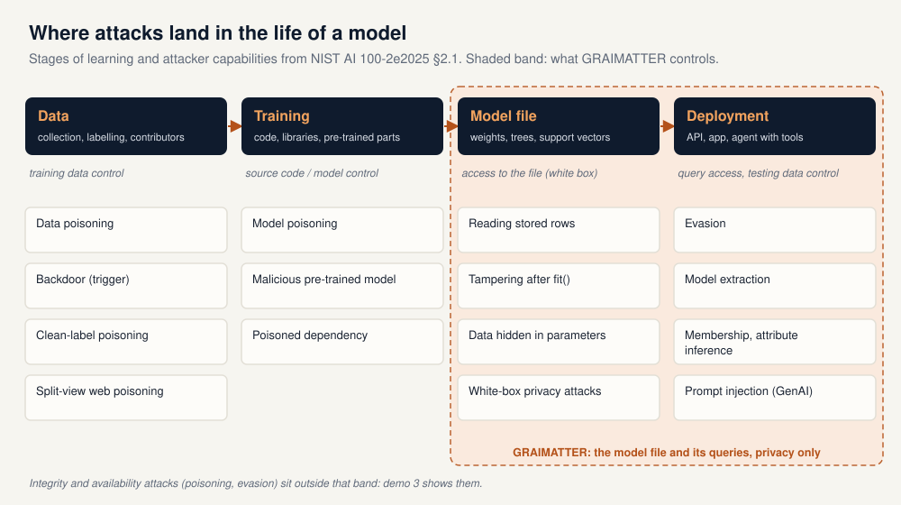

NIST AI 100-2e2025, *Adversarial Machine Learning: A Taxonomy and Terminology of Attacks and Mitigations* (March 2025), is the reference vocabulary for this field. It splits the life of a predictive model into a **training stage** and a **deployment stage** (§2.1.1):

* **Training-time attacks** are poisoning attacks. In *data poisoning* the attacker inserts or modifies training rows; in *model poisoning* they control the model parameters, for example through a malicious pre-trained model or a compromised update.
* **Deployment-time attacks** need only access to the trained model. *Evasion* changes test inputs so the model gets them wrong. *Privacy attacks* such as membership inference and data reconstruction learn about the training data from the model's answers.

The three things to protect map onto that split:

* **The data.** Whoever can add rows can steer what the model learns. Web-scale datasets make this cheap: NIST cites work showing that an adversary with limited money can control part of public datasets used for training (§2.3, §3.2.1).
* **The model.** A model file can be stolen, edited after training, swapped for a malicious one in the supply chain (demo 4), or carry training rows inside it (§3.2; GRAIMATTER §10.1).
* **The answers.** Every prediction leaks a little. Enough queries can fool the model, copy it, or reveal who was in its training data (§2.2, §2.4).

NIST is direct about the state of the art: for many tasks there are no theoretically secure ML algorithms, so "designing mitigations is an inherently ad hoc and fallible process" (§4.1.2). The practical consequence runs through this whole guide: test the system against attacks rather than assume a defence works.

---

## 2. The NIST taxonomy

> **In plain words.** NIST classifies an attack by three questions. What does the attacker want: to break the model for everyone, to make it give a chosen answer, or to learn something secret? What can they touch: the training data, the model, the inputs, or only the query interface? And how much do they know about the system? Each attack class has an identifier, such as NISTAML.033 for membership inference, so reports can be precise.

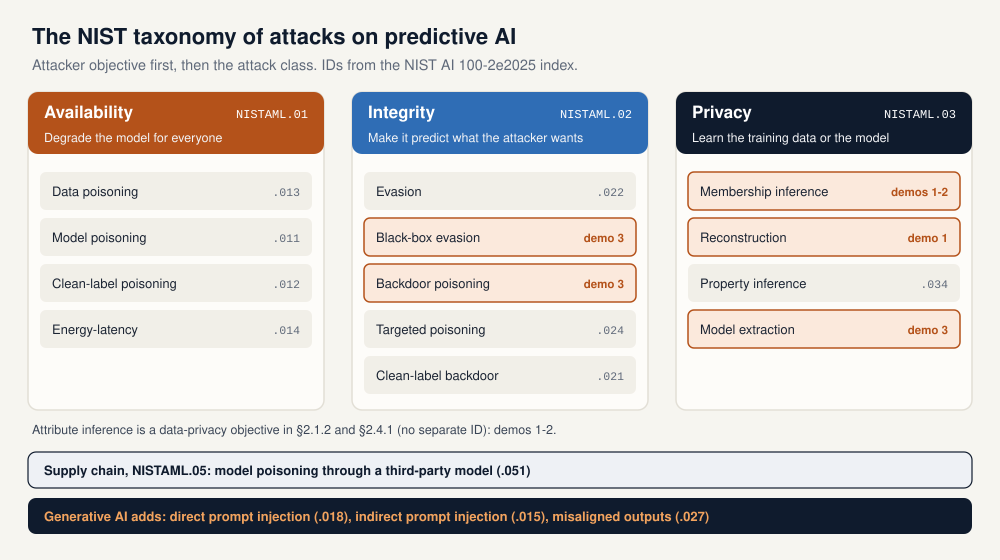

### 2.1 Attacker objectives (§2.1.2)

| Objective | ID | What the attacker wants | Main attack classes |
|---|---|---|---|
| **Availability breakdown** | NISTAML.01 | Disrupt timely, reliable access to the system for everyone | Data poisoning (.013), model poisoning (.011), clean-label poisoning (.012), energy-latency attacks (.014) |
| **Integrity violation** | NISTAML.02 | Make the model produce the predictions the attacker chooses | Evasion (.022), black-box evasion (.025), backdoor poisoning (.023), targeted poisoning (.024), clean-label backdoor (.021), model poisoning (.026) |
| **Privacy compromise** | NISTAML.03 | Learn restricted information about the training data or the model | Model extraction (.031), reconstruction (.032), membership inference (.033), property inference (.034) |
| **Supply chain** | NISTAML.05 | Reach the model through a third party | Model poisoning through a supplied model (.051) |

**The CIA triad, in NIST's words.** These are the three properties information security has always protected: confidentiality, integrity and availability, the CIA triad. Availability and integrity keep their usual names. Privacy is NIST's word for confidentiality: the report notes that "confidentiality" is the term used in traditional cybersecurity taxonomies, and that adversarial ML uses "privacy" as the top-level term because it covers both the confidentiality of the model (its weights and architecture) and the privacy of the people in its training data (§2.1.2). The EU AI Act uses the classic word for the same attacks: "confidentiality attacks" (Art. 15(5), section 8.4). Supply chain is not a fourth property but a route in: what arrives through a third party then breaks one of the three. What machine learning changes is not what an attacker wants but where they can get it: the data, the model file and the answers (section 1). Appendix B lays out the correspondence; this guide keeps NIST's word, privacy, whenever it cites NIST.

Attribute inference, the attack at the centre of GRAIMATTER's case studies, appears in NIST as one of the data-privacy objectives (§2.1.2, §2.4.1) without an ID of its own. For generative AI, NIST adds direct prompt injection (.018), indirect prompt injection (.015) and misaligned outputs (.027).

Appendix B explains each of these classes in turn: what the attacker does and needs, an example, NIST's defences and their limits, and where the class appears in this repository.

### 2.2 Attacker capabilities (§2.1.3)

| Capability | What it means | Typical attack | In this repository |
|---|---|---|---|
| Training data control | Insert or modify training rows | Data poisoning, backdoor | Demo 3: backdoor from 1-5% of rows |
| Model control | Change the parameters, insert a Trojan, send malicious updates | Model poisoning | Demo 1: edits after `fit()` are caught |
| Testing data control | Perturb inputs at deployment time | Evasion | Demo 3: misreported form fields |
| Label limit | No control over the labels of poisoned rows | Clean-label poisoning | – |
| Source code control | Modify the training code, a library or the random number generator | Backdoor via code | – |
| Query access | Send inputs and receive predictions | Black-box evasion, extraction, privacy attacks | Demos 1, 2 and 3 |

### 2.3 Attacker knowledge (§2.1.4)

* **White box:** full knowledge of the training data, architecture and hyperparameters. NIST notes these assumptions are strong, but white-box attacks are how a system is tested against worst-case adversaries. In a TRE they are not hypothetical: once a model file is released, whoever obtains it has white-box access (Part 3).
* **Gray box:** partial knowledge, such as the architecture but not the parameters, or data from the same distribution.
* **Black box:** only query access. These attacks are the most practical. The demo 3 attacks are black box and see only the predicted label.

---

## 3. Demos 3 and 4: evasion, extraction, a backdoor and a tampered supply chain

> **In plain words.** GRAIMATTER is about privacy. To show the rest of the taxonomy, demo 3 trains a risk model on the same kind of synthetic patients and attacks it three ways: people lie on a form to get a better score (evasion), an outsider copies the model through its API (extraction), and a data contributor plants a hidden trigger in the training data (backdoor). It runs in seconds with numpy and scikit-learn.

Entry point: `demo/run_aml_demo.py`. Code: `demo/aml_demo/` (`evasion.py`, `extraction.py`, `poisoning.py`). Report: `demo/output/aml_report.txt`.

**Set-up.** The cohort generator is the one from Part 3 (`graimatter_demo/cohort.py`, seed 7) with 4,000 rows and two lab-style columns that carry no label signal. The target is a random forest (200 trees, minimum leaf 10) trained on 2,000 rows. Its accuracy on the other 2,000 is 0.635. The label is a noisy logistic draw, so no model gets far above that; the attacks below are about changing decisions, not about accuracy.

### 3.1 Evasion: misreporting a form (NISTAML.025, OWASP ML01, ATLAS AML.T0015)

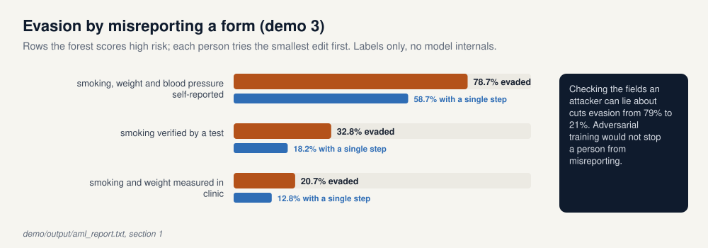

974 test rows are scored high risk. Each of those people can edit only fields that nobody checks: drop the smoker flag, or lower the weight or blood-pressure band by one or two steps. They try the smallest edit first and keep the first one the model scores as low risk. The attack sees only predicted labels.

| Which fields can be misreported | Evaded | With one step | With two steps |
|---|---|---|---|
| Smoking, weight and blood pressure | 78.7% | 58.7% | 70.5% |
| Weight and blood pressure (smoking verified by a test) | 32.8% | 18.2% | 28.6% |
| Blood pressure only (smoking and weight measured in clinic) | 20.7% | 12.8% | 20.7% |

The mitigation that works here is to verify the inputs an attacker can lie about. Adversarial training, the best-known defence against evasion, makes a model robust to small perturbations of its inputs; it does nothing about a person who reports a false value. NIST's real-world examples have the same flavour: ID.me saw more than 80,000 attempts to fool its face verification in the second half of 2020, and attackers beat a commercial phishing detector with cropping, masking and blurring rather than optimisation (§2.2.4).

**Under the hood.** `evasion.candidate_edits()` enumerates every allowed edit of a row (at most 17) with its cost: 1 for dropping the smoker flag, 1 per band. `cheapest_evasion()` sends all candidates to the model in one batch and keeps, per row, the cheapest one labelled 0. An attacker querying one edit at a time in cost order would get the same answer.

### 3.2 Extraction: copying the model through its API (NISTAML.031, OWASP ML05, ATLAS AML.T0024.002)

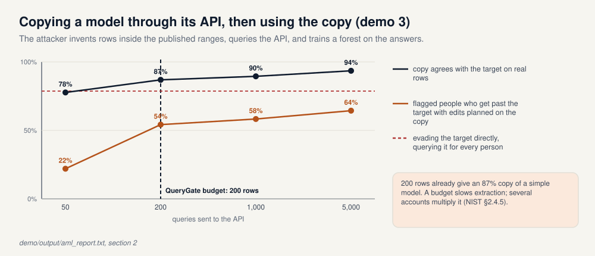

The attacker never sees a real record. The value ranges are public (they are in the data dictionary), so they invent rows inside those ranges, send them to the API and train their own random forest on the returned labels.

| Queries | Copy agrees with the target on real rows | Copy accuracy | Flagged people who get past the target with edits planned on the copy |
|---|---|---|---|
| 50 | 77.7% | 0.610 | 22.0% |
| 200 | 86.9% | 0.623 | 54.2% |
| 1,000 | 89.5% | 0.629 | 58.3% |
| 5,000 | 93.5% | 0.630 | 64.4% |

Two points. First, the copy is nearly as accurate as the original (0.630 against 0.635): the model owner's work has been taken. Second, the copy is a white-box stand-in. Edits planned on it, without querying the target for each person, already get more than half of the flagged people past the real model; querying the target directly gets 78.7% (section 3.1).

Demo 1's `QueryGate` with a 200-row budget refuses the 1,000-row request, but 200 rows were already enough for an 87% copy of this simple model, and several accounts multiply any budget. NIST says the same about query limits and detection of suspicious queries: they "can be circumvented by motivated and well-resourced attackers" (§2.4.5).

**Under the hood.** `extraction.invented_rows()` draws each column uniformly from its published range (normal for the lab columns). `steal()` queries the target's `predict` (labels only) and fits a random forest with the same settings as the target. `fidelity()` is the share of the 2,000 test rows on which copy and target agree.

### 3.3 Backdoor: a contributor poisons the training data (NISTAML.023, OWASP ML02, ATLAS AML.T0020)

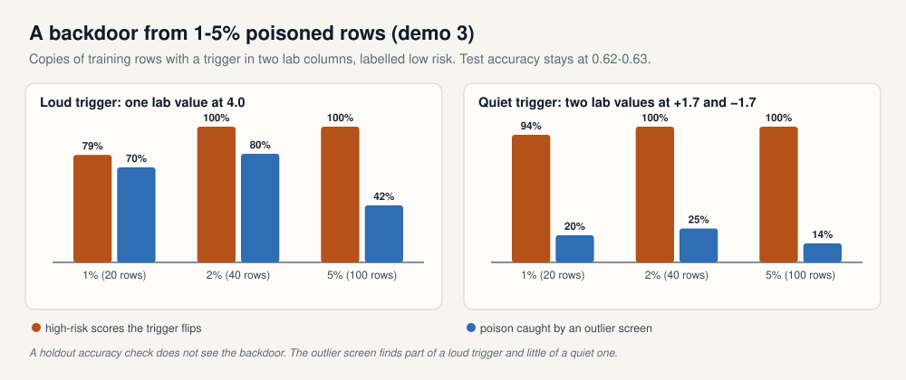

A data contributor appends copies of random training rows with a trigger in the two lab columns, all labelled low risk, and the model is retrained. Two triggers: a **loud** one (one lab value set to 4.0, four standard deviations out) and a **quiet** one (two lab values at +1.7 and −1.7, each ordinary on its own).

| Trigger | Poisoned rows | Test accuracy | High-risk scores the trigger flips | Poison caught by an outlier screen |
|---|---|---|---|---|
| none (clean model) | 0 | 0.635 | 28.3% (loud), 32.3% (quiet) | – |
| loud | 20 (1%) | 0.627 | 79.2% | 70% |
| loud | 40 (2%) | 0.626 | 100% | 80% |
| loud | 100 (5%) | 0.630 | 100% | 42% |
| quiet | 20 (1%) | 0.630 | 94.0% | 20% |
| quiet | 40 (2%) | 0.627 | 100% | 25% |
| quiet | 100 (5%) | 0.615 | 100% | 14% |

With 40 poisoned rows the trigger turns every high-risk score into low risk, and test accuracy moves by 0.02 at most. A holdout accuracy check, such as GRAIMATTER's TECH 6, would not notice. NIST lists outlier detection among the data-sanitisation defences (§2.3.1). Here an isolation forest that drops the oddest 5% of rows catches most of the loud trigger at 1-2% and little of the quiet one, and it catches less as the poison grows, because a dense cluster of identical triggers stops looking unusual.

NIST's real-world poisoning cases all exploited models that keep learning after release: Microsoft's Tay chatbot in 2016, mass attempts to poison Gmail's spam filter, and near-duplicate ransomware samples submitted to VirusTotal (§2.3.5).

**Under the hood.** `poisoning.poison()` copies random training rows, applies the trigger and sets the label to 0. `attack_success()` takes the test rows the model scores high risk and measures the share that flip with the trigger. The clean-model row shows the baseline: on a noisy label, editing two columns already changes some decisions. `outlier_screen()` fits `IsolationForest(contamination=0.05)` on the poisoned training table.

### 3.4 Demo 4: a supplied model, tampered on the way (NISTAML.051, OWASP ML06, ATLAS AML.T0010)

> **In plain words.** The first three attacks work on the model you trained. This one never touches it: it changes the model you download. A supplier publishes a model and its files, someone between the supplier and you swaps them, and every swapped file still passes the check you would normally run. What catches them is a fingerprint of each file taken when it was approved, a look at the code a model file would run, and minimum settings kept in your own code. Nothing here encrypts anything or touches real cryptographic software.

Entry point: `demo/run_supply_chain_demo.py`. Code: `demo/supply_chain/` (`integrity.py`, `pickle_scan.py`, `downgrade.py`, `payload.py`). Report: `demo/output/supply_chain_report.txt`; the working files go to `demo/output/supply_chain/`, which is not versioned.

**Set-up.** The supplier trains the same random forest as demo 3 (same cohort, seed and split; accuracy 0.635 on the user's 2,000 rows) and publishes three files: `model.pkl`, `bundle.json` (the published accuracy and the key length used to encrypt artefacts at rest, 256 bits) and `constraints.json` (demo 1's safe-wrapper rules: minimum leaf 20, maximum depth 4). At approval the user records the SHA-256 of each file in a lock file, from the supplier's own release notes, not from the place they download from. Then the user downloads the files from a mirror, and whoever runs the mirror changes them.

| Tampered on the mirror | The check a user usually runs | Pinned digest | Import scan or floor |
|---|---|---|---|
| Swapped model: same rows plus 2% with demo 3's quiet trigger | Accuracy 0.627 against 0.635 published, within 0.02: **passes** | refuses | passes |
| Code in the pickle: the genuine forest, wrapped so loading calls a function of the attacker's choosing | Accuracy 0.635: **passes** | refuses | refuses |
| `key_bits` lowered from 256 to 40 in `bundle.json` | Still encrypts and decrypts: **passes** | refuses | refuses |
| Safe-wrapper floor lowered: minimum leaf 1, maximum depth 100 | `request_release()`: **passes** | refuses | refuses |

**The swapped model.** The backdoored forest scores 0.627 on the user's holdout, so an acceptance test that compares accuracy with the published figure passes. Its trigger then turns 100% of high-risk scores into low risk, against 32.3% on the supplier's forest. A scan finds nothing, because the backdoor lives in the weights: the file imports exactly what a clean forest imports. Only the pin sees that the file is not the one that was approved.

**Code in the model file.** A pickle (and a `.joblib` file, which is built on pickle) names the functions Python calls while loading it. The mirror's file calls a function of its choosing and then hands back the supplier's forest, so it predicts exactly as before, with accuracy 0.635. In the demo the function only writes a line to a log; in the incidents MITRE ATLAS records (AML.CS0031) it opened a reverse shell. By the time an accuracy test runs, the code has already run. The import scan reads the file's opcodes without loading it and lists every `module.name` it would import; anything outside numpy and scikit-learn is refused. Formats that hold only tensors, such as safetensors, remove the problem instead of scanning for it.

**A downgrade.** One number in a configuration file weakens the whole system, and nothing breaks. With 40-bit keys everything still encrypts and decrypts, so a functional test passes. What changes is the cost of trying every key at a billion keys a second: 18 minutes at 40 bits, 2.3 years at 56, 1.1e22 years at 128. This is the export-grade cryptography of the 1990s, and the protocol downgrade attacks FREAK and Logjam (2015) that tricked servers into using it. The model-side version is the safe wrapper's rules file: with a minimum leaf of 1, demo 1's wrapper accepts a researcher's unconstrained tree, and `request_release()` recommends the next step of checking for a tree whose smallest leaf is one person, exactly as it does for the supplier's rules with a smallest leaf of 21. A check that trusts the file it checks against can be switched off by editing that file. The defence is a floor kept in code under review: key length at least 128, minimum leaf at least 20, maximum depth at most 4.

**What the pin does not catch.** A digest proves that a file is the one that was pinned, not that the pinned file was good. If the pin is taken from the mirror after the swap, the backdoored forest verifies; the same holds if the supplier's own build was compromised. The rest of the defence is provenance: signatures that say who published a file (Sigstore, OpenSSF model signing), build attestations that say how it was built (SLSA), a bill of materials for the model and its data (an SBOM, or AI-BOM), and testing a supplied model as untrusted. NIST calls robustness to supply-chain model poisoning a "critical open problem" (§4.2.2).

**Is this source-code control?** It is supply-chain integrity, of which version control is one link. Git protects what was committed; this attack happens after the build, between the publisher and the user, which is where release signing, pinned hashes and provenance work. In the frameworks: EU AI Act Art. 15(5) names attacks on pre-trained components (model poisoning); UK Code principle 7 asks to secure the supply chain and provision 8.1.2 to publish cryptographic hashes of shared model components; NIST AI RMF GOVERN 6.1 asks for policies on third-party AI risk; and federal model-risk guidance expects vendor models to be validated like in-house ones.

**Under the hood.** `integrity.write_lock()` records `sha256_file()` of each file; `verify()` refuses a file whose digest differs or that has no pin. `pickle_scan.imports()` walks `pickletools.genops()` and resolves `GLOBAL` and `STACK_GLOBAL` opcodes, including strings fetched back from the pickle memo, without executing anything; `scan()` compares them with an allow list (modules under `sklearn` and `numpy`, and `_codecs.encode`). `payload.Trojan.__reduce__()` is the harmless stand-in for hidden code. `downgrade.below_floor()` checks `key_bits` and the wrapper rules against the floors in the module; `brute_force_years()` is `2**bits / 1e9` seconds. The release gate reads one number from the run: tampered files that passed both the pin and the scan or floor (0 of 4, section 17.2).

---

## 4. Privacy attacks

> **In plain words.** Privacy attacks learn something from a model that should have stayed hidden: whether a person was in the training data, a hidden field of a known person, whole records, a statistic of the training population, or the model itself. Part 3 covers the first three in depth, because they are what a TRE must check before releasing a model.

| Attack | NIST ID | Question it answers | In this repository |
|---|---|---|---|
| Membership inference | NISTAML.033 | Was this record in the training set? | Demos 1 and 2 (sections 13 and 14) |
| Attribute inference | (§2.4.1) | Given part of a record, what is the hidden field? | Demos 1 and 2; the planted record in section 13.2 |
| Reconstruction | NISTAML.032 | Can whole training records be recovered? | Demo 1: nearest neighbours and SVC store rows (section 13.6) |
| Property inference | NISTAML.034 | What share of the training set has a given property? | Not demonstrated |
| Model extraction | NISTAML.031 | Can the model's behaviour or parameters be copied? | Demo 3 (section 3.2) |

Membership inference matters on its own: in a study of patients with a rare disease, being in the training set already discloses the diagnosis (NIST §2.4.2). NIST describes the main techniques: the loss-threshold attack, shadow models trained on similar data, and LiRA, which fits Gaussian distributions to the outputs of a smaller number of shadow models. It also notes that the simple and expensive attacks perform similarly in precision at low false-positive rates. That is why GRAIMATTER's Appendix F and section 12 of this guide look at the tail of the score distribution, not only the AUC.

**Mitigations (§2.4.5).** Differential privacy gives a provable bound on membership inference and reconstruction, but not on model extraction, and choosing the privacy parameter is a trade-off with utility: the 2020 US Census used ε = 19.61. NIST recommends complementing the theory with empirical privacy auditing, which is exactly what attack simulations before release do. Limiting and monitoring queries can slow extraction but can be circumvented. Machine unlearning removes a person's influence from a trained model, exactly by retraining or approximately.

---

## 5. Generative AI

> **In plain words.** Large language models add a new problem: the text a model reads is both data and instructions. An attacker can type instructions that override the system's (direct prompt injection) or hide them in an email or web page the model will read later (indirect prompt injection). Agents that use tools make the consequences larger. This repository has no generative-AI demo; the end of this section points to one that tests LLMs.

NIST's generative-AI taxonomy (§3) keeps the three objectives of section 2 and adds attacks that work through prompts:

* **Supply chain** (§3.2): poisoned pre-training or fine-tuning data, and malicious pre-trained models whose backdoors can persist after downstream fine-tuning.
* **Direct prompt injection** (NISTAML.018, §3.3): jailbreaks and extraction of the system prompt or of memorised data.
* **Indirect prompt injection** (NISTAML.015, §3.4): instructions planted in content the model retrieves, leading to availability, integrity or privacy failures.
* **Agents** (§3.5): hijacked agents can run code or exfiltrate data from the environment they operate in.

The OWASP Top 10 for LLM Applications 2025 is the most used checklist for these systems:

| ID | Risk |
|---|---|
| LLM01 | Prompt injection |
| LLM02 | Sensitive information disclosure |
| LLM03 | Supply chain |
| LLM04 | Data and model poisoning |
| LLM05 | Improper output handling |
| LLM06 | Excessive agency |
| LLM07 | System prompt leakage |
| LLM08 | Vector and embedding weaknesses |
| LLM09 | Misinformation |
| LLM10 | Unbounded consumption |

NIST's conclusion on indirect prompt injection is a design rule: because current mitigations do not offer full protection, designers may assume that prompt injection is possible whenever a model reads untrusted input, and limit what it can do, for example with separate models for separate permissions and narrow interfaces to untrusted data (§3.4.4).

**Testing an LLM in practice.** For language models and agents, the companion repository [safety-trust-engine](https://github.com/olonok69/safety-trust-engine) does what demo 3 does for a classifier, and goes further: it runs three red-team tools against a model or agent, with each finding stored as an attack-success rate per category. NVIDIA garak gives a single-turn vulnerability scan, AgentDojo tests tool injection over untrusted data (indirect prompt injection, LLM06) and Microsoft PyRIT runs multi-turn attack campaigns. It maps each finding to named controls (EU AI Act Art. 15 and 55, DORA, FCA PS21/3, and optionally NIST AI RMF), and fails a CI build when any category exceeds its tolerance. A control whose tests were skipped is reported as not evidenced, never as passed.

---

## 6. Real incidents

> **In plain words.** These attacks are not only academic. MITRE ATLAS, the adversarial-ML counterpart of the ATT&CK knowledge base, collects case studies. A few of them line up with the attacks above.

| ATLAS | Case | Class | Year | Type |
|---|---|---|---|---|
| AML.CS0009 | Tay: Microsoft's chatbot learned abusive language from a coordinated campaign and was decommissioned within 24 hours | Poisoning | 2016 | Incident |
| AML.CS0003 | Cylance: researchers built a universal string that, appended to malware, evaded the AI detector | Evasion | 2019 | Exercise |
| AML.CS0017 | ID.me: one person used wigs and fake licences to pass identity verification; at least 180 false claims and $3.4 million paid | Evasion | 2020-21 | Incident |
| AML.CS0019 | PoisonGPT: researchers edited an open LLM to return a false fact and uploaded it to Hugging Face | Supply chain | 2023 | Exercise |
| AML.CS0025 | Split-view poisoning: expired domains behind URL-based datasets could be bought and refilled with poisoned content | Poisoning | 2024 | Exercise |
| AML.CS0031 | Malicious models on Hugging Face executed reverse shells when loaded; the hub's scanner did not flag them | Supply chain | 2025 | Incident |
| AML.CS0058 | Google Photos: researchers recovered on-device models from the Android app | Extraction | 2025 | Exercise |
| AML.CS0059 | EchoLeak: a prompt injection in an email made Microsoft 365 Copilot exfiltrate data with no user action | Indirect prompt injection | 2025 | Exercise |

Source: MITRE ATLAS data release 2026.09, which has 16 tactics and 73 case studies. ATLAS labels a case as an *incident* when it happened in the wild and as an *exercise* when researchers demonstrated it.

---

## 7. Mitigations and their limits

> **In plain words.** Every defence has a cost or a gap. The ones that hold up against evasion cost accuracy; most poisoning defences were built for images with fixed triggers; differential privacy costs utility; and there is no complete defence against prompt injection. The working rule is to test defences adversarially and accept trade-offs explicitly.

| Attack | Mitigations NIST lists | Limit NIST notes |
|---|---|---|
| Evasion (§2.2.5) | Adversarial training, randomised smoothing, formal verification | All trade robustness against accuracy and compute; adaptive attacks have broken many proposed detectors |
| Poisoning and backdoors (§2.3) | Data sanitisation (including outlier detection), robust training, trigger reconstruction, model inspection, certified defences, provenance and integrity attestation | Mostly designed for image classifiers with fixed triggers; semantic and functional triggers, and clean-label attacks on malware classifiers, escape several of them |
| Privacy (§2.4.5) | Differential privacy, privacy auditing, query limits and monitoring, machine unlearning | DP costs utility and its practical guarantee is hard to estimate; query limits can be circumvented |
| Supply chain (§3.2.2, §4.2.2) | Verify downloads against published cryptographic hashes, scan model artefacts, treat supplied models as untrusted | Robustness to supply-chain model poisoning is a critical open problem; a hash proves a file is the approved one, not that the approved one is sound (demo 4) |
| Prompt injection (§3.3.3, §3.4.4) | Safety and adversarial training, prompt formatting, input and output detectors, least privilege for tools | No full protection; detectors can be attacked and can fail together with the model they monitor |

Two general recommendations close NIST's discussion (§4.1.1, §4.1.3). Evaluate defences adversarially: the people proposing a defence should also try to break it, because defences tested only against known attacks often fall to the next one. And evaluate attributes together: accuracy, robustness, privacy and fairness trade off, so compare defences on all of them at once rather than one at a time. Demo 3's evasion result is a small example of the first point: the defence that worked was verifying inputs, which is a process change, not a model change.

---

# Part 2 · Frameworks

## 8. Who says what: five frameworks and a crosswalk

> **In plain words.** Several documents cover adversarial ML, and they do different jobs. Some describe the attacks (NIST, MITRE ATLAS), some rank risks for the people building systems (OWASP), and some require controls (the EU AI Act, the UK Code of Practice and its ETSI standard). GRAIMATTER is a different kind of document: a detailed control framework for one setting.

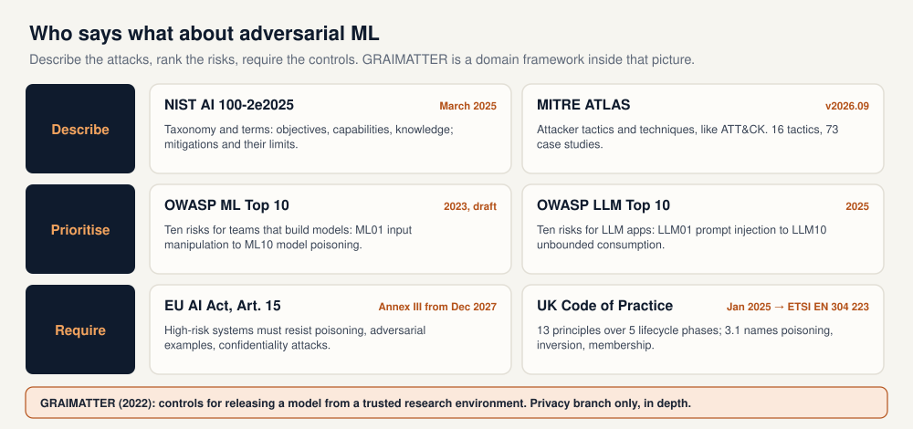

### 8.1 NIST AI 100-2e2025: the taxonomy

Published in March 2025 by NIST with co-authors from Northeastern University, the US AI Safety Institute, Cisco and the UK AI Security Institute. It is voluntary guidance: a taxonomy, a glossary, and a survey of mitigations and their limits for predictive and generative AI. Part 1 of this guide follows its structure.

### 8.2 MITRE ATLAS: the attacker's playbook

ATLAS (Adversarial Threat Landscape for AI Systems) organises attacker behaviour as tactics and techniques, like MITRE ATT&CK, and documents case studies. Release 2026.09 has 16 tactics and 73 case studies. Useful technique IDs for this repository: AML.T0015 *Evade AI Model*, AML.T0020 *Training Data Poisoning*, AML.T0024 *Exfiltration via AI Inference API* with sub-techniques .000 *Infer Training Data Membership*, .001 *Invert AI Model* and .002 *Extract AI Model*, AML.T0010 *AI Supply Chain Compromise*, AML.T0018 *Manipulate AI Model*, and AML.T0051 *LLM Prompt Injection*.

### 8.3 OWASP: two top-ten lists for builders

| OWASP Machine Learning Security Top 10 (2023, draft) | In this repository |
|---|---|
| ML01 Input manipulation attack | Demo 3, evasion |
| ML02 Data poisoning attack | Demo 3, backdoor |
| ML03 Model inversion attack | Demos 1 and 2, attribute inference |
| ML04 Membership inference attack | Demos 1 and 2 |
| ML05 Model theft | Demo 3, extraction |
| ML06 AI supply chain attacks | Demo 4, tampered supplier files |
| ML07 Transfer learning attack | – |
| ML08 Model skewing | – |
| ML09 Output integrity attack | – |
| ML10 Model poisoning | Demo 1, edits after `fit()` |

The ML list is still marked as a draft; treat it as a checklist for design reviews. The LLM list (section 5) was refreshed for 2025.

### 8.4 EU AI Act, Article 15: a legal duty for high-risk systems

Regulation (EU) 2024/1689 requires high-risk AI systems to achieve an appropriate level of accuracy, robustness and cybersecurity and to perform consistently throughout their lifecycle (Art. 15(1)). They must be as resilient as possible to errors, faults and inconsistencies, and systems that keep learning after deployment must mitigate biased feedback loops (Art. 15(4)). Article 15(5) reads like the NIST taxonomy: high-risk systems must be resilient against unauthorised third parties trying to alter their use, outputs or performance, and the technical solutions shall include, where appropriate, measures to prevent, detect, respond to, resolve and control

* attacks trying to manipulate the training data set (**data poisoning**),
* attacks on pre-trained components used in training (**model poisoning**),
* inputs designed to cause the model to make a mistake (**adversarial examples or model evasion**),
* **confidentiality attacks** or **model flaws**.

The article says what to resist, not how; Article 15(2) asks the Commission to encourage benchmarks and measurement methods.

**Dates.** The Digital Omnibus on AI, Regulation (EU) 2026/1744, entered into force on 27 July 2026. It moves the high-risk obligations to **2 December 2027** for stand-alone (Annex III) systems and to **2 August 2028** for AI in products covered by EU product-safety law, such as medical devices.

**And the GDPR.** The European Data Protection Board's Opinion 28/2024 (December 2024) says that an AI model trained on personal data cannot be assumed to be anonymous; anonymity has to be shown case by case, including resistance to attacks that extract or infer training data. That is the starting point of GRAIMATTER (section 10.2, ELA 1). This section summarises the documents; it is not legal advice.

### 8.5 UK: Code of Practice, ETSI EN 304 223 and the NCSC guidelines

The UK Department for Science, Innovation and Technology published the voluntary **Code of Practice for the Cyber Security of AI** on 31 January 2025. It has 13 principles over five lifecycle phases, for developers, system operators and data custodians:

| Phase | Principles |
|---|---|
| Secure design | 1 Raise awareness of AI security threats and risks · 2 Design for security as well as functionality and performance · 3 Evaluate the threats and manage the risks · 4 Enable human responsibility |
| Secure development | 5 Identify, track and protect assets · 6 Secure the infrastructure · 7 Secure the supply chain · 8 Document data, models and prompts · 9 Conduct appropriate testing and evaluation |
| Secure deployment | 10 Communication and processes with end-users and affected entities |
| Secure maintenance | 11 Regular security updates, patches and mitigations · 12 Monitor the system's behaviour |
| Secure end of life | 13 Proper data and model disposal |

Four provisions map directly to Part 1. **3.1:** threat modelling must cover AI-specific attacks such as data poisoning, model inversion and membership inference. **6.2:** developers offering APIs should, for example, limit the rate of model access to hinder reverse engineering and rapid poisoning. **8.1.2:** developers should publish cryptographic hashes of model components they share. **9.4:** developers should evaluate outputs so they do not let operators or users reverse engineer non-public aspects of the model or its training data. The last one is GRAIMATTER's subject.

The Code was taken to ETSI as TS 104 223, and ETSI published **EN 304 223** in January 2026, a European Standard with the same 13 principles over the same five phases. Its predecessor is the **Guidelines for secure AI system development** led by the UK NCSC and the US CISA (27 November 2023), with four areas: secure design, development, deployment, and operation and maintenance.

### 8.6 Crosswalk

| Attack | NIST AI 100-2 | OWASP | MITRE ATLAS | EU AI Act 15(5) | UK Code | Here |
|---|---|---|---|---|---|---|
| Evasion | NISTAML.022, .025 | ML01 | AML.T0015 | adversarial examples, model evasion | 3.1, 9 | demo 3 |
| Data poisoning, backdoor | NISTAML.013, .023 | ML02, LLM04 | AML.T0020 | data poisoning | 6.2, 8.2 | demo 3 |
| Model poisoning, supply chain | NISTAML.026, .051 | ML06, ML10, LLM03 | AML.T0010, AML.T0018 | model poisoning | 7, 8.1.2 | demo 4 |
| Membership inference | NISTAML.033 | ML04 | AML.T0024.000 | confidentiality attacks | 3.1, 9.4 | demos 1-2 |
| Attribute inference, inversion | §2.4.1, NISTAML.032 | ML03 | AML.T0024.001 | confidentiality attacks | 3.1, 9.4 | demos 1-2 |
| Model extraction | NISTAML.031 | ML05 | AML.T0024.002 | confidentiality attacks | 6.2, 9.4 | demo 3 |
| Prompt injection | NISTAML.015, .018 | LLM01 | AML.T0051 | not named | 3.1, 6 | – |

The mapping was built for this guide from the documents; the frameworks do not cross-reference each other this precisely. It lets one test report speak all five languages: a membership-inference test is NISTAML.033, OWASP ML04, ATLAS AML.T0024.000, a confidentiality attack under Article 15(5), and covered by UK provisions 3.1 and 9.4.

---

# Part 3 · A high-trust case: GRAIMATTER

> **Why this case.** In a trusted research environment, sensitive health records never leave; researchers train models inside. The model file is what leaves, so whoever obtains it has white-box access, and the researcher, who sits inside the trust boundary, may be the risk. In the terms of Part 1, GRAIMATTER covers the privacy objective (NISTAML.03) in depth, plus model control (tampering after training) and query access (query limits). It does not address evasion or poisoning, and it predates the generative-AI wave. Sections 9 to 15 follow the green paper and demos 1 and 2; section 16 draws the lessons for other high-trust deployments.

## 9. What a TRE is protecting when the output is a model

> **In plain words.** A trusted research environment (TRE) is a locked room for sensitive data: researchers work inside it and only checked results come out. For decades those results were tables and statistics, and staff know how to check them. Now researchers want to take out a trained machine-learning model. A model is a file full of numbers that nobody can read by eye, and some models carry pieces of the training data inside them. The green paper explains how a TRE can decide whether such a file is safe to release.

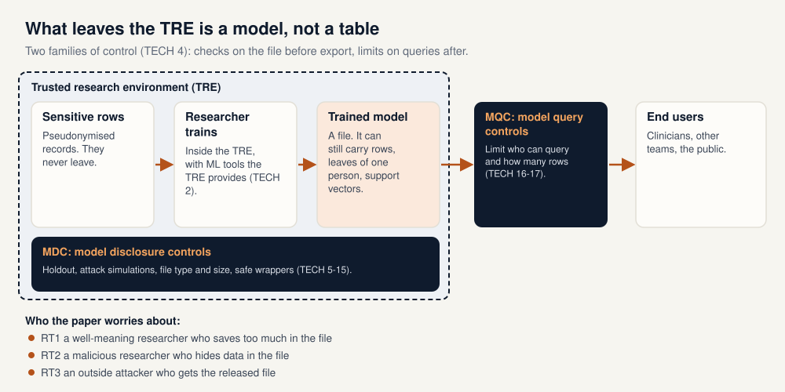

### 9.1 TREs and the new kind of output

TREs (also called safe havens or data enclaves) give researchers access to pseudonymised, linked data inside a secure environment. They follow the "Five Safes" model and check every output before it leaves. For a table the rules are well known: for example, no cell should describe fewer than *k* people (paper §10.1, p. 35).

A trained model breaks those habits in three ways (paper §9.1, pp. 22-23 and §10.1, p. 35):

* **It is not human-readable.** Even a "simple" model has too many parameters to inspect. Checking one decision tree for leaves with a single person is possible but tedious; checking a forest of trees, where the intersection of leaves can single someone out, is not practical by hand.
* **Some models store rows.** A nearest-neighbour model needs every training row to make a prediction. A support-vector classifier keeps the training rows closest to its decision boundary (the support vectors). Those rows can be read straight out of the file (paper §10.1.5, pp. 39-40).
* **A file can be edited.** A model is a large array of numbers, so someone could hide data inside it, much as text can be hidden inside an image (paper §10.1, p. 35).

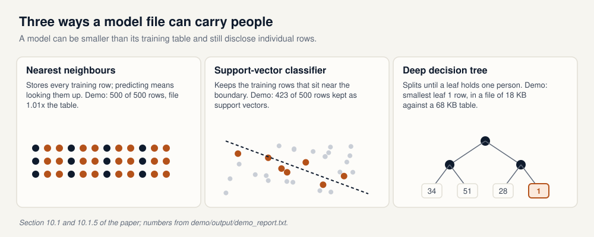

The file size does not warn you. In demo 1 the deep decision tree is 18,150 bytes against a 68,000-byte training table (ratio 0.267), and its smallest leaf still describes one person (`demo_report.txt`, section 4).

### 9.2 Who the paper worries about

The executive summary names three risk types (paper §9.1, p. 23). The demos refer to them by these labels:

| Risk type | Who | Example in the demos |
|---|---|---|
| **RT1** | A well-meaning researcher who does not know the threats and saves too much in the model file. | Training a tree with no leaf-size limit; changing a parameter after fitting and forgetting to retrain. |
| **RT2** | A malicious researcher who deliberately hides data inside the file. | Adding a `hidden_rows` attribute to the model after `fit()`. |
| **RT3** | An outside attacker who gets the released model. | All the attacks in sections 13 and 14. |

### 9.3 The attacks

The paper uses three families of attack (paper §9.1, p. 23 and §10.1.1, p. 36):

* **Membership inference.** Was this person's row in the training set? If the training set is "patients with cancer", membership alone is sensitive.
* **Attribute inference.** Given part of someone's record, can the model fill in a hidden field, such as weight or blood pressure?
* **Model inversion.** Can the attacker reconstruct whole records likely to be in the training set? The demos do not cover this one.

These are the privacy attacks of NIST section 2.4 (section 4 of this guide).

Appendix E of the paper tells these stories for a non-technical reader: a famous politician whose weight and blood pressure are recovered from a cancer-risk model (attribute inference), the same person's membership in a cancer study (membership inference), a recruitment agency that screens out former study participants, and a hospital SVM found to contain 441 exact patient rows out of 798 (pp. 86-92).

---

## 10. A map of the green paper

> **In plain words.** The paper makes five sets of recommendations. The technical set (TECH 1 to 17) says what to check and how; the demos illustrate it. The other four sets cover law and ethics, cost, training and public involvement. This section summarises them so you know where to look; the clause text is in the PDF.

The paper's full title is *Green Paper: Recommendations for disclosure control of trained Machine Learning (ML) models from Trusted Research Environments (TREs)*. It is an output of the DARE UK sprint project GRAIMatter, published in September 2022 (paper §2, p. 7).

### 10.1 Technical recommendations (TECH 1 to 17)

TECH 4 splits controls into two families (paper §10.2.4, p. 42):

* **Model disclosure controls (MDCs)** act on the model file before it leaves: a holdout set, attack simulations, file checks, safe wrappers, and extra controls for models that memorise.
* **Model query controls (MQCs)** act after release: the model stays on a server and the TRE limits how it can be queried.

The table lists every technical recommendation, with where the demos show it. The wording is a short paraphrase.

| ID | What it asks for, in brief | Where the demos show it |
|---|---|---|
| TECH 1 | Discuss disclosure risk when the project is applied for (p. 41). | Not demonstrated. |
| TECH 2 | Provide ML tools inside the TRE (p. 41). | Not demonstrated. |
| TECH 3 | Snapshot the pipeline that produced an approved model, for audit (p. 42). | `demo/output/pipeline_snapshot.json` (demo 1, section 9). |
| TECH 4 | Two families of control: MDCs and MQCs (p. 42). | The structure of both demos. |
| TECH 5 | MDC work needs staff trained in ML (p. 43). | Not demonstrated. |
| TECH 6 | Keep part of the data aside; the research team never trains on it (p. 43). | 500 of 1,000 rows withheld (section 11). |
| TECH 7 | Run a range of checks before release: holdout accuracy, attacks, file size and type (p. 43). | `disclosure.decide()` in demo 1; structural, worst-case and attribute attacks in demo 2. |
| TECH 8 | Researchers supply a data dictionary of model inputs (p. 46). | `demo/output/data_dictionary.json`; Appendix C is the template. |
| TECH 9 | Researchers may use community safe wrappers (p. 46). | `SafeDecisionTreeClassifier` in both demos. |
| TECH 10 | Safe wrappers follow a set of principles: constraints file, hyperparameter correction, checks for post-fit changes, `request_release()` (p. 48). | `demo/constraints.json` and the wrapper in demo 1; the package's own wrapper in demo 2. |
| TECH 11 | Instance-based models, and models that memorise, need extra controls: aggregated data, differential privacy, or query limits (p. 49). | Nearest neighbours and a standard SVC are refused (demo 1, section 6). |
| TECH 12 | Make informed choices about differential privacy (p. 50). | Laplace noise on a mean and a best-of-50 cherry-pick (demo 1, section 3). |
| TECH 13 | Ensembles need special treatment (p. 50). | Not demonstrated. |
| TECH 14 | Test the final model of federated learning (p. 51). | Not demonstrated. |
| TECH 15 | Treat synthetic data as personal data (p. 52). | Not demonstrated. |
| TECH 16 | Limit queries on a released model (p. 52). | Row-counting query gate (demo 1, section 8). |
| TECH 17 | Have query limits tested by an external party (p. 53). | Named in demo 1; the demo implements only the gate. |

The appendices this guide uses are A (risk experiments, pp. 70-79), C (data dictionary template, p. 83), D (constraints file, p. 83), E (case studies, pp. 86-92), F (lay explanations of metrics, pp. 92-95) and G (steps for running attack simulations, p. 96).

> **Appendix A, experiment 2, in one sentence.** The team trained a wide range of hyperparameter settings on several tabular datasets and found many settings that looked safe on one dataset and were risky on another (§16.2, p. 76). A safe range from a previous dataset is therefore not, by itself, a release decision: run the attacks on the model in hand. This is why demo 1 still attacks the wrapped tree.

### 10.2 Ethics and legal (ELA 1 to 11)

The trained model may itself fall under data protection law, so sharing agreements may be needed (ELA 1). Approval processes should weigh the risks and controls of each application, contracts should cover query controls after release, and data use registers should list models and their controls (ELA 2 to 4). Researchers, TRE staff and committees should be trained (ELA 5). EULAs and researcher declarations get extra clauses (ELA 6 and 7). **ELA 8** says approval can take a risk-based approach, which is why the thresholds in demo 1 are a local policy, not the paper's. The data controller approves the TRE's disclosure-control process (ELA 11). See §11.2, pp. 54-63. The demos do not draft any clause text.

### 10.3 Costing (C 1 to 5)

Checking models and running attacks is extra work that TREs should charge for; tool development needs funding; query-limited hosting has its own cost; some highly technical work may be outsourced (§12.2, pp. 64-65).

### 10.4 Training (TR 1 to 4)

Courses and documentation for TRE staff, researchers, and data governance and ethics committees, on ML and on disclosure risk in trained models (§13.2, pp. 65-66).

### 10.5 Public involvement (P 1 and 2)

Public representatives should take part in data governance and ethics approval, and the use of data to train models, with the controls applied, should be visible through searchable data use registers (§14.2, p. 67).

---

## 11. The synthetic cohort and the holdout

> **In plain words.** Both demos use the same made-up group of 1,000 people. The researcher gets 500 of them to train on. The TRE keeps the other 500 locked away and uses them to test the model, which is TECH 6. Nobody in the data is real.

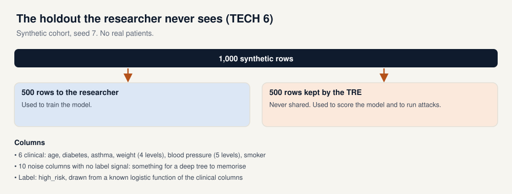

The cohort is generated by `demo/graimatter_demo/cohort.py` with seed 7.

* **Clinical columns (6):** age (30 to 89), diabetes, asthma, weight (underweight, normal, overweight, obese), blood pressure (low, slightly high, high, very high, extremely high), smoker.
* **Noise columns (10):** `noise_0` to `noise_9`, standard normal, with no link to the label. They exist so that an unconstrained tree has something to memorise.
* **Label:** `high_risk`, drawn from a known logistic function of the clinical columns.

**Under the hood.** The log-odds of `high_risk` are `-1.35 + 0.034·(age − 55) + 0.9·smoker + 0.55·diabetes + 0.22·asthma + 0.32·[weight ≥ overweight] + 0.30·[blood pressure ≥ high]`. `hold_out_for_tre()` shuffles the 1,000 row indices and gives the first 500 to the TRE and the rest to the researcher.

The data dictionary that TECH 8 asks for is written to `demo/output/data_dictionary.json`. It lists each input with its encoding (`int`, `binary`, `ordinal:` with the level names, or `float64` for noise), the split sizes and the seed, following the template in Appendix C (p. 83).

Demo 3 (section 3) uses the same generator with 4,000 rows and two noise columns, which it treats as lab values.

---

## 12. The metrics, in words and in code

> **In plain words.** An attack gives every row a score: how likely the attacker thinks it is that the row was in training. The metrics answer three questions. On average, does the score separate members from non-members (AUC)? Are there rows where the attack is very sure and right (TPR at low FPR, FDIF)? And if the attacker says "member", how likely is that to be true, given how rare members are (the posterior)?

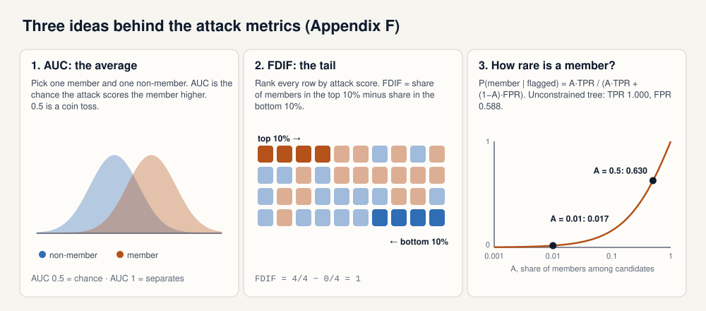

Each metric below is defined once, with the formula the repository uses (`demo/graimatter_demo/metrics.py`) and the paper's explanation (Appendix F, pp. 92-95).

**Training accuracy and set-aside accuracy.** Training accuracy is the share of correct predictions on the rows the model was trained on. Set-aside accuracy is the same on the 500 rows the researcher never received. A large gap means the model has fitted this particular sample, noise included. Demo 1's policy flags a gap above 0.15.

**Membership inference.** The attack labels each row "member" (in training) or "non-member". The worst-case version of Appendix G gives the attacker both the training rows and the held-out rows, so it is a conservative upper bound rather than a realistic attacker (p. 96).

**TPR and FPR.** The true-positive rate is the share of real members the attack calls members. The false-positive rate is the share of non-members it wrongly calls members. The demo uses a score threshold of 0.5.

**AUC.** Pick one member and one non-member at random. AUC is the probability that the attack scores the member higher. 0.5 is a coin toss; 1 means the attack always ranks members first. The paper notes that there is no single "bad" AUC value and suggests comparing with the range expected by chance (Appendix F §21.4, p. 94). For 100 members and 100 non-members, three standard deviations around 0.5 is roughly 0.38 to 0.62. The `sacroml` report prints the same band as `0.3772 -> 0.6228`.

**Advantage.** `advantage = |TPR − FPR|`. Zero means the attack calls members and non-members "member" at the same rate.

**TPR at 10% FPR.** Walk down the rows from the highest score. Stop just before the false alarms exceed 10% of the non-members. The share of members caught so far is the TPR at 10% FPR. A model can have a modest AUC and still give away a group of members in this tail.

**FDIF (frequency difference).** Sort the rows by score. FDIF is the share of members in the top 10% minus the share of members in the bottom 10%. Random scores give an FDIF near 0; an attack that is certain about some members and some non-members pushes it towards 1. The demo computes a permutation p-value: shuffle the membership labels 300 times and count how often the shuffled FDIF is at least as large. Appendix F explains why this matters: an attack that is certain about 20 of 200 rows (10 members scored 1, 10 non-members scored 0) and random elsewhere has an average AUC of about 0.595, inside the chance band, yet it exposes those people (§21.5, pp. 94-95). Demo 1 treats FDIF ≥ 0.20 with p ≤ 0.05 as a failure.

**Membership posterior.** If the attacker says "this row was in training", how likely is that to be true? It depends on *A*, the share of members among the rows the attacker is testing:

```
P(member | flagged) = (A × TPR) / (A × TPR + (1 − A) × FPR)
```

The demo reports it at A = 0.5 (half the candidates are members) and A = 0.01 (one in a hundred). For the unconstrained tree (TPR 1.000, FPR 0.588) that is 0.630 and 0.017 (`demo_report.txt`, section 4). The paper's own example shows the same effect: a good attack (TPR 0.8, FPR 0.2) gives only 0.04 when members are 1 in 100 (Appendix F, Table 9, p. 93).

**Attribute inference.** For a row, try every possible value of one hidden field and ask the model for its confidence in the row's label. If a single value gives the highest confidence, that value is the attack's guess; if several values tie, the attack abstains. Appendix G asks for two numbers: the share of rows that get a unique guess, and how many of those guesses are correct, each on the training rows and on the held-out rows (p. 96). Demo 1 summarises the comparison as an **attribute risk ratio**: the correct-guess rate on training rows divided by the rate on set-aside rows. Above 1 means training rows are easier to complete. Demo 1's policy flags 1.35.

**k-anonymity of a leaf.** The number of training rows in the smallest leaf of a tree. A leaf of 1 is one person.

**Under the hood.** `summarise_attack_scores()` in `metrics.py` returns all of the above for one set of attack scores. `true_positive_rate_at_false_positive_rate()` walks the ranked scores; `frequency_difference()` uses a 10% tail and 300 permutations; `membership_probability()` is the posterior formula.

### 12.1 The three readings, worked through

> **In plain words.** Slide 26 reads an attack in three ways: the average (AUC and advantage), the tail (FDIF and TPR at low FPR), and how rare a member is (the posterior). Each one answers a different question, and a model can pass one and fail another. Here each is worked through with numbers small enough to check by hand.

**1. The average: AUC and advantage.** Take 4 members (M) and 4 non-members (N), with these attack scores:

| Row | M1 | N1 | M2 | M3 | N2 | M4 | N3 | N4 |
|---|---|---|---|---|---|---|---|---|
| Score | 0.9 | 0.8 | 0.7 | 0.6 | 0.5 | 0.4 | 0.3 | 0.2 |

AUC compares every member with every non-member: 4 × 4 = 16 pairs. M1 (0.9) beats all 4 non-members. M2 (0.7) and M3 (0.6) each beat 3 (all but N1). M4 (0.4) beats 2 (N3 and N4). That is 4 + 3 + 3 + 2 = 12 wins out of 16, so **AUC = 0.75**. Shuffle the scores at random and each pair is a coin toss: AUC 0.5.

For the advantage, call "member" every score of 0.5 or more. Three of the 4 members are flagged (TPR = 0.75) and two of the 4 non-members are too (N1 and N2, FPR = 0.50). **Advantage = |0.75 − 0.50| = 0.25.**

How to read it: averaged over everyone, the attack ranks members first three times in four. The demo's unconstrained tree is in the same territory (worst-case AUC 0.708, advantage 0.412) and the safe wrapper brings it down to 0.528 and 0.004. What the average cannot say is *who* is exposed: twelve mild wins look the same as a few certain ones plus noise.

**2. The tail: FDIF and TPR at 10% FPR.** This is the Appendix F example (§21.5, pp. 94-95). There are 200 rows, 100 members and 100 non-members. The attack is certain about 20 of them: 10 members get a score of 1 and 10 non-members a score of 0. The other 180 rows get random scores.

* *AUC.* Of the 100 × 100 = 10,000 pairs, the 10 certain members win all 1,000 of theirs. The 90 other members beat the 10 non-members at 0, another 900 wins. The remaining 90 × 90 = 8,100 pairs are coin tosses, about 4,050 wins. In total 1,000 + 900 + 4,050 = 5,950, so **AUC ≈ 0.595**, inside the chance band of 0.38 to 0.62. By the average, this attack looks harmless.
* *FDIF.* The top 10% is the 20 highest scores: the 10 certain members plus the 10 highest of the random rows, about half of them members. That is about 15 members out of 20, 75%. The bottom 20 holds the 10 certain non-members plus about 5 members, 25%. **FDIF ≈ 0.75 − 0.25 = 0.50.** Shuffling the labels 300 times almost never gives a value that large, so the p-value is close to the smallest the demo can report (about 0.003). Demo 1 would flag it (limit 0.20 with p ≤ 0.05).
* *TPR at 10% FPR.* Walk down from the top. The 10 certain members come first with no false alarm. After that the random rows mix members and non-members, and the walk stops once 10 non-members have been flagged; by then about 10 more members have been caught. **TPR ≈ 0.20**, about twice what random scores give (0.10).

Running this setup 200 times with `metrics.py` gives an average AUC of 0.599, FDIF of 0.50, a median p-value of 0.003 and TPR at 10% FPR of 0.22 (0.11 for random scores). How to read it: the average hides ten people the attack can name for certain. Section 13.5 shows a milder version of the same gap: Salem-synth on the wrapped tree gives AUC 0.512 but FDIF 0.160 with p = 0.027, although there the signal is a tilt across the tail rather than a few rows the attacker is sure about.

**3. How rare a member is: the posterior.** A flag is only as good as the share of flagged people who really are members. Take the paper's attack (TPR 0.8, FPR 0.2; Appendix F, Table 9, p. 93) and count people instead of using the formula.

| | 1,000 candidates, half members (A = 0.5) | 10,000 candidates, 1 in 100 a member (A = 0.01) |
|---|---|---|
| Members | 500 | 100 |
| Members flagged (× 0.8) | 400 | 80 |
| Non-members | 500 | 9,900 |
| Non-members flagged (× 0.2) | 100 | 1,980 |
| All flagged | 500 | 2,060 |
| **Share of flags that are members** | 400 / 500 = **0.80** | 80 / 2,060 = **0.04** |

The attack is the same in both columns. Only the base rate changed, and with it the meaning of "flagged": at 1 in 100, 25 of every 26 flags are false alarms. The demo's unconstrained tree (TPR 1.000, FPR 0.588) gives the same picture. Out of 10,000 candidates with 100 members, it flags all 100 members and about 5,821 non-members, so 100 / 5,921 ≈ **0.017**. With half the candidates members it is 0.5 / (0.5 + 0.294) ≈ **0.630**.

How to read it: in a TRE the attacker rarely knows that half the people they test were in training, so a realistic base rate makes a typical flag weak evidence. That does not make the model safe. In example 2, an attacker who flags only the rows scored 1 has no false alarms, so FPR = 0 and the posterior is 1 at any base rate. A rare member is protected on average and not in the tail, which is why the three readings are used together.

| Reading | Question it answers | Example above | Demo 1 limit |
|---|---|---|---|
| Average | Does the score separate members from non-members overall? | AUC 0.75, advantage 0.25 | AUC 0.62, advantage 0.20 |
| Tail | Are there people the attack is sure about, and right? | FDIF 0.50, TPR at 10% FPR 0.20 | FDIF 0.20 with p ≤ 0.05, TPR 0.35 |
| Rare member | If the attack says "member", how often is it true? | 0.80 at A = 0.5, 0.04 at A = 0.01 | Reported, not a rule |

---

## 13. Demo 1: the hand-written checks

> **In plain words.** The first script is a small, readable implementation of the paper's checks. It trains several models on the synthetic cohort, attacks them, and says yes or no to each one using a demo policy. It refuses a deep tree that memorised people and releases a tamer tree built through a safe wrapper. It also refuses models that store rows, catches a model that was edited after training, and blocks a query that tries to sweep hidden fields.

Entry point: `demo/run_demo.py`. Report: `demo/output/demo_report.txt`. Policy: `demo/graimatter_demo/disclosure.py`. Constraints: `demo/constraints.json`. The walkthrough follows the report's sections 1 to 10.

### 13.0 The demo policy

The paper does not publish universal cut-offs; ELA 8 leaves the risk appetite to an agreement with the data controller. So that the script can say yes or no, `disclosure.py` sets a local policy. **These numbers are the demo's, not the paper's.**

| Rule | Limit |
|---|---|
| Worst-case membership AUC | 0.62 |
| Advantage | 0.20 |
| TPR at 10% FPR | 0.35 |
| FDIF, and its p-value | 0.20, with p ≤ 0.05 |
| Attribute risk ratio | 1.35 |
| Training minus set-aside accuracy | 0.15 |
| Model file size ÷ training table size | 0.75 |
| Accepted file types | `.joblib`, `.pkl` |

A model that stores training rows is refused even when every other rule passes.

### 13.1 The rows the researcher never sees (section 1)

The script generates the 1,000 rows, keeps 500 aside and writes the data dictionary (section 11 of this guide). *Illustrates TECH 6 and TECH 8, Appendix C.*

### 13.2 Attribute inference on one planted record (section 2)

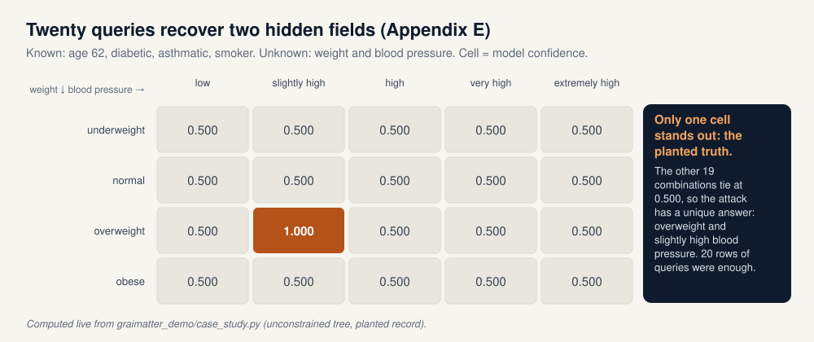

`case_study.py` rebuilds the paper's first case study on synthetic data. It plants one person, aged 62, diabetic, asthmatic and a smoker, who is overweight with slightly high blood pressure. Around that person it places a block of rows that share the same public fields and cover every other weight × blood-pressure combination, with mixed labels. An unconstrained tree is trained on all of it.

The attacker knows the four public fields and tries all 4 × 5 = 20 combinations of the two hidden ones. The planted pair (overweight, slightly high) comes back with confidence 1.000; every other combination is at 0.500. The unique highest confidence is the hidden truth. In the paper's version the top answer was at 93.8% and the next at 57.7% (Appendix E §20.1, p. 87); the demo's planted block makes the gap even clearer. *Illustrates Appendix E.*

### 13.3 What epsilon means, on a mean (section 3)

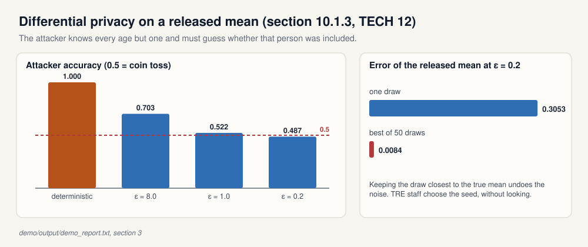

Differential privacy is a property of the mechanism that turns private data into a release, not of the data itself (paper §10.1.3, pp. 37-39). The paper's thought experiment: the attacker knows everything except whether one particular person was included, and sees the release. A deterministic release, such as a plain mean, gives the answer away: the attacker computes the mean both ways and sees which one matches. A differentially private mechanism adds randomness so that the two cases look alike, to a degree set by epsilon (smaller is more private).

The demo applies this to the mean age of the 500 training rows. The attacker knows every age and must guess whether row 0 was included. Accuracy is how often the guess is right over 400 trials.

| Release | Attacker accuracy | Laplace scale |
|---|---|---|
| Deterministic mean | 1.000 | 0 |
| epsilon 8.0 | 0.703 | 0.015 |
| epsilon 1.0 | 0.522 | 0.120 |
| epsilon 0.2 | 0.487 | 0.600 |

TECH 12 adds a practical warning. At epsilon 0.2 one noisy mean misses the true mean by 0.3053. If someone draws 50 noisy means and keeps the one closest to the true answer, the miss is 0.0084. Picking the draw that looks most like the non-private answer cancels the protection, so TRE staff, not the researcher, should choose the random seed, without looking at the result. *Illustrates §10.1.3 and TECH 12.*

**Under the hood.** `dp_sketch.py` uses sensitivity `(90 − 30) / 500 = 0.12` (the age range divided by the number of rows) and Laplace scale `sensitivity / epsilon`. The attacker guesses "included" when the release is closer to the mean with the row than to the mean without it. This repository does not train a differentially private model.

### 13.4 Unconstrained tree (section 4)

A `DecisionTreeClassifier` with no depth limit and `min_samples_leaf = 1` is trained on the 500 researcher rows.

| | Seeded result |
|---|---|
| Training accuracy | 1.000 |
| Set-aside accuracy | 0.590 |
| Gap | 0.410 (limit 0.15) |
| Smallest leaf | 1 training row |
| File size | 18,150 bytes vs training table 68,000 bytes (ratio 0.267; size alone does not fail) |
| Worst-case membership AUC | 0.708 (limit 0.62) |
| Advantage | 0.412 (limit 0.20) |
| TPR / FPR | 1.000 / 0.588 |
| TPR at 10% FPR | 0.156 (does not trip the 0.35 limit) |
| FDIF | 0.620, p = 0.003 |
| Posterior if flagged | 0.630 when half of candidates are members; 0.017 when 1 in 100 are |
| Salem-synth | AUC 0.703; TPR at 10% FPR 0.186; FDIF 0.660 |
| Weight attribute inference | Abstained. Ratio 1.000. |

**Decision: do not release.** Four rules fire: the accuracy gap, the AUC, the advantage and FDIF.

Two details are worth pointing out. First, the file-size check and the TPR at 10% FPR both pass: on their own they would have let this model through, which is why TECH 7 asks for a range of checks. Second, the attribute attack on weight abstains. This tree separates rows using the noise columns, so changing a person's weight does not move them to another leaf and every weight value gives the same confidence. Section 13.2 is the case where the model does split on the hidden fields.

**Under the hood.** The worst-case attack (`attacks.worst_case_membership`) builds one row per record with the model's predicted probabilities **plus the true label**, labels it member or non-member, splits that set in half, trains a random forest on one half and scores the other. Salem-synth (`attacks.salem_synth_membership`) draws a fresh cohort from the same generator, trains a shadow tree with the same hyperparameters, trains the attack on the shadow model's outputs and then scores the real model: the attacker has similar data, not the TRE's tables (Appendix A, Table 2, p. 71).

### 13.5 The same data through a safe wrapper (section 5)

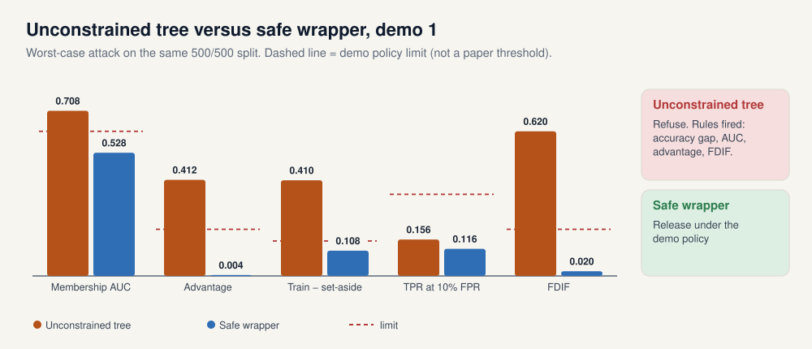

The researcher asks for the same unconstrained settings, but through `SafeDecisionTreeClassifier`. The wrapper reads `demo/constraints.json` and corrects them: `min_samples_leaf` from 1 to 20 and `max_depth` from unlimited to 4. Appendix D of the paper shows the constraints-file format with an example minimum leaf size of 5 (p. 83); the demo is stricter so that the contrast shows on a few hundred rows.

| | Seeded result |
|---|---|
| Training accuracy | 0.692 |
| Set-aside accuracy | 0.584 |
| Smallest leaf | 20 training rows |
| Worst-case membership AUC | 0.528 |
| Advantage | 0.004 |
| TPR at 10% FPR | 0.116 |
| FDIF | 0.020, p = 0.445 |
| Posterior if flagged | 0.502 at half members; 0.010 at 1 in 100 |
| Weight attribute inference | Abstained. Ratio 1.000. |

`request_release()` returns "Run file through the next step of the checking procedure": the wrapper only gets the file into the TRE's queue. The attack numbers then drive the decision. No demo rule fires. **Decision: allow release under the demo policy.** The set-aside accuracy barely changed (0.590 to 0.584), which tells you that the deep tree's extra training accuracy was memorisation, not skill.

#### The quiet failure (Appendix F)

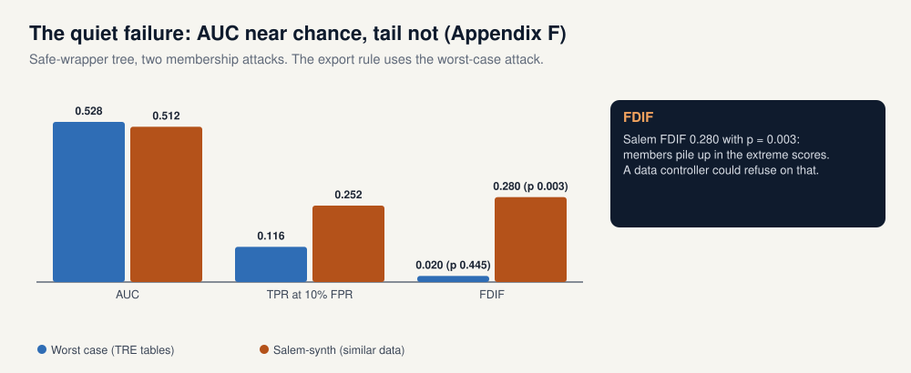

Salem-synth on the same wrapped tree gives AUC 0.512, close to chance, but FDIF 0.160 with p = 0.027: the top tenth of its scores holds more members than the bottom tenth, by more than chance explains. Its TPR at 10% FPR, 0.118, is about the same as the worst case's 0.116, so the signal is a tilt across the tail rather than a few rows the attacker is sure about. This is the Appendix F warning in practice: the average says "chance", the tail does not. Demo 1's export rule follows the worst-case attack of Appendix G, whose FDIF is 0.020, so it still releases, and 0.160 is under the demo's FDIF limit of 0.20 anyway. A data controller who cares about the tail could set a stricter limit. (Earlier versions of the demo printed FDIF 0.280 here, inflated by the order of tied scores; the [demo guide](Demo_Guide_EN.md), §1.4, explains it.) *Illustrates TECH 9, TECH 10, TECH 7, Appendix F and Appendix A experiment 2.*

### 13.6 Instance-based models are refused (section 6)

* A 1-nearest-neighbour model stores all 500 training rows. The file is 68,677 bytes, 1.010 times the training table.
* An RBF support-vector classifier stores 423 support vectors out of 500 rows. File ratio 0.94.
* The safe wrappers for both classes refuse to fit: `constraints.json` marks `KNeighborsClassifier` and `SVC` as not permitted.

**Decision: do not release** either model. The reasons are that the model stores training rows and that the file is bigger than 0.75 of the table. The paper's alternatives are training on aggregated data, using a differentially private algorithm, or keeping the model inside a query-limited service (TECH 11, p. 49; §10.1.5, pp. 39-40). This repository does not implement a private SVM. *Illustrates TECH 11.*

### 13.7 Editing the model after `fit()` (section 7)

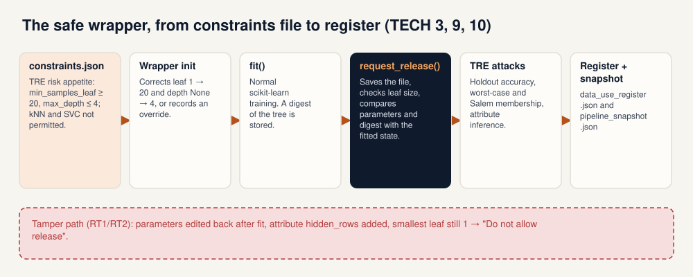

This time the researcher sets `override=True`. The wrapper accepts `min_samples_leaf = 1` and unlimited depth but reports both breaches. After fitting, the researcher edits the parameters back to the allowed values (`max_depth` 4, `min_samples_leaf` 20) and adds an attribute called `hidden_rows`. `request_release()` compares the current state with the snapshot taken at `fit()` and returns "Do not allow release", listing:

* `max_depth` changed from `None` to 4 after the model was fitted;
* `min_samples_leaf` changed from 1 to 20 after the model was fitted;
* the smallest leaf holds 1 training row, while the constraints require 20;
* attributes were added after `fit()`: `hidden_rows`.

The first two catch the careless case (RT1: changing a parameter without retraining). The last catches a deliberate attempt to hide data (RT2). The paper describes this check in §10.1.2 (p. 37). Finally, a file called `not_a_model.txt` is refused because its type is not `.joblib` or `.pkl`. *Illustrates TECH 10 and the RT1/RT2 risk types.*

**Under the hood.** At `fit()`, the wrapper stores the parameters, a SHA-256 digest of the tree arrays, the leaf k-anonymity and the list of attribute names. `request_release()` re-checks the constraints, compares parameters and digest, recomputes the smallest leaf and looks for new attributes. It writes `<model>.release.json` next to the model file.

### 13.8 A query budget that counts rows (section 8)

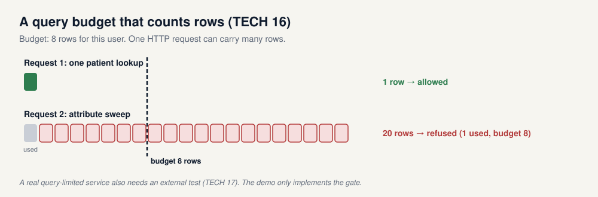

If the model is not released as a file but kept on a server, the TRE can limit queries (paper §10.1.7, pp. 40-41). `query_gate.py` gives each user a budget of 8 rows. A single patient lookup (1 row) is allowed; the predicted class probabilities come back as 0 and 1. Then the same user sends the 20-combination sweep of section 13.2 in one request. The gate refuses it: 20 rows requested, 1 already used, budget 8.

The unit matters. If the budget counted HTTP calls, one call carrying all 20 rows would pass. TECH 17 adds that a real query-limited service should be tested by an external party (p. 53); the demo implements only the control logic. *Illustrates TECH 16 and TECH 17.*

### 13.9 Register entry and pipeline snapshot (section 9)

`demo/output/data_use_register.json` records the wrapped tree (`safe_tree.joblib`) with the decision `approved_for_demo_release`, the controls applied (set-aside, wrapper constraints, membership and attribute attacks, leaf k-anonymity, size check) and the refused files (`unsafe_tree.joblib`, `tampered_tree.joblib`). `demo/output/pipeline_snapshot.json` stores what is needed to reproduce the approved candidate: the seed, the researcher and set-aside row ids, the wrapper's recommendation and corrected parameters, and the demo policy. The researcher declaration is written in plain language (follow the approved controls, accept the register entry, accept that TRE staff will run attacks); the paper's clause text was left for a qualified legal review. *Illustrates TECH 3 and ELA 4.*

### 13.10 Side by side (section 10)

| Model | Train | Set-aside | Worst-case AUC | Advantage | TPR at 10% FPR | Decision |
|---|---|---|---|---|---|---|
| Unconstrained tree | 1.000 | 0.590 | 0.708 | 0.412 | 0.156 | Refuse |
| Safe wrapper, leaf 20, depth 4 | 0.692 | 0.584 | 0.528 | 0.004 | 0.116 | Release under the demo policy |
| 1-nearest neighbour | | | | | | Refuse: stores 500 rows |
| RBF SVC | | | | | | Refuse: 423 support vectors |
| Tampered tree | | | | | | Refuse: edited after fit |

---

## 14. Demo 2: the official SACRO-ML package

> **In plain words.** The second script runs the same cohort through `sacroml`, the maintained toolkit that grew out of the paper's AI-SDC work. Its safe wrapper is looser than demo 1's (minimum leaf 5 instead of 20), it never approves anything by itself, and its own structural check still calls the wrapped tree risky. Its membership attack gives an AUC near 0.5 even for the tree that memorised everyone, because it looks at different information.

Entry point: `demo/run_sacroml_demo.py`. Package: `sacroml` 2.0.1 from [SACRO-ML](https://github.com/AI-SDC/SACRO-ML). Summary: `demo/output/sacroml/sacroml_report.txt`. Per-attack `report.json` and `report.pdf` live under `demo/output/sacroml/unconstrained_tree/` and `demo/output/sacroml/safe_wrapper_tree/`, in `worst_case`, `structural` and `attribute`. The seeded run took about three and a half minutes.

### 14.1 The package's safe wrapper

* Created with the default leaf size, `SafeDecisionTreeClassifier` warns that `min_samples_leaf = 1` is below the recommended minimum of 5 and marks the configuration as disclosive.
* With constraints applied, it changes `min_samples_leaf` to 5.
* `request_release()` without a `Target` writes `safe_release/target.yaml` and recommends "Proceed to next step of checking". It does not run attacks, and it is not an approval.
* Setting `min_samples_leaf` from 5 back to 1 after `fit()` makes `posthoc_check()` return disclosive, with the message that the parameter changed after the model was fitted.

Passing a `Target` into `request_release()` would also start the package's likelihood-ratio attack (LiRA); the upstream example runs it with 100 shadow models. This demo does not run LiRA.

### 14.2 Unconstrained tree

Training accuracy 1.000, set-aside accuracy 0.590, gap 0.410.

| Check | Seeded result |
|---|---|
| Worst-case membership AUC, 3 repetitions | mean 0.500 (min 0.500, max 0.500); none above the null band 0.377 to 0.623 |
| Structural | `gen_error_risk`, `unnecessary_risk`, `k_anonymity_risk`, `class_disclosure_risk`, `smallgroup_risk` true; `dof_risk` false. Smallest leaf 1 row, under the package threshold of 10 |

The membership AUC of 0.500 needs explaining, and section 15.2 does it with a picture. In short: this attack uses the predicted probabilities only, and a tree of pure leaves gives extreme probabilities to training rows and to set-aside rows alike. The structural attack is what flags the memorisation here.

### 14.3 Wrapped tree (`min_samples_leaf` 5)

Training accuracy 0.868, set-aside accuracy 0.566, gap 0.302. Leaf k-anonymity 5.

| Check | Seeded result |
|---|---|
| Worst-case membership AUC, 3 repetitions | mean 0.494 (min 0.471, max 0.519); none above the null band |
| Structural | The same risk flags true, including `k_anonymity_risk`, because 5 is still under 10. `dof_risk` false |

Moving from leaf size 1 to leaf size 5 is what the published rules file does, and the package's own structural check still calls that tree risky.

### 14.4 Attribute inference

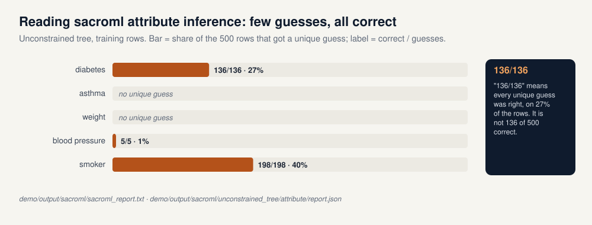

Read every cell as **correct unique guesses / unique guesses made, out of 500 rows**.

| Field | Unconstrained, training | Unconstrained, set-aside | Wrapped, training | Wrapped, set-aside |
|---|---|---|---|---|
| diabetes | 136/136 | 141/141 | 195/257 | 191/246 |
| asthma | no unique guess | no unique guess | 50/67 | 49/64 |
| weight | no unique guess | no unique guess | no unique guess | no unique guess |
| blood pressure | 5/5 | 3/3 | no unique guess | no unique guess |
| smoker | 198/198 | 205/205 | 254/327 | 262/330 |
| age | reconstructed fraction 0.012 | 0.010 | 0.034 | 0.050 |

"136/136" means that every unique guess was right, on the 136 rows (27%) where the attack was willing to guess. It does **not** mean that 136 of 500 rows were guessed correctly. A "no unique guess" cell means the attack abstained on every row. The training and set-aside numbers are close, which is the comparison Appendix G asks for: a model that leaks attributes only for its training rows would show a clear gap. Age is numeric, so the package reports the fraction of rows whose age it can bound within its tolerance, not a guess count.

### 14.5 How to read `report.json`

Each attack folder holds a `report.json` and a `report.pdf`. The JSON is a dictionary with one entry per run, keyed by the attack name and a run id; if you run the script more than once, new runs are appended, so read the last key. Inside each run:

* `metadata.attack_params`: the settings, for example `n_reps: 3` for the worst-case attack, `safe_threshold: 10` for the structural attack.
* `metadata.global_metrics`: the summary. For the worst-case attack, `null_auc_3sd_range` is the chance band and `n_sig_auc_p_vals` counts repetitions whose AUC is significantly above chance (0 here). For the structural attack, the risk flags listed above.
* `attack_experiment_logger.attack_instance_logger`: one entry per repetition. For the worst-case attack: `TPR`, `FPR`, `AUC`, `Advantage`, the FDIF family (`FDIF01` is the 10% tail, with its p-value in `PDIF01`), and `TPR@0.1%` style tail rates. For the attribute attack: `categorical` holds, per field, `train` and `test` lists of five numbers, `[correct, unique guesses, baseline %, number of values, rows]`, where the baseline is the share of the most common value; `quantitative` holds the age fraction.

**Under the hood.** Two details differ from demo 1. The package's worst-case attack is configured with `include_model_correct_feature: false` and `sort_probs: true`: the attack model sees sorted predicted probabilities, not the true label. Its attribute attack keeps a candidate value only when the model's predicted label for that candidate matches the model's prediction for the original row, and requires the unique maximum confidence to pass a threshold.

---

## 15. The two demos side by side

> **In plain words.** The two scripts look at the same data and disagree on purpose, and the disagreement is instructive. They use different leaf sizes, their "worst-case" attacks see different information, and one says "release" while the other says "keep checking".

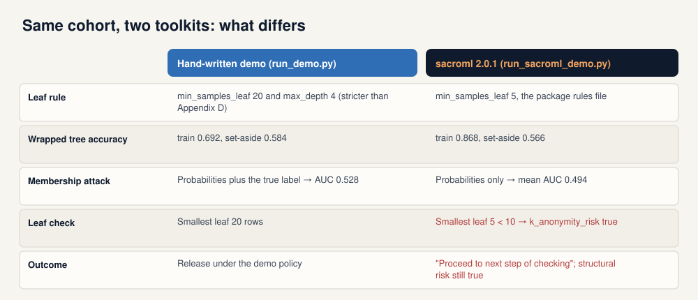

### 15.1 Three differences that matter

| | Demo 1 (hand-written) | Demo 2 (`sacroml` 2.0.1) |
|---|---|---|
| **Leaf rule** | `min_samples_leaf` 20 and `max_depth` 4, stricter than the Appendix D example | `min_samples_leaf` 5, from the package rules file |
| **Membership attack** | Predicted probabilities plus the true label | Predicted probabilities only |
| **Wrapped tree** | train 0.692, set-aside 0.584, AUC 0.528 | train 0.868, set-aside 0.566, mean AUC 0.494 |
| **Leaf check** | smallest leaf 20 | smallest leaf 5 < 10, so `k_anonymity_risk` is true |
| **Outcome** | release under the demo policy | "Proceed to next step of checking"; structural risk still true |

### 15.2 Why the membership numbers differ

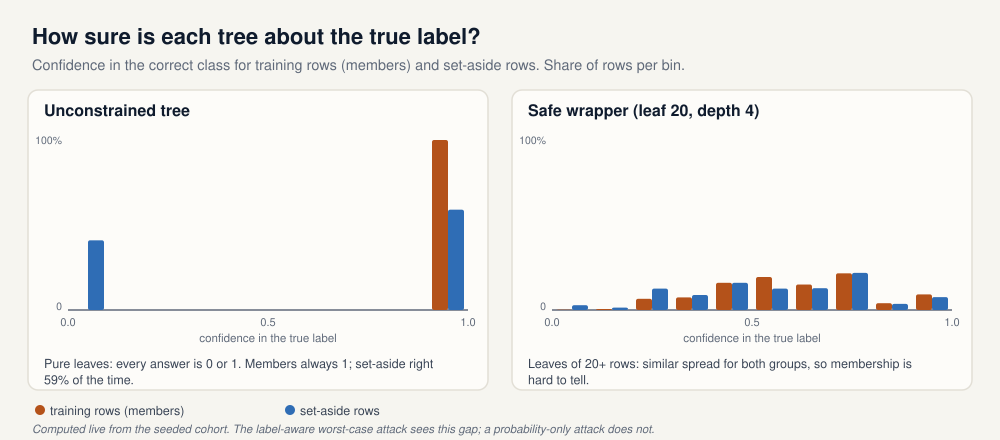

Both scripts call their attack "worst case", but they are different tests.

On the unconstrained tree every leaf is pure, so every prediction is a probability of exactly 0 or 1. The figure shows the confidence each tree gives to the **true** label. Training rows always get 1. Set-aside rows get 1 when the tree happens to be right (59% of the time) and 0 when it is wrong.

* **Demo 1** gives the attack the true label, so it can see "confidence 1 in the right class" versus "confidence 0 in the right class". Members are always in the first group; 41% of non-members are in the second. AUC 0.708.
* **Demo 2** gives the attack only the sorted probabilities. Without the label, "probability 1 for class A" looks the same whether the tree is right or wrong. Members and non-members are equally extreme, so the AUC is 0.500.

An AUC near 0.5 from the package therefore does not mean the tree failed to memorise. In demo 2 the structural attack is the check that catches it. For the wrapped tree with leaves of 20 rows, both groups spread over similar confidences, which is why demo 1's AUC drops to 0.528.

### 15.3 What to take away

Neither demo is an approval process. The hand-written script releases a tree only after forcing leaf 20 and depth 4 and after its own label-aware attack falls inside a local policy. The package recommends further checking and keeps flagging the leaf-5 tree. A real TRE would combine both kinds of evidence with a risk appetite agreed with its data controller (ELA 8, ELA 11).

---

---

## 16. What carries over to other high-trust deployments

> **In plain words.** GRAIMATTER was written for health data in research environments, but six of its habits apply anywhere a model touches sensitive data or high-stakes decisions. What it does not give you is protection against evasion and poisoning, so other settings need those tests too.

| GRAIMATTER habit | Where in this guide | The same idea in the frameworks |
|---|---|---|
| **Assume the worst-case attacker.** Test white box, with the training and held-out data in hand. | Appendix G; sections 12 and 13.4 | NIST §2.1.4: white-box attacks test against worst-case adversaries |
| **Score on rows the builder never saw, and let someone else run the attacks.** | TECH 5, TECH 6; section 11 | UK Code 9.2.1 (independent testers); NIST §2.4.5 (privacy auditing) |
| **Check structure, not only scores.** Stored rows, leaf size, file type. | Sections 13.6 and 14.2: the structural check flags a tree that the probability-only attack scores at 0.500 | OWASP ML03, ML04; UK Code 9.4 |
| **Watch the tail.** FDIF and TPR at low FPR catch exposure that the AUC averages away. | Section 12; section 13.5, the quiet failure | NIST §2.4.2: attacks compared on precision at low false-positive rates |
| **Freeze the artefact and detect edits.** Snapshot at `fit()`, compare before release, keep the pipeline. | TECH 3, TECH 10; section 13.7 | UK Code 8.1.2 (hashes), 8.3 (audit logs); OWASP ML10 |
| **Count queries in rows.** | TECH 16; section 13.8 | UK Code 6.2; NIST §2.4.5. Demo 3: a budget slows extraction but does not stop it (section 3.2) |

Two more carry over as governance rather than code. The risk appetite is agreed with whoever is accountable for the data (ELA 8, ELA 11), which matches the UK Code's provision 3.1.3 on controls weighed against risk tolerance. And the model itself may be personal data (ELA 1), which the EDPB confirmed in Opinion 28/2024 (section 8.4).

**What GRAIMATTER does not cover.** Its checks look at a model's privacy, not at whether the model can be fooled or was trained on poisoned data. Demo 3 shows why that matters: a backdoor planted with 2% of the rows leaves holdout accuracy unchanged, so the TRE's accuracy check passes it (section 3.3). A deployment that takes inputs from people with an incentive to lie, or training data from outside contributors, needs the evasion and poisoning tests of Part 1 as well, and a generative system needs the prompt-injection controls of section 5.

---

# Closing

## 17. A release gate over the demos

> **In plain words.** The demos print numbers. A release decision needs those numbers judged against named obligations, with a record someone can audit. `demo/run_gate.py` reruns the demos, compares each number with a tolerance, and gives every control in the EU AI Act, the UK Code, NIST and GRAIMATTER a verdict: pass, fail or not evidenced. On the seeded run the GRAIMATTER controls pass and Article 15(5) fails, because demo 3's forest can be evaded, copied and backdoored; its model-poisoning clause passes, because demo 4's checks refuse every tampered file.

The pattern comes from [safety-trust-engine](https://github.com/olonok69/safety-trust-engine), which does the same for LLMs and agents (section 5). Its tools (garak, AgentDojo, PyRIT) attack language models and are no use against a tree or a random forest; what carries over is the method: controls mapped to evidence, numeric tolerances, a `not_evidenced` status, and a report that makes CI fail.

### 17.1 What the gate does

1. It runs the demos it is asked for (all four by default) and keeps the numbers each one already prints. Nothing is recomputed, and the reports in `demo/output/` stay as they are.
2. It compares each metric with its tolerance. A category is within tolerance when none of its metrics breaches.
3. It gives each control in the selected regime packs a verdict. **pass**: every demo the control relies on ran and none of its categories breached. **fail**: one of them breached. **not_evidenced**: a demo it relies on did not run. A control is never marked pass on evidence that was not produced.
4. It writes `demo/output/gate/gate_<packs>.json` for machines and `.md` for people, and exits with 1 if any category breaches or any selected control is not evidenced.

```bash
uv run python demo/run_gate.py                                   # demos 1-4; packs eu_uk, nist_aml, graimatter
uv run python demo/run_gate.py --regimes us                      # NIST AI RMF and SR 26-02
uv run python demo/run_gate.py --demos 1,3,4 --accept-missing 2  # what CI runs: no sacroml
uv run python demo/run_gate.py --fail-under evasion.self_reported=0.5
```

### 17.2 Tolerances

A tolerance is the largest value of a metric the data controller accepts. It is a risk appetite (ELA 8), not a threshold from the green paper, NIST or any regulation, none of which publishes one. The privacy tolerances are read from demo 1's `POLICY` in `disclosure.py`, so on the wrapped tree the gate decides exactly as `decide()` does; a test checks that. The robustness tolerances were set for the workshop.

| Category | Metric | Demo | Tolerance | Seeded value |
|---|---|---|---|---|
| membership | Worst-case AUC; advantage; TPR at 10% FPR; FDIF when p ≤ 0.05 | 1 | 0.62; 0.20; 0.35; 0.20 | 0.528; 0.004; 0.116; 0.020 (p = 0.445) |
| attribute | Attribute risk ratio for weight | 1 | 1.35 | 1.000 |
| generalisation | Training minus TRE-holdout accuracy | 1 | 0.15 | 0.108 |
| stored_rows | Training rows stored in the file; file size over table size | 1 | 0; 0.75 | 0; 0.051 |
| release_check | Known-disclosive files let through (deep tree, 1-NN, SVC, edited tree, wrong file type) | 1 | 0 | 0 |
| query_budget | Rows of the attribute sweep allowed; 1,000-row extraction request allowed | 1, 3 | 0 | 0 |
| evasion | High-risk people who evade, in the three scenarios of section 3.1 | 3 | 10% | 78.7%, 32.8%, 20.7% |
| extraction | Agreement of a copy trained on one 200-row budget of labels | 3 | 80% | 86.9% |
| poisoning | Worst rise in trigger success over the clean model | 3 | 10 points | 71.7 points |
| supply_chain | Tampered supplier files that passed the pin and the scan or floor (section 3.4) | 4 | 0 | 0 of 4 |

Demo 2 adds two readings when `sacroml` is installed: the package's worst-case membership AUC on its wrapped tree (tolerance 0.62) and the disclosive configurations it failed to flag (tolerance 0).

### 17.3 Regime packs and the seeded verdicts

Packs are chosen with `--regimes`, as in safety-trust-engine. Each control records how binding it is: `statute` (the EU AI Act), `guidance` (NIST, the UK Code), `supervisory` (model risk management) or `recommendation` (the green paper).

| Pack | Controls | Demos 1, 3 and 4 |
|---|---|---|
| `eu_uk` | EU AI Act Art. 15(5): data poisoning, model poisoning, model evasion, confidentiality attacks. UK Code / ETSI EN 304 223: 3.1, 6.2, 7 and 8.1.2, 9.4 | 6 fail, 2 pass |
| `nist_aml` | NISTAML.025 evasion, .023 backdoor, .031 extraction, .032 reconstruction (attribute inference, §2.4.1), .033 membership, .051 supply chain | 3 fail, 3 pass |
| `graimatter` | TECH 6, 7, 9-10, 11, 16, and a SACRO-ML cross-check of TECH 7 and 9 that needs demo 2 | 5 pass, 1 not evidenced |
| `us` | NIST AI RMF GOVERN 6.1, MEASURE 2.6, 2.7, 2.10; SR 26-02 validation, monitoring, third-party model, documentation | 3 fail, 5 pass |

The two halves of the result are not in tension. The GRAIMATTER checks were built for privacy, and the wrapped tree passes them. Article 15(5) also names poisoning and model evasion, and its confidentiality clause covers extraction as well as membership; demo 3's forest fails all three. Its model-poisoning clause passes on demo 4: the pin, the scan and the floors refuse every tampered file. Privacy checks alone do not make a model resilient in the sense of the Article, which is the point of section 16.

### 17.4 Never a silent green

A control whose demo did not run is `not_evidenced`, and the gate fails on it. CI does not install `sacroml`, because it brings PyTorch, so demo 2 does not run there. Rather than a job that is always red, or a control quietly marked pass, the workflow declares demo 2 out of scope with `--accept-missing 2`. The SACRO-ML control is then reported as not evidenced and out of scope, and the report says so in its header.

### 17.5 The US reading

The `us` pack reads the same evidence through two US lenses. NIST AI RMF GOVERN 6.1 asks for policies on the AI risks of third parties, which demo 4 evidences. MEASURE 2.6 asks that residual negative risk not exceed the risk tolerance, which is what the tolerances encode; MEASURE 2.7 covers security and resilience, and MEASURE 2.10 privacy risk. Federal model risk management guidance (Federal Reserve SR 26-02 and OCC Bulletin 2026-13, which replaced SR 11-7 in April 2026) leaves generative and agentic AI outside its formal scope, so safety-trust-engine applies it to LLMs by analogy. A risk classifier like the ones here is a model in the plain sense of that guidance. The TRE holdout (TECH 6), which the developer never sees, is the independent validation; the gate in CI is the ongoing monitoring; the JSON and Markdown report is the documentation; and demo 4's pin is the check that the vendor model in use is the one that was validated. NIST AI RMF is voluntary and SR 26-02 is supervisory, and the report marks them so.

### 17.6 In CI

`.github/workflows/gate.yml` runs on every pull request. One job lints with `ruff` and runs the tests: demos 1, 3 and 4 regenerate their reports, which must match `demo/output/` apart from what depends on the machine (the absolute path, the pickled size of the tree and the digests of pickled models); demo 4 must refuse all four tampered files and show that a late pin accepts the backdoor; the gate must agree with `decide()`; the seeded verdicts are pinned; a missing demo must give `not_evidenced`; `--fail-under` must change the outcome. A second job runs the gate twice: the GRAIMATTER pack on demo 1 must pass, and all packs on demos 1, 3 and 4 must block, on evasion, extraction and poisoning and nothing else. Both reports are uploaded as build artefacts.

---

## 18. How to reproduce

Setup is described once, in the repository [README](../../README.md); the step-by-step notes on demo 1 are in [demo/README.md](../../demo/README.md), and the walkthrough of every demo's code and output is the [demo guide](Demo_Guide_EN.md). In short, with [uv](https://docs.astral.sh/uv/) installed, from the repository root:

```bash
uv venv --python 3.11
uv pip install -r demo/requirements.txt     # numpy, scikit-learn, sacroml (brings PyTorch)

uv run python demo/run_aml_demo.py          # seconds; writes demo/output/aml_report.txt
uv run python demo/run_supply_chain_demo.py # seconds; writes demo/output/supply_chain_report.txt
uv run python demo/run_demo.py              # seconds; writes demo/output/demo_report.txt
uv run python demo/run_sacroml_demo.py      # a few minutes; writes demo/output/sacroml/
uv run python demo/run_gate.py              # reruns the demos; writes demo/output/gate/
```

With the `pyproject.toml`, `uv sync` installs numpy, scikit-learn, pytest and ruff without sacroml (add `--extra sacroml` for demo 2); `uv run pytest` and `uv run ruff check .` are what CI runs.

On Windows PowerShell, activate the environment with a leading dot: `. .\.venv\Scripts\Activate.ps1`.

| Output | Produced by |
|---|---|
| `demo/output/aml_report.txt` | demo 3: evasion, extraction, backdoor |
| `demo/output/supply_chain_report.txt` | demo 4: four tampered files; working files in `demo/output/supply_chain/` (not versioned) |
| `demo/output/demo_report.txt` | demo 1, all ten sections |
| `demo/output/data_dictionary.json` | demo 1, TECH 8 |
| `demo/output/safe_tree.release.json`, `tampered_tree.release.json` | demo 1, wrapper release reports |
| `demo/output/data_use_register.json`, `pipeline_snapshot.json` | demo 1, section 9 |
| `demo/output/sacroml/sacroml_report.txt` | demo 2 summary |
| `demo/output/sacroml/<model>/<attack>/report.json` and `report.pdf` | demo 2, per attack |
| `demo/output/sacroml/safe_release/target.yaml` | demo 2, `request_release()` |
| `demo/output/gate/gate_<packs>.json` and `.md` | the release gate (section 17) |

The figures in this guide and the deck are generated from the repository:

```bash
pip install -r docs/requirements-docs.txt   # python-pptx, cairosvg
python docs/guide/make_figures.py           # GRAIMATTER figures, img/en and img/es
python docs/guide/make_aml_figures.py       # adversarial-ML figures (figA*)
python docs/make_deck.py                    # docs/Adversarial_ML.pptx
```

`make_figures.py` computes two figures live from the demo code (the planted sweep and the confidence histograms); the other numbers are copied from the seeded reports.

---

## 19. Limits of the demos

* **The cohort is synthetic.** There are no real patients. Demos 1 and 2: seed 7, 1,000 rows, split 500 for the researcher and 500 kept by the TRE. Demo 3: seed 7, 4,000 rows, split 2,000 and 2,000.
* **Demo 3 is a sketch.** One model type (a random forest), simple greedy and query-based attacks, and a single outlier screen as the poisoning defence. Optimised attacks, other defences and other data types are out of scope.
* **Demo 4 is a sketch too.** One supplier, one mirror, four kinds of tampering. The import scan's allow list fits a scikit-learn forest and nothing else; real scanners (picklescan, the Hugging Face hub's) have missed malicious files (ATLAS AML.CS0031). The lock file is a stand-in for signed releases: a digest says what was approved, not who published it. The key length is a number in a file; nothing is encrypted.
* **No generative-AI demo.** Prompt injection, agents and LLM supply chain are covered in prose only here; [safety-trust-engine](https://github.com/olonok69/safety-trust-engine) tests them on live models (section 5).
* **The frameworks are summarised, not interpreted.** Part 2 is a reading of the documents, not legal advice; the crosswalk is ours.
* **The cut-offs are a demo policy.** The limits in `disclosure.py` exist so demo 1 can say yes or no. The paper publishes no universal thresholds; ELA 8 describes a risk-based approval agreed with the data controller. The same holds for the gate's tolerances (section 17.2), and its mapping of metrics to clauses is ours.
* **The wrapper is stricter than the paper's example.** Demo 1 uses `min_samples_leaf` 20 and `max_depth` 4; Appendix D's example minimum leaf size is 5.
* **`sacroml` uses its own rules.** Its rules file raises `min_samples_leaf` from 1 to 5, and its structural attack marks a leaf as risky below 10 training rows.
* **The official package approves nothing here.** `request_release()` records "Proceed to next step of checking", and the structural attack still flags the wrapped tree.
* **The two membership attacks are different tests.** Demo 1 trains on predicted probabilities plus the true label; `sacroml` scores by predicted probability only. An AUC near 0.5 from the package does not mean the tree failed to memorise.
* **Attribute counts are guesses, not rows.** "136/136 unique guesses correct out of 500 rows" means every unique guess was correct, not that 136 of 500 rows were guessed.
* **LiRA is not run.** The likelihood-ratio attack is in the package; the upstream example uses 100 shadow models.
* **No private model.** The repository sketches differential privacy on a released mean only.
* **No legal drafting.** The researcher declaration is plain language; the paper's clause text was left for a qualified legal review.

---

## 20. Glossary

| Term | Meaning |
|---|---|
| **Adversarial machine learning (AML)** | The study of attacks on ML systems and of their mitigations (NIST AI 100-2). |
| **Availability, integrity, privacy** | NIST's three attacker objectives: break the model for everyone, make it give chosen answers, learn restricted information (section 2.1). |
| **Evasion** | Changing a test input so the model gets it wrong, without touching the model (NISTAML.022, .025). |
| **Adversarial example** | An input crafted to cause a wrong prediction. |
| **Poisoning** | Attacking the training stage by controlling part of the training data or the model. |
| **Backdoor, trigger** | A hidden behaviour planted by poisoning; inputs carrying the trigger get the attacker's chosen output (NISTAML.023). |
| **Clean-label poisoning** | Poisoning where the attacker cannot choose the labels of the poisoned rows. |
| **Model extraction** | Copying a model's behaviour or parameters through queries (NISTAML.031). |
| **Fidelity** | Share of inputs on which a copied model agrees with the original. |
| **Property inference** | Learning a statistic of the training set (NISTAML.034). |
| **Prompt injection** | Instructions in model input that override the system's; direct when typed by the user, indirect when planted in content the model reads (NISTAML.018, .015). |
| **Supply chain attack** | Reaching a model through a third party: a supplied model, dataset, library or file swapped or edited on the way (NISTAML.05, section 3.4). |
| **Pin, lock file** | A cryptographic digest of each approved file, recorded when it was approved; later downloads must match it (section 3.4). |
| **Pickle** | Python's object format, also behind `.joblib`; loading one can run code the file names. |
| **Downgrade** | Making a system use a weaker setting, such as a shorter key, while it keeps working (section 3.4). |
| **White, gray, black box** | Full, partial or query-only knowledge of the system (section 2.3). |
| **ATLAS, OWASP, EU AI Act, UK Code, ETSI EN 304 223** | The frameworks of section 8. |
| **TRE** | Trusted research environment: a secure place where approved researchers analyse sensitive data, with outputs checked before release. |
| **Data controller** | The organisation responsible for the data under data protection law; it agrees the risk appetite (ELA 8, ELA 11). |
| **MDC** | Model disclosure control: a check on the model file before export (TECH 4 to 15). |
| **MQC** | Model query control: a limit on how a released model can be queried (TECH 16, 17). |
| **Holdout / set-aside** | Rows the TRE keeps and never gives to the researcher (TECH 6). |
| **Safe wrapper** | A version of a model class that enforces a constraints file, records its state at `fit()` and offers `request_release()` (TECH 9, 10). |
| **Constraints file** | A human-readable file with the TRE's allowed hyperparameter ranges and model types (Appendix D). |
| **Instance-based model** | A model that needs stored training rows to predict, such as nearest neighbours or a kernel SVM (TECH 11). |
| **Membership inference** | Deciding whether a row was in the training set (NISTAML.033). |
| **Attribute inference** | Filling in a hidden field of a person by querying the model (Appendix E). |
| **Worst-case attack** | An attack that has the training and held-out rows; a conservative upper bound (Appendix G). |
| **Salem scenarios** | Attacks where the adversary trains shadow models on other data (Appendix A, Table 2). |
| **Structural attack** | `sacroml` check of the model's structure: leaf sizes, degrees of freedom, class disclosure. |
| **LiRA** | Likelihood-ratio membership attack using many shadow models; in `sacroml`, not run here. |
| **Differential privacy (epsilon)** | A guarantee on a release mechanism; smaller epsilon means the release changes less when one person is added or removed (green paper §10.1.3, NIST §2.4.5). |
| **AUC, advantage, TPR, FPR, FDIF, posterior** | See section 12. |
| **k-anonymity (of a leaf)** | Number of training rows in the smallest leaf. |
| **Tolerance** | The largest value of a metric the data controller accepts; a risk appetite, not an official threshold (section 17.2). |
| **not_evidenced** | The gate's verdict for a control whose demo did not run; never reported as a pass (section 17.4). |
| **RT1, RT2, RT3** | The green paper's risk types: careless researcher, malicious researcher, outside attacker (section 9.2). |

---

## 21. References

1. A. Vassilev, A. Oprea, A. Fordyce, H. Anderson, X. Davies, M. Hamin. *Adversarial Machine Learning: A Taxonomy and Terminology of Attacks and Mitigations.* NIST AI 100-2e2025, March 2025. doi:10.6028/NIST.AI.100-2e2025. `NIST.AI.100-2e2025.pdf` in this repository.
2. MITRE ATLAS, Adversarial Threat Landscape for AI Systems. https://atlas.mitre.org (data release 2026.09).
3. OWASP Machine Learning Security Top 10 (2023, draft). https://owasp.org/www-project-machine-learning-security-top-10/
4. OWASP Top 10 for LLM Applications 2025. https://genai.owasp.org/llm-top-10/
5. Regulation (EU) 2024/1689 (Artificial Intelligence Act), Article 15. Regulation (EU) 2026/1744 (Digital Omnibus on AI).
6. European Data Protection Board. Opinion 28/2024 on certain data protection aspects related to the processing of personal data in the context of AI models. December 2024.
7. UK Department for Science, Innovation and Technology. *Code of Practice for the Cyber Security of AI.* 31 January 2025. ETSI EN 304 223, *Securing Artificial Intelligence: Baseline Cyber Security Requirements for AI Models and Systems*, January 2026.
8. UK NCSC, US CISA and partners. *Guidelines for secure AI system development.* 27 November 2023.
9. *Green Paper: Recommendations for disclosure control of trained Machine Learning (ML) models from Trusted Research Environments (TREs).* Output of the DARE UK sprint project GRAIMatter, September 2022. `GRAIMATTER Green Paper.pdf` in this repository. An earlier version: E. Jefferson et al., Zenodo, July 2022, doi:10.5281/zenodo.6896214.
10. SACRO-ML (`sacroml` 2.0.1). https://github.com/AI-SDC/SACRO-ML
11. A. Salem, Y. Zhang, M. Humbert, P. Berrang, M. Fritz, M. Backes. *ML-Leaks: Model and Data Independent Membership Inference Attacks and Defenses on Machine Learning Models.* arXiv:1806.01246, 2018 (green paper reference [37]).
12. F. Ritchie. *The "Five Safes": a framework for planning, designing and evaluating data access solutions.* Zenodo, 2017, doi:10.5281/zenodo.897821 (green paper reference [2]).
13. safety-trust-engine: a red-team compliance gate for LLMs and agents (garak, AgentDojo, PyRIT). https://github.com/olonok69/safety-trust-engine. The release gate of section 17 follows its `compliance.py` and `report.py`, and its `docs/REGULATORY_RESEARCH.md` is the source for SR 26-02.
14. NIST. *Artificial Intelligence Risk Management Framework (AI RMF 1.0).* NIST AI 100-1, January 2023 (GOVERN 6.1, MEASURE 2.6, 2.7, 2.10).
15. Board of Governors of the Federal Reserve System, SR 26-02, and OCC Bulletin 2026-13: revised interagency guidance on model risk management, April 2026 (replaces SR 11-7).
16. Supply-chain integrity: SLSA, Supply-chain Levels for Software Artifacts (https://slsa.dev); Sigstore (https://www.sigstore.dev) and the OpenSSF model signing project (https://github.com/sigstore/model-transparency); safetensors (https://github.com/huggingface/safetensors).
17. This repository: [README.md](../../README.md), [demo/README.md](../../demo/README.md), [docs/brief-for-presentation-and-guide.md](../brief-for-presentation-and-guide.md).

---

## Appendix A: how the guide, slides and demos line up

The guide and the deck follow the same order: attacks (sections 1 to 7, slides 1 to 14), frameworks (section 8, slides 15 to 19), the GRAIMATTER case (sections 9 to 16, slides 20 to 37), and closing (sections 17 to 21, slides 38 to 41).

| Guide section | Slides (deck order) | Demo output |
|---|---|---|
| 1. Why ML needs its own security | 1 *Cover*, 2 *Agenda*, 3 *Why*, 4 *Stages and capabilities* | – |
| 2. The NIST taxonomy | 5 *Taxonomy*, 6 *Capabilities and knowledge* | – |
| Appendix B. The NIST attack classes and the CIA triad | 5 *Taxonomy* (backup for questions), 7 to 10 | `aml_report.txt`, `demo_report.txt` |
| 3.1 Evasion | 7 *Evasion* | `aml_report.txt` §1 |
| 3.2 Extraction | 10 *Extraction* | `aml_report.txt` §2 |
| 3.4 Supply chain | 11 *Supply chain* | `supply_chain_report.txt` |
| 3.3 Backdoor | 8 *Poisoning* | `aml_report.txt` §3 |
| 4. Privacy attacks | 9 *Privacy* | – |
| 5. Generative AI | 12 *Generative AI* | – |
| 6. Real incidents | 13 *Real incidents* | – |
| 7. Mitigations | 14 *Mitigations* | – |
| 8. Frameworks and crosswalk | 15 *Frameworks*, 16 *OWASP*, 17 *EU AI Act*, 18 *UK*, 19 *Crosswalk* | – |
| 9. What a TRE is protecting | 20 *A high-trust case*, 21 *The problem*, 22 *TECH 4* | – |
| 10. Map of the green paper | 23 *The paper* | – |
| 11. Cohort and holdout | 24 *TECH 6 · TECH 8 · The cohort* | `data_dictionary.json` |
| 12. Metrics | 26 *Appendix F · Reading attack metrics* | – |
| 13.2 Planted record | 25 *Appendix E · Attribute inference* | `demo_report.txt` §2 |
| 13.3 Differential privacy | 33 *§10.1.3 · TECH 12* | `demo_report.txt` §3 |
| 13.4 Unconstrained tree | 27 *Demo 1 · Unconstrained tree* | `demo_report.txt` §4 |
| 13.5 Safe wrapper and the quiet failure | 28 *Demo 1 · Safe wrapper*, 29 *Appendix F · The tail* | `demo_report.txt` §5 |
| 13.6 Instance-based models | 30 *TECH 11* | `demo_report.txt` §6 |
| 13.7 Editing after `fit()` | 31 *RT1 · RT2 · TECH 3* | `demo_report.txt` §7, `tampered_tree.release.json` |
| 13.8 Query budget | 32 *TECH 16* | `demo_report.txt` §8 |
| 13.9 Register and snapshot | 30 (notes) | `data_use_register.json`, `pipeline_snapshot.json` |
| 14. SACRO-ML | 34 *Demo 2 · sacroml 2.0.1* | `sacroml_report.txt`, `sacroml/*/*/report.json` |
| 15.1 Differences | 36 *Two demos compared* | both reports |
| 15.2 Why the membership numbers differ | 35 *Why the two membership numbers differ* | – |
| 16. What carries over | 37 *What carries over* | – |
| 17. Release gate | 39 *Release gate* | `demo/output/gate/` |
| 18. How to reproduce | 40 *Run it yourself* | – |
| 19. Limits | 38 *Limits* | – |
| 20. Glossary, 21. References | 41 *References* | – |

### Suggested workshop agenda (about 95 minutes)

| Time | Block | Material |
|---|---|---|
| 0:00 | Why ML needs its own security; the NIST taxonomy | Guide §1 and §2, slides 1 to 6 |
| 0:12 | Demos 3 and 4: evasion, poisoning, extraction, supply chain; privacy attacks | Guide §3 and §4, slides 7 to 11 |
| 0:30 | Generative AI, real incidents, mitigations | Guide §5 to §7, slides 12 to 14 |
| 0:40 | Frameworks and the crosswalk | Guide §8, slides 15 to 19 |
| 0:53 | GRAIMATTER: the problem, the paper, the cohort, the metrics | Guide §9 to §12, slides 20 to 26 |
| 1:05 | Demo 1: unconstrained tree, safe wrapper, tail, tampering, query budget, DP | Guide §13, slides 27 to 33 |
| 1:17 | Demo 2 and the comparison | Guide §14 and §15, slides 34 to 36 |
| 1:25 | What carries over; limits; the release gate; running the demos; questions | Guide §16 to §19, slides 37 to 41 |

---

## Appendix B: the NIST attack classes, one by one

> **In plain words.** Section 2.1 lists the attack classes NIST uses for predictive AI, grouped by what the attacker wants: break the system for everyone (availability), make it give chosen answers (integrity), learn something restricted (privacy, which classic security calls confidentiality), or reach the model through a supplier (supply chain). This appendix explains each class in turn: what the attacker does, what they need, an example, what NIST lists as defences and where those fall short, and where the class appears in this repository. Use it as a reference whenever a test report, a risk register or a slide cites a NISTAML identifier.

**The CIA triad.** The objectives are the classic security triad of confidentiality, integrity and availability, with NIST's own names (section 2.1). The table shows the correspondence and what machine learning adds to each property.

| Classic property | NIST objective | What changes with machine learning |
|---|---|---|
| **Confidentiality** | Privacy compromise, NISTAML.03 | The secret is not only a file or a database but what the model learned: whether a person was in the training set, their hidden fields, whole records, statistics of the population, and the model's own parameters. It leaks through the model's normal answers, or straight from the file once it is released. NIST says "privacy" because the term covers both the model's confidentiality and the privacy of the people in the data (§2.1.2). |
| **Integrity** | Integrity violation, NISTAML.02 | Not only tampering with data or code: an input crafted at deployment, or a few poisoned training rows, make the model give the attacker's answer while every accuracy metric looks healthy. |
| **Availability** | Availability breakdown, NISTAML.01 | Not only flooding a server: poisoned training data degrades the model for everyone, and crafted inputs exhaust its compute. |
| *A route, not a property* | Supply chain, NISTAML.05 | A model, dataset or library from a third party carries the attack in, which then breaks confidentiality, integrity or availability. |

For generative AI, NIST's fourth objective, misuse enablement (NISTAML.04), fits the triad less neatly: the attacker uses the system as designed but gets around the owner's restrictions on its use, which is closer to an authorisation failure (section B.5).

**How to read an identifier.** The digit after `NISTAML.0` is the objective: 1 availability, 2 integrity, 3 privacy, 5 supply chain (4, misuse, exists only for generative AI). The last digit numbers the class inside that objective. The same technique can therefore carry more than one ID: model poisoning is .011 when it breaks the model for everyone, .026 when it forces chosen answers and .051 when it arrives inside a supplied model, and NIST's index lists clean-label poisoning (.012) under both availability and integrity. An ID names a technique *and* its purpose. Section numbers in brackets refer to NIST AI 100-2e2025.

| ID | Class | Stage | What the attacker needs (§2.1.3) | In this repository |
|---|---|---|---|---|
| **NISTAML.01** | **Availability breakdown** | | | |
| .013 | Data poisoning | Training | Training data control | Not as an availability attack; demo 3 uses the same capability for a backdoor |
| .011 | Model poisoning | Training | Model control | Demo 1 detects edits after `fit()` (§13.7) |
| .012 | Clean-label poisoning | Training | Training data control, no control of labels | – |
| .014 | Energy-latency | Deployment | Query access | – |
| **NISTAML.02** | **Integrity violation** | | | |
| .022 | Evasion | Deployment | Testing data control | Demo 3 (§3.1) |
| .025 | Black-box evasion | Deployment | Testing data control, query access | Demo 3 (§3.1), and transfer from the stolen copy (§3.2) |
| .023 | Backdoor poisoning | Training and deployment | Training and testing data control | Demo 3 (§3.3) |
| .024 | Targeted poisoning | Training | Training data control | – |
| .021 | Clean-label backdoor | Training and deployment | Training and testing data control, no control of labels | – |
| .026 | Model poisoning | Training | Model control | Demo 1 detects edits after `fit()` (§13.7) |
| **NISTAML.03** | **Privacy compromise** | | | |
| .031 | Model extraction | Deployment | Query access | Demo 3 (§3.2) |
| .032 | Reconstruction | Deployment | Query access or the model file | Demo 1: stored rows (§13.6) and the planted record (§13.2) |
| .033 | Membership inference | Deployment | Query access or the model file | Demos 1 and 2 (§13, §14) |
| .034 | Property inference | Deployment | Query access or the model file | – |
| **NISTAML.05** | **Supply chain** | | | |
| .051 | Model poisoning through a supplied model | Before training or deployment | Control of a model, component or library someone else uses | Demo 4 (§3.4) |

### B.1 Availability breakdown (NISTAML.01): availability

**The objective.** A deliberate interference that stops other users or processes from getting timely and reliable service from the system (§2.1.2). The attack can be mounted at training time or at deployment time, but the damage is felt at deployment. It is usually indiscriminate: the model gets worse on every input, not only on the attacker's. That makes it the noisiest objective. NIST notes that availability poisoning "is usually detectable by monitoring the standard performance metrics" because accuracy, precision or recall drop sharply (§2.3.1), which is the opposite of the integrity attacks in B.2.

**Data poisoning (NISTAML.013, §2.3.1).** The attacker inserts or modifies a share of the training rows so that the model degrades on all inputs.

* *How.* The first known cases targeted security systems: fake traffic that misled a worm-signature generator, and spam messages stuffed with words from legitimate email, so that a Bayesian spam filter started blocking legitimate mail. The simplest black-box technique is **label flipping**, training rows with wrong labels, which usually needs a large share of poisoned rows. Optimisation-based versions choose the poisoned rows that maximise the model's error (for example the hinge loss of an SVM or the squared error of a regression); they need fewer rows but usually white-box access. In gray-box settings, poisons crafted on a surrogate model often transfer to the target. NIST also describes detectors for industrial control systems that are retrained on operational data to follow drift: an attacker who mimics faulty sensors during training can make real attacks invisible later.
* *Defences and limits.* **Training data sanitisation** (remove rows whose inclusion lowers accuracy, outlier detection, clustering, disagreement within an ensemble), then provenance and integrity attestation of the cleaned data; **robust training** (ensembles with voting, trimmed loss functions, randomised smoothing against label flipping). Because the attack is loud, monitoring the usual metrics also catches it, but only after the damage is done.
* *Generative AI.* NIST lists the same ID for poisoning web-scale training data (§3.2.1), for example buying the expired domains behind a URL-based dataset (MITRE ATLAS CS0025, section 6).
* *Here.* Not demonstrated as an availability attack. Demo 3's backdoor (§3.3) uses the same capability, adding rows, with an integrity goal.

**Model poisoning (NISTAML.011, §2.3.4).** The attacker controls the model's parameters instead of the data.

* *How.* Most attacks target **federated learning**, where clients send local model updates to a server that averages them. Compromised clients send malicious updates. Degrading the global model for everyone works, but usually needs a large share of the clients.
* *Defences and limits.* Byzantine-resilient aggregation rules try to identify and drop malicious updates, but motivated attackers bypass them by keeping their updates inside the accepted range. Gradient clipping and differential privacy help to some extent, cost accuracy and do not give complete protection.
* *Here.* Demo 1 controls the model-control capability in a different setting: the safe wrapper snapshots the model at `fit()` and refuses a model whose parameters or attributes changed afterwards (§13.7). The motive there is privacy, not availability, but the check is the same idea: do not trust a model file you did not watch being produced.

**Clean-label poisoning (NISTAML.012, §2.3.1).** The attacker controls training examples but not their labels, which someone else assigns.

* *How.* This is the realistic case when labelling is outside the attacker's reach. NIST's example: malware samples submitted to threat-intelligence platforms are labelled by antivirus signatures, not by the submitter. Published attacks add carefully computed noise to training samples (generated by a model trained for the purpose), or modify them minimally with gradient alignment, so that the correctly labelled samples still damage the model.
* *Why it matters.* Every poisoned row carries a correct label, so a defence that looks for wrong labels finds nothing.
* *Note.* NIST's index lists .012 under both availability and integrity: the same technique can degrade the whole model or target specific inputs.
* *Here.* Not demonstrated.

**Energy-latency attacks (NISTAML.014, §2.1.2).** Inputs crafted to make the model consume far more computation than normal.

* *How.* NIST's glossary describes attacks that "negate the effects of hardware optimizations, increase computational latency, increase hardware temperature, and massively increase the amount of energy consumed". They need only black-box access and have been shown for neural networks in vision and language tasks (the best-known paper calls these inputs *sponge examples*).
* *Defences.* NIST does not list specific mitigations in this section. In practice (our reading, not NIST's text) the answer is engineering: per-request time and compute limits, rate limiting and monitoring of latency. For LLM applications the same risk appears as OWASP LLM10, *unbounded consumption* (section 5).
* *Here.* Not demonstrated. The trees and forests in the demos do a bounded amount of work per prediction, so this attack has little to work with on them.

### B.2 Integrity violation (NISTAML.02): integrity

**The objective.** Force the system to misperform and give the predictions the attacker wants (§2.1.2). At deployment this is done by evasion; at training by targeted, backdoor or model poisoning. Unlike availability attacks, integrity attacks touch only the inputs the attacker cares about, so overall accuracy barely moves. Demo 3 shows it: a backdoor that flips every high-risk score carrying the trigger changes test accuracy by 0.02 at most (§3.3).

**Evasion (NISTAML.022, §2.2, §2.2.1).** The attacker changes a test input into an **adversarial example**: close to the original, but classified the way the attacker wants. The model is not touched.

* *How.* Known since evasion of linear spam filters in 2004. In 2013 two groups showed that gradient optimisation finds adversarial examples for neural networks that a human cannot tell apart from the original. These first methods need white-box access. On tabular data, malware or forms, the change must still be a valid input (a weight band cannot become 2.7); NIST discusses this gap between feature space and problem space.
* *Real world (§2.2.4).* ID.me saw more than 80,000 attempts to fool its face verification in the second half of 2020; attackers beat a commercial phishing detector with cropping, masking and blurring rather than optimisation.
* *Defences and limits (§2.2.5).* Three directions have held up: **adversarial training** (train on adversarial examples with their correct labels), **randomised smoothing** (predict under noise, with a certified radius) and **formal verification**. The first two cost accuracy and the third compute, and there is "an inherent trade-off between robustness and accuracy". Many other proposed defences were broken by adaptive attacks.
* *Here.* Demo 3's evasion (§3.1) only sees labels, so it is the black-box variant below.

**Black-box evasion (NISTAML.025, §2.2.2).** The same goal when the attacker can only query the model.

* *How.* **Score-based** attacks see confidence scores and estimate gradients from them (zeroth-order optimisation). **Decision-based** attacks see only the final label: random walks along the decision boundary (the Boundary Attack, HopSkipJump) or searches for the nearest boundary. NIST notes that recent techniques often succeed with fewer than 1,000 queries. A third route is **transferability** (§2.2.3): train a substitute model, craft white-box examples on it and send them to the target.
* *Here.* Demo 3 (§3.1): people scored high risk try one- and two-step edits of fields nobody verifies, querying until the label flips; 78.7% get a low-risk score, falling to 32.8% if smoking is verified and 20.7% if weight is measured too. Section 3.2 shows the transfer route: edits planned on a stolen copy get 58.3% of flagged people past the real model without querying it per person.

**Backdoor poisoning (NISTAML.023, §2.3.3).** The attacker adds a **trigger** to some training rows, labelled with the target class. The model learns "trigger means target class" and keeps behaving normally otherwise. At deployment, any input carrying the trigger gets the attacker's answer.

* *How.* BadNets (2017) used a small patch on images. Later variants blend the trigger into the image, survive fine-tuning (latent backdoors), move it around (dynamic backdoors), spread it across the input (functional triggers), use physical objects such as sunglasses, or modify the architecture when training is outsourced. They also exist for audio, text and malware. NIST stresses that backdoors are the only attacks that need control of both the training data and the test inputs.
* *Defences and limits.* The literature is large: data sanitisation (outlier detection in a model's latent space, activation clustering), **trigger reconstruction** (NeuralCleanse and successors), **model inspection** (for example a meta-classifier that predicts whether a model is backdoored) followed by pruning or fine-tuning, **certified defences** that train on partitions of the data, and poison forensics to trace a detected backdoor back to its training rows. Most were designed for image classifiers with fixed triggers; semantic and functional triggers escape trigger reconstruction, and meta-classifiers need thousands of shadow models.
* *Here.* Demo 3 (§3.3): 40 poisoned rows (2%) make the trigger flip every high-risk score while test accuracy stays within 0.02 of the clean model. An isolation forest catches 80% of a loud trigger at 2% but only 25% of a quiet one.

**Targeted poisoning (NISTAML.024, §2.3.2).** The attacker changes the model's prediction on a **few specific inputs chosen in advance**, such as one person's application or one malware file. Unlike a backdoor, the target input is not modified at deployment.

* *How.* If the attacker controls labels, inserting a few copies with the wrong label is enough, so research focuses on the clean-label case: poisons built with influence functions, feature collision ("poison frogs"), polytope attacks that transfer across models, meta-learning (MetaPoison) and gradient alignment (Witches' Brew, the state of the art). **Subpopulation poisoning** extends this to a whole group defined by a few features, and works with label flipping on tabular data.
* *Defences and limits.* "Notoriously challenging": there is an impossibility result for subpopulation poisoning. NIST lists access controls on training data, sanitisation and validation, provenance and integrity attestation, and differential privacy, which helps by definition but costs accuracy.
* *Here.* Not demonstrated.

**Clean-label backdoor (NISTAML.021, §2.3.3).** A backdoor in which the attacker cannot change the labels: the poisoned rows keep their correct label and only carry the trigger.

* *How.* The model is pushed to rely on the trigger rather than the real features, for example by making the trigger-carrying examples hard to classify otherwise. It usually needs more poisoned rows than a normal backdoor, but the threat model is more realistic. On malware classifiers, explainability tools have been used to choose small, effective triggers.
* *Defences and limits.* Some sanitisation methods that work against ordinary backdoors (spectral signatures, activation clustering) were shown to be ineffective against clean-label backdoors on malware classifiers.
* *Here.* Not demonstrated. Demo 3's backdoor is the ordinary kind: the poisoned rows are relabelled low risk. A clean-label version would add the trigger only to rows that are genuinely low risk, and is a useful exercise to run on the same code.

**Model poisoning (NISTAML.026, §2.3.4).** The attacker modifies the trained model's parameters to cause a targeted or backdoor behaviour.

* *How.* In centralised learning, TrojNN reverse-engineers a trigger from a trained network and retrains the model to respond to it. In federated learning, a compromised client replaces or boosts its update (model replacement) or plants a backdoor through its updates. Such backdoors fade if the compromised clients stop taking part, but last longer when injected into rarely used parameters.
* *Defences and limits.* As for .011: robust aggregation, clipping and differential privacy, none complete; model inspection when the poisoning is a backdoor.
* *Here.* Demo 1's post-fit check (§13.7) catches edits to `max_depth`, `min_samples_leaf`, the tree arrays (by SHA-256 digest) and added attributes. It is the OWASP ML10 control in the crosswalk (section 8.6).

### B.3 Privacy compromise (NISTAML.03): confidentiality

**The objective.** The unintended leakage of restricted or proprietary information: details of the training data, the weights or the architecture (§2.1.2). NIST uses "privacy" for both **data privacy** attacks, about the training rows, and **model privacy** attacks, about the model itself, where classic security, and the EU AI Act, would say confidentiality. It focuses on what can leak at deployment from the model's outputs, which can happen even when training used secure computation. Attribute inference, the attack at the centre of GRAIMATTER's case studies, sits here without an ID of its own (§2.4.1). This is the objective Part 3 covers in depth.

**Model extraction (NISTAML.031, §2.4.4).** The attacker recovers the model's architecture or parameters, or a functionally equivalent copy, by querying it.

* *How.* The first attacks (2016) stole logistic regressions, decision trees and neural networks from online ML services. Exact extraction is impossible in general and even a functionally equivalent copy is computationally hard, but an approximate copy that behaves almost the same is practical. Techniques: algebraic extraction from the network's equations, learning-based extraction guided by active learning or reinforcement learning, and side channels (electromagnetic emissions, Rowhammer).
* *Why it matters.* Besides losing the model, extraction is "often not an end goal but a step toward other attacks": once the attacker has a copy, they can run white-box attacks on it.
* *Defences and limits (§2.4.5).* Differential privacy does **not** protect against extraction, because it protects the training data, not the model. Query limits and detection of suspicious queries can be circumvented by motivated and well-resourced attackers.
* *Here.* Demo 3 (§3.2): the attacker invents rows inside the published ranges and trains a forest on the returned labels. 200 queries give a copy that agrees with the target on 86.9% of real rows; 5,000 give 93.5%. Demo 1's query gate would refuse a 1,000-row request, but 200 rows already make a close copy.

**Reconstruction (NISTAML.032, §2.4.1).** The attacker recovers an individual's data from released aggregate information or from a model.

* *How.* Dinur and Nissim showed that enough linear statistics reveal individual records; a large study by the US Census Bureau of this risk led to differential privacy in the 2020 census. For ML classifiers, **model inversion** recovers class representatives rather than exact rows; stronger attacks recover training samples from neural-network parameters, helped by the tendency of networks to memorise. **Attribute inference**, filling in a sensitive field of a record from partial knowledge of it, is the related attack NIST describes here.
* *Defences.* Differential privacy gives a provable bound; the green paper adds structural checks, because some models simply store rows.
* *Here.* Reconstruction is trivial when the model stores its training rows: the 1-nearest-neighbour model holds all 500 and the SVC 423 support vectors, so demo 1 refuses both (§13.6); the paper's case study found 441 exact patient rows out of 798 in an SVM. The planted-record sweep (§13.2) is attribute inference: 20 queries recover two hidden fields. The release gate files attribute inference under .032 (section 17.3).

**Membership inference (NISTAML.033, §2.4.2).** The attacker decides whether a given record was in the training set.

* *Why it matters.* Membership alone can be sensitive, as in a study of patients with a rare disease, and it is a building block for extracting training data.
* *How.* First shown on genomic statistics in 2008 (tracing attacks). For ML models: the **loss-threshold** attack (a row is a member if the model's loss on it is unusually low), refined with per-example thresholds; **shadow models** trained on similar data to teach an attack classifier; **LiRA**, which fits Gaussian distributions to the outputs of a smaller number of shadow models; a single quantile-regression model; and **label-only** attacks. Simple and expensive attacks perform similarly in precision at low false-positive rates, which is why the tail metrics in section 12 matter.
* *Defences and limits (§2.4.5).* Differential privacy implies an upper bound on membership-inference success, at a cost in utility. NIST recommends empirical privacy auditing alongside it.
* *Here.* Demos 1 and 2: the unconstrained tree reaches a worst-case AUC of 0.708 with the label-aware attack and is refused; the wrapped tree falls to 0.528; the package's probability-only attack reports 0.500 on both (§13 to §15).

**Property inference (NISTAML.034, §2.4.3).** Also called distribution inference: the attacker learns a global property of the training data, such as the share of records with a sensitive attribute, rather than anything about one person.

* *How.* Formalised as a game in which the attacker must tell apart two models trained with different fractions of the sensitive group. Shown in white-box and black-box settings (labels or probabilities) for many model types, from SVMs to neural, federated, generative and graph models. Poisoning the property of interest makes the test sharper, and one attack recovers the exact fraction.
* *Defences and limits.* Several papers report negative results for differential privacy here: it protects individuals, and the property is a statistic of the population.
* *Example (illustration).* A model trained in a TRE could reveal what share of a hospital's patients have a condition the hospital has not published, even if no individual is exposed.
* *Here.* Not demonstrated.

### B.4 Supply chain (NISTAML.05)

**The objective.** Reach the model through a third party (§3.2). AI inherits the software supply chain's weaknesses, such as dependencies on third-party code, and adds its own: collected and labelled data, pre-trained models from other developers, and plugins. NIST treats as adversarial ML the attacks that exploit the statistical and data-driven nature of these dependencies; the rest belongs to classic supply-chain security, and both are needed.

**Model poisoning through a supplied model (NISTAML.051, §2.3.4, §3.2.2).** Models or model components provided by a supplier carry malicious behaviour.

* *How.* For predictive AI, NIST cites the **Dropout Attack**: whoever controls the randomness used in training (for example in dropout) can lower accuracy, precision or recall on chosen classes. For generative AI, attackers publish pre-trained models with backdoors or targeted behaviour, and some of these backdoors survive downstream fine-tuning and even safety training. Model files can also carry ordinary malicious code: MITRE ATLAS records models on Hugging Face that opened reverse shells when loaded (CS0031) and an edited open model that returned a false fact (PoisonGPT, CS0019; section 6).
* *Defences and limits.* Verify downloads against published cryptographic hashes; scan model artefacts, which catches some risks; research uses interpretability methods to find backdoor features and detects triggers at inference time. NIST's design advice is to treat models as untrusted components and limit what an attacker-controlled output can do. Robustness to supply-chain model poisoning is a "critical open problem", and the report mentions work on information-theoretically undetectable Trojans and the DARPA-NIST TrojAI programme (§4.2.2).
* *Frameworks.* UK Code principle 7 (secure the supply chain) and provision 8.1.2 (publish hashes of shared model components); OWASP ML06 and LLM03; ATLAS AML.T0010.
* *Here.* Demo 4 (section 3.4): a supplier's forest swapped on a mirror for one with a backdoor, a pickle that runs code when loaded, a key length lowered from 256 to 40 bits and a safe-wrapper floor lowered from 20 rows to 1. Each passes the usual check; a pinned SHA-256 refuses all four, and an import scan or a floor kept in code refuses all but the backdoor. A pin taken from the tampered copy accepts it. One observation for TREs (ours): demo 1 accepts `.joblib` and `.pkl` files, and both formats are built on Python's pickle, which can execute code when the file is loaded. A model file that arrives from outside the TRE, or from a researcher, should be loaded as untrusted input.

### B.5 Beyond predictive AI

For generative AI, NIST keeps these objectives, adds **misuse enablement** (NISTAML.04: getting around the restrictions a system's owner placed on its use) and adds classes that work through prompts: direct prompt injection (.018), indirect prompt injection (.015), misaligned outputs (.027), prompt extraction (.035), leaking information from user interactions (.036), training data attacks (.037), data extraction (.038) and compromising connected resources (.039). Section 5 summarises them; [safety-trust-engine](https://github.com/olonok69/safety-trust-engine) tests them on live models.

---

*Figures are generated by `docs/guide/make_figures.py` and `docs/guide/make_aml_figures.py` (English and Spanish versions). The planted sweep and the confidence histograms are computed live with the demo code; the other numbers come from the seeded reports.*
