# GRAIMATTER: guía técnica del taller

**Control de divulgación para modelos entrenados que salen de un entorno de investigación seguro, con dos demos sobre datos sintéticos**

Esta guía acompaña a la presentación del taller (`docs/GRAIMATTER.pptx`, en inglés) y a los dos scripts de demo de este repositorio (`demo/run_demo.py` y `demo/run_sacroml_demo.py`). Está pensada para una persona de ciencia de datos que no ha leído el green paper de 99 páginas. Cubre las recomendaciones técnicas del paper y recorre las dos demos sección por sección, con las cifras de las ejecuciones sembradas. El anexo A relaciona cada sección con sus diapositivas.

> **Cómo leer esta guía.** Cada sección empieza con un recuadro **En pocas palabras**. El texto que sigue entra en detalle. Las partes marcadas **Por dentro** describen exactamente lo que hace el código y se pueden saltar. La sección 4 define cada métrica una sola vez; el resto de la guía usa los nombres cortos. El paper se cita por sección y página de `GRAIMATTER Green Paper.pdf`; las cifras de las demos se citan de `demo/output/demo_report.txt` (demo 1) y `demo/output/sacroml/sacroml_report.txt` (demo 2). Los nombres de funciones, ficheros y mensajes del programa se dejan en inglés, tal como aparecen.

---

## Índice

1. [Qué protege un TRE cuando el resultado es un modelo](#1-qué-protege-un-tre-cuando-el-resultado-es-un-modelo)
2. [Mapa del green paper](#2-mapa-del-green-paper)
3. [La cohorte sintética y el holdout](#3-la-cohorte-sintética-y-el-holdout)
4. [Las métricas, en palabras y en código](#4-las-métricas-en-palabras-y-en-código)
5. [Demo 1: las comprobaciones escritas a mano](#5-demo-1-las-comprobaciones-escritas-a-mano)
6. [Demo 2: el paquete oficial SACRO-ML](#6-demo-2-el-paquete-oficial-sacro-ml)
7. [Las dos demos, lado a lado](#7-las-dos-demos-lado-a-lado)
8. [Cómo reproducirlo](#8-cómo-reproducirlo)
9. [Límites de las demos](#9-límites-de-las-demos)
10. [Glosario](#10-glosario)
11. [Referencias](#11-referencias)

[Anexo A: correspondencia entre la guía, las diapositivas y las demos](#anexo-a-correspondencia-entre-la-guía-las-diapositivas-y-las-demos)

---

## 1. Qué protege un TRE cuando el resultado es un modelo

> **En pocas palabras.** Un entorno de investigación seguro (TRE, por sus siglas en inglés) es una sala cerrada para datos sensibles: los investigadores trabajan dentro y solo salen resultados revisados. Durante décadas esos resultados han sido tablas y estadísticas, y el personal sabe revisarlas. Ahora los investigadores quieren sacar un modelo de machine learning entrenado. Un modelo es un fichero lleno de números que nadie puede leer a simple vista, y algunos modelos llevan dentro trozos de los datos de entrenamiento. El green paper explica cómo puede decidir un TRE si ese fichero se puede publicar.

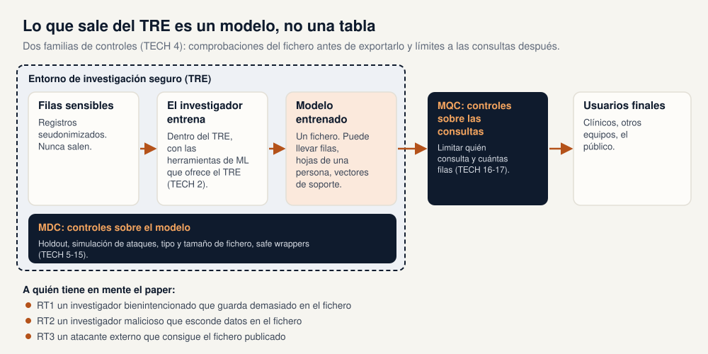

### 1.1 Los TRE y el nuevo tipo de resultado

Los TRE (también llamados safe havens o enclaves de datos) dan acceso a datos seudonimizados y enlazados dentro de un entorno seguro. Siguen el modelo de las "Five Safes" y revisan cada resultado antes de que salga. Para una tabla las reglas son conocidas: por ejemplo, ninguna celda debe describir a menos de *k* personas (paper §10.1, p. 35).

Un modelo entrenado rompe esas costumbres de tres maneras (paper §9.1, pp. 22-23 y §10.1, p. 35):

* **No es legible por una persona.** Incluso un modelo "sencillo" tiene demasiados parámetros para inspeccionarlo. Comprobar que ninguna hoja de un árbol de decisión describe a una sola persona es posible pero tedioso; hacerlo en un bosque de árboles, donde la intersección de hojas puede señalar a alguien, no es práctico a mano.
* **Algunos modelos guardan filas.** Un modelo de vecinos más cercanos necesita todas las filas de entrenamiento para predecir. Un clasificador de vectores soporte conserva las filas más cercanas a su frontera de decisión (los vectores soporte). Esas filas se pueden leer directamente del fichero (paper §10.1.5, pp. 39-40).
* **Un fichero se puede editar.** Un modelo es una gran matriz de números, así que alguien podría esconder datos dentro, igual que se puede esconder texto dentro de una imagen (paper §10.1, p. 35).

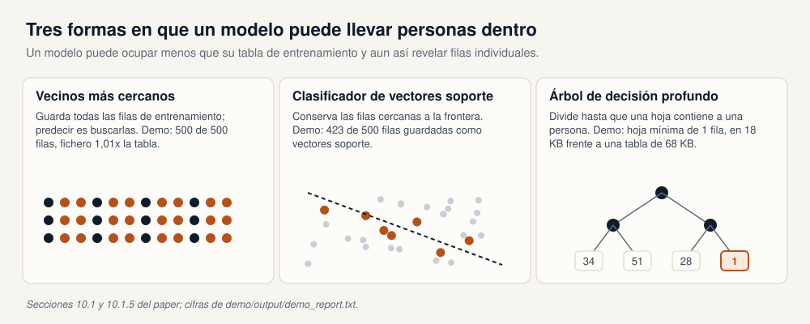

El tamaño del fichero no avisa. En la demo 1 el árbol de decisión profundo ocupa 18.150 bytes frente a una tabla de entrenamiento de 68.000 bytes (cociente 0,267), y su hoja más pequeña sigue describiendo a una persona (`demo_report.txt`, sección 4).

### 1.2 A quién tiene en mente el paper

El resumen ejecutivo nombra tres tipos de riesgo (paper §9.1, p. 23). Las demos los usan con estas etiquetas:

| Tipo de riesgo | Quién | Ejemplo en las demos |
|---|---|---|
| **RT1** | Un investigador bienintencionado que no conoce las amenazas y guarda demasiado en el fichero del modelo. | Entrenar un árbol sin límite de tamaño de hoja; cambiar un parámetro después de entrenar y olvidar reentrenar. |
| **RT2** | Un investigador malicioso que esconde datos en el fichero a propósito. | Añadir un atributo `hidden_rows` al modelo después de `fit()`. |
| **RT3** | Un atacante externo que consigue el modelo publicado. | Todos los ataques de las secciones 5 y 6. |

### 1.3 Los ataques

El paper usa tres familias de ataque (paper §9.1, p. 23 y §10.1.1, p. 36):

* **Inferencia de pertenencia (membership inference).** ¿Estaba la fila de esta persona en el conjunto de entrenamiento? Si el conjunto es "pacientes con cáncer", la pertenencia ya es sensible.
* **Inferencia de atributos (attribute inference).** Dada una parte del registro de alguien, ¿puede el modelo completar un campo oculto, como el peso o la tensión arterial?
* **Inversión del modelo (model inversion).** ¿Puede el atacante reconstruir registros completos que probablemente estén en el entrenamiento? Las demos no cubren este caso.

El anexo E del paper cuenta estas historias para un público no técnico: un político conocido cuyo peso y tensión se recuperan de un modelo de riesgo de cáncer (inferencia de atributos), la pertenencia de esa misma persona a un estudio sobre cáncer (inferencia de pertenencia), una agencia de selección que descarta a antiguos participantes de un estudio, y un SVM de un hospital que contenía 441 filas exactas de pacientes de un total de 798 (pp. 86-92).

---

## 2. Mapa del green paper

> **En pocas palabras.** El paper hace cinco grupos de recomendaciones. El grupo técnico (TECH 1 a 17) dice qué comprobar y cómo; las demos lo ilustran. Los otros cuatro grupos cubren lo legal y ético, el coste, la formación y la participación del público. Esta sección los resume para que sepas dónde mirar; el texto de las cláusulas está en el PDF.

El título completo del paper es *Green Paper: Recommendations for disclosure control of trained Machine Learning (ML) models from Trusted Research Environments (TREs)*. Es un resultado del proyecto sprint GRAIMatter de DARE UK, publicado en septiembre de 2022 (paper §2, p. 7).

### 2.1 Recomendaciones técnicas (TECH 1 a 17)

TECH 4 divide los controles en dos familias (paper §10.2.4, p. 42):

* **Controles de divulgación del modelo (MDC)**: actúan sobre el fichero antes de que salga: un conjunto reservado (holdout), simulación de ataques, comprobaciones del fichero, safe wrappers y controles adicionales para modelos que memorizan.
* **Controles de consulta del modelo (MQC)**: actúan después de publicar: el modelo se queda en un servidor y el TRE limita cómo se puede consultar.

La tabla recoge todas las recomendaciones técnicas y dónde las muestran las demos. La redacción es una paráfrasis breve.

| ID | Qué pide, en breve | Dónde lo muestran las demos |
|---|---|---|
| TECH 1 | Hablar del riesgo de divulgación al solicitar el proyecto (p. 41). | No se muestra. |
| TECH 2 | Ofrecer herramientas de ML dentro del TRE (p. 41). | No se muestra. |
| TECH 3 | Guardar una instantánea (snapshot) del pipeline que produjo un modelo aprobado, para auditoría (p. 42). | `demo/output/pipeline_snapshot.json` (demo 1, sección 9). |
| TECH 4 | Dos familias de control: MDC y MQC (p. 42). | La estructura de ambas demos. |
| TECH 5 | El trabajo de MDC necesita personal formado en ML (p. 43). | No se muestra. |
| TECH 6 | Reservar parte de los datos; el equipo investigador nunca entrena con ellos (p. 43). | 500 de 1.000 filas reservadas (sección 3). |
| TECH 7 | Hacer varias comprobaciones antes de publicar: precisión en el holdout, ataques, tamaño y tipo de fichero (p. 43). | `disclosure.decide()` en la demo 1; ataques estructural, de peor caso y de atributos en la demo 2. |
| TECH 8 | Los investigadores entregan un diccionario de datos de las entradas del modelo (p. 46). | `demo/output/data_dictionary.json`; el anexo C es la plantilla. |
| TECH 9 | Los investigadores pueden usar safe wrappers de la comunidad (p. 46). | `SafeDecisionTreeClassifier` en ambas demos. |
| TECH 10 | Los safe wrappers siguen unos principios: fichero de restricciones, corrección de hiperparámetros, detección de cambios tras el entrenamiento, `request_release()` (p. 48). | `demo/constraints.json` y el wrapper de la demo 1; el wrapper del paquete en la demo 2. |
| TECH 11 | Los modelos basados en instancias, y los que memorizan, necesitan controles extra: datos agregados, privacidad diferencial o límites de consulta (p. 49). | Se rechazan vecinos más cercanos y un SVC estándar (demo 1, sección 6). |
| TECH 12 | Decidir con conocimiento al usar privacidad diferencial (p. 50). | Ruido de Laplace sobre una media y la elección de la mejor de 50 (demo 1, sección 3). |
| TECH 13 | Los ensembles requieren un trato especial (p. 50). | No se muestra. |
| TECH 14 | Probar el modelo final del aprendizaje federado (p. 51). | No se muestra. |
| TECH 15 | Tratar los datos sintéticos como datos personales (p. 52). | No se muestra. |
| TECH 16 | Limitar las consultas a un modelo publicado (p. 52). | Puerta de consultas que cuenta filas (demo 1, sección 8). |
| TECH 17 | Que una parte externa pruebe los límites de consulta (p. 53). | Se menciona en la demo 1; la demo solo implementa la puerta. |

Los anexos que usa esta guía son el A (experimentos de riesgo, pp. 70-79), C (plantilla de diccionario de datos, p. 83), D (fichero de restricciones, p. 83), E (casos de estudio, pp. 86-92), F (explicación sencilla de las métricas, pp. 92-95) y G (pasos para simular ataques, p. 96).

> **El experimento 2 del anexo A, en una frase.** El equipo entrenó una gran variedad de configuraciones de hiperparámetros sobre varios conjuntos de datos tabulares y encontró muchas que parecían seguras en un conjunto y eran arriesgadas en otro (§16.2, p. 76). Por tanto, un rango seguro heredado de otro conjunto de datos no es, por sí solo, una decisión de publicación: hay que atacar el modelo concreto. Por eso la demo 1 sigue atacando el árbol con wrapper.

### 2.2 Ética y legal (ELA 1 a 11)

El propio modelo entrenado puede estar sujeto a la ley de protección de datos, así que pueden hacer falta acuerdos de cesión (ELA 1). Los procesos de aprobación deben valorar los riesgos y controles de cada solicitud, los contratos deben cubrir los controles de consulta tras la publicación y los registros de uso de datos deben incluir los modelos y sus controles (ELA 2 a 4). Investigadores, personal del TRE y comités deben recibir formación (ELA 5). Las licencias (EULA) y las declaraciones de los investigadores incorporan cláusulas adicionales (ELA 6 y 7). **ELA 8** dice que la aprobación puede seguir un enfoque basado en el riesgo, y por eso los umbrales de la demo 1 son una política local, no del paper. El responsable de los datos aprueba el proceso de control de divulgación del TRE (ELA 11). Ver §11.2, pp. 54-63. Las demos no redactan ninguna cláusula.

### 2.3 Costes (C 1 a 5)

Revisar modelos y lanzar ataques es trabajo adicional que el TRE debería cobrar; el desarrollo de herramientas necesita financiación; alojar un modelo con consultas limitadas tiene su propio coste; parte del trabajo más técnico se puede externalizar (§12.2, pp. 64-65).

### 2.4 Formación (TR 1 a 4)

Cursos y documentación para el personal del TRE, los investigadores y los comités de gobernanza y ética, sobre ML y sobre el riesgo de divulgación en modelos entrenados (§13.2, pp. 65-66).

### 2.5 Participación del público (P 1 y 2)

Representantes del público deben participar en la gobernanza de datos y en la aprobación ética, y el uso de datos para entrenar modelos, junto con los controles aplicados, debe ser visible en registros de uso de datos consultables (§14.2, p. 67).

---

## 3. La cohorte sintética y el holdout

> **En pocas palabras.** Las dos demos usan el mismo grupo inventado de 1.000 personas. El investigador recibe 500 para entrenar. El TRE guarda las otras 500 bajo llave y las usa para evaluar el modelo, que es lo que pide TECH 6. Nadie en los datos es real.

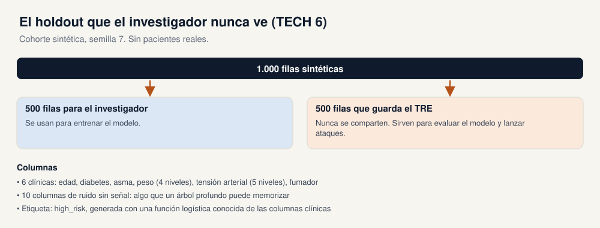

La cohorte la genera `demo/graimatter_demo/cohort.py` con la semilla 7.

* **Columnas clínicas (6):** edad (de 30 a 89), diabetes, asma, peso (bajo peso, normal, sobrepeso, obesidad), tensión arterial (baja, algo alta, alta, muy alta, extremadamente alta), fumador.
* **Columnas de ruido (10):** de `noise_0` a `noise_9`, normales estándar, sin relación con la etiqueta. Existen para que un árbol sin restricciones tenga algo que memorizar.
* **Etiqueta:** `high_risk`, generada con una función logística conocida de las columnas clínicas.

**Por dentro.** El logit de `high_risk` es `-1.35 + 0.034·(edad − 55) + 0.9·fumador + 0.55·diabetes + 0.22·asma + 0.32·[peso ≥ sobrepeso] + 0.30·[tensión ≥ alta]`. `hold_out_for_tre()` baraja los 1.000 índices de fila, da los primeros 500 al TRE y el resto al investigador.

El diccionario de datos que pide TECH 8 se escribe en `demo/output/data_dictionary.json`. Lista cada entrada con su codificación (`int`, `binary`, `ordinal:` con los nombres de los niveles, o `float64` para el ruido), el tamaño de las particiones y la semilla, siguiendo la plantilla del anexo C (p. 83).

---

## 4. Las métricas, en palabras y en código

> **En pocas palabras.** Un ataque da a cada fila una puntuación: cuánto cree el atacante que esa fila estaba en el entrenamiento. Las métricas responden a tres preguntas. De media, ¿separa la puntuación a los miembros de los no miembros (AUC)? ¿Hay filas en las que el ataque está muy seguro y acierta (TPR con FPR bajo, FDIF)? Y si el atacante dice "miembro", ¿qué probabilidad hay de que sea cierto, dado lo raros que son los miembros (la probabilidad a posteriori)?

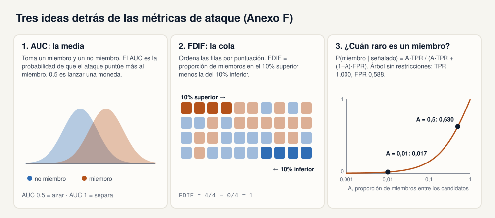

Cada métrica se define una vez, con la fórmula que usa el repositorio (`demo/graimatter_demo/metrics.py`) y la explicación del paper (anexo F, pp. 92-95).

**Precisión de entrenamiento y precisión en el holdout.** La precisión de entrenamiento es la proporción de aciertos en las filas con las que se entrenó el modelo. La precisión en el holdout (set-aside) es lo mismo sobre las 500 filas que el investigador nunca recibió. Una diferencia grande significa que el modelo se ha ajustado a esta muestra concreta, ruido incluido. La política de la demo 1 marca una diferencia superior a 0,15.

**Inferencia de pertenencia.** El ataque etiqueta cada fila como "miembro" (estaba en el entrenamiento) o "no miembro". La versión de peor caso del anexo G da al atacante tanto las filas de entrenamiento como las reservadas, así que es una cota superior conservadora, no un atacante realista (p. 96).

**TPR y FPR.** La tasa de verdaderos positivos es la proporción de miembros reales que el ataque llama miembros. La tasa de falsos positivos es la proporción de no miembros que llama miembros por error. La demo usa un umbral de puntuación de 0,5.

**AUC.** Toma al azar un miembro y un no miembro. El AUC es la probabilidad de que el ataque puntúe más alto al miembro. 0,5 es lanzar una moneda; 1 significa que el ataque siempre coloca primero a los miembros. El paper señala que no hay un valor de AUC "malo" universal y propone compararlo con el rango esperable por azar (anexo F §21.4, p. 94). Con 100 miembros y 100 no miembros, tres desviaciones típicas alrededor de 0,5 dan aproximadamente de 0,38 a 0,62. El informe de `sacroml` imprime la misma banda como `0.3772 -> 0.6228`.

**Ventaja (advantage).** `ventaja = |TPR − FPR|`. Cero significa que el ataque llama "miembro" a miembros y no miembros con la misma frecuencia.

**TPR al 10% de FPR.** Recorre las filas desde la puntuación más alta. Detente justo antes de que las falsas alarmas superen el 10% de los no miembros. La proporción de miembros detectados hasta ahí es la TPR al 10% de FPR. Un modelo puede tener un AUC modesto y aun así delatar a un grupo de miembros en esta cola.

**FDIF (diferencia de frecuencias).** Ordena las filas por puntuación. FDIF es la proporción de miembros en el 10% superior menos la proporción de miembros en el 10% inferior. Con puntuaciones aleatorias FDIF ronda 0; un ataque que está seguro de algunos miembros y de algunos no miembros la acerca a 1. La demo calcula un p-valor por permutación: baraja las etiquetas de pertenencia 300 veces y cuenta cuántas veces la FDIF barajada es al menos igual de grande. El anexo F explica por qué importa: un ataque que está seguro de 20 de 200 filas (10 miembros con puntuación 1 y 10 no miembros con puntuación 0) y es aleatorio en el resto tiene un AUC medio de 0,595, dentro de la banda del azar, y sin embargo expone a esas personas (§21.5, pp. 94-95). La demo 1 considera un fallo FDIF ≥ 0,20 con p ≤ 0,05.

**Probabilidad a posteriori de pertenencia.** Si el atacante dice "esta fila estaba en el entrenamiento", ¿qué probabilidad hay de que sea verdad? Depende de *A*, la proporción de miembros entre las filas que el atacante está probando:

```
P(miembro | señalado) = (A × TPR) / (A × TPR + (1 − A) × FPR)
```

La demo la da con A = 0,5 (la mitad de los candidatos son miembros) y A = 0,01 (uno de cada cien). Para el árbol sin restricciones (TPR 1,000, FPR 0,588) sale 0,630 y 0,017 (`demo_report.txt`, sección 4). El propio ejemplo del paper muestra el mismo efecto: un buen ataque (TPR 0,8, FPR 0,2) da solo 0,04 cuando los miembros son 1 de cada 100 (anexo F, tabla 9, p. 93).

**Inferencia de atributos.** Para una fila, prueba todos los valores posibles de un campo oculto y pide al modelo su confianza en la etiqueta de la fila. Si un único valor da la confianza más alta, esa es la conjetura del ataque; si varios empatan, el ataque se abstiene. El anexo G pide dos cifras: la proporción de filas con conjetura única y cuántas de esas conjeturas aciertan, tanto en las filas de entrenamiento como en las reservadas (p. 96). La demo 1 resume la comparación en un **cociente de riesgo de atributos**: la tasa de aciertos en filas de entrenamiento dividida entre la tasa en el holdout. Por encima de 1 significa que las filas de entrenamiento son más fáciles de completar. La política de la demo 1 marca 1,35.

**k-anonimato de una hoja.** El número de filas de entrenamiento en la hoja más pequeña de un árbol. Una hoja de 1 es una persona.

**Por dentro.** `summarise_attack_scores()` en `metrics.py` devuelve todo lo anterior para un conjunto de puntuaciones. `true_positive_rate_at_false_positive_rate()` recorre las puntuaciones ordenadas; `frequency_difference()` usa una cola del 10% y 300 permutaciones; `membership_probability()` es la fórmula de la probabilidad a posteriori.

---

## 5. Demo 1: las comprobaciones escritas a mano

> **En pocas palabras.** El primer script es una implementación pequeña y legible de las comprobaciones del paper. Entrena varios modelos con la cohorte sintética, los ataca y dice sí o no a cada uno según una política de demo. Rechaza un árbol profundo que memorizó personas y libera un árbol más contenido construido con un safe wrapper. También rechaza modelos que guardan filas, detecta un modelo editado después de entrenarse y bloquea una consulta que intenta barrer campos ocultos.

Punto de entrada: `demo/run_demo.py`. Informe: `demo/output/demo_report.txt`. Política: `demo/graimatter_demo/disclosure.py`. Restricciones: `demo/constraints.json`. El recorrido sigue las secciones 1 a 10 del informe.

### 5.0 La política de la demo

El paper no publica umbrales universales; ELA 8 deja el apetito de riesgo a un acuerdo con el responsable de los datos. Para que el script pueda decir sí o no, `disclosure.py` fija una política local. **Estas cifras son de la demo, no del paper.**

| Regla | Límite |
|---|---|
| AUC de pertenencia de peor caso | 0,62 |
| Ventaja | 0,20 |
| TPR al 10% de FPR | 0,35 |
| FDIF y su p-valor | 0,20, con p ≤ 0,05 |
| Cociente de riesgo de atributos | 1,35 |
| Precisión de entrenamiento menos precisión en holdout | 0,15 |
| Tamaño del modelo ÷ tamaño de la tabla de entrenamiento | 0,75 |
| Tipos de fichero aceptados | `.joblib`, `.pkl` |

Un modelo que guarda filas de entrenamiento se rechaza aunque pase todas las demás reglas.

### 5.1 Las filas que el investigador nunca ve (sección 1)

El script genera las 1.000 filas, reserva 500 y escribe el diccionario de datos (sección 3 de esta guía). *Ilustra TECH 6 y TECH 8, anexo C.*

### 5.2 Inferencia de atributos sobre un registro plantado (sección 2)

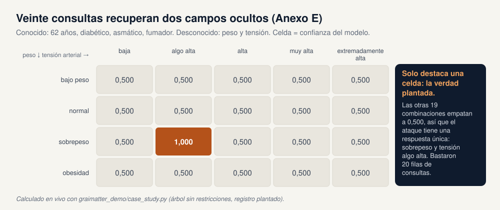

`case_study.py` reconstruye el primer caso de estudio del paper con datos sintéticos. Planta a una persona de 62 años, diabética, asmática y fumadora, con sobrepeso y tensión algo alta. A su alrededor coloca un bloque de filas que comparten los mismos campos públicos y cubren todas las demás combinaciones de peso × tensión, con etiquetas mezcladas. Se entrena un árbol sin restricciones con todo ello.

El atacante conoce los cuatro campos públicos y prueba las 4 × 5 = 20 combinaciones de los dos ocultos. La pareja plantada (sobrepeso, algo alta) devuelve confianza 1,000; todas las demás combinaciones dan 0,500. La confianza más alta, única, es la verdad oculta. En la versión del paper la primera respuesta estaba en el 93,8% y la siguiente en el 57,7% (anexo E §20.1, p. 87); el bloque plantado de la demo hace la diferencia aún más clara. *Ilustra el anexo E.*

### 5.3 Qué significa epsilon, sobre una media (sección 3)

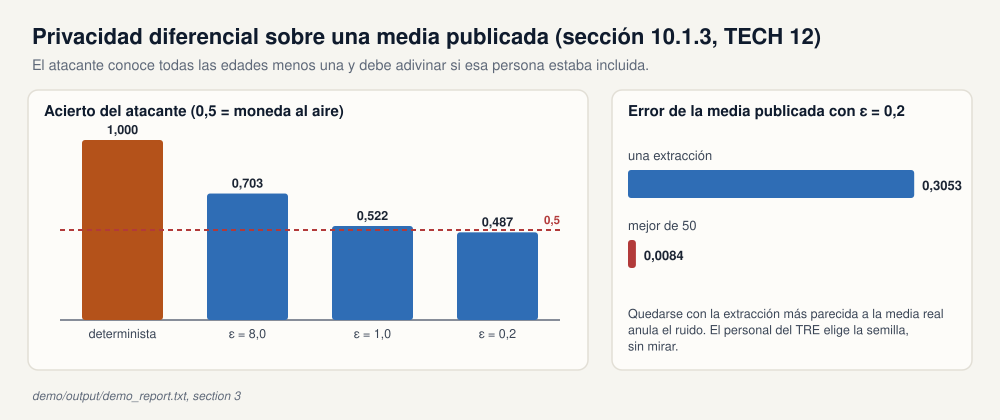

La privacidad diferencial es una propiedad del mecanismo que convierte datos privados en una publicación, no de los datos (paper §10.1.3, pp. 37-39). El experimento mental del paper: el atacante lo sabe todo salvo si una persona concreta estaba incluida, y ve lo publicado. Una publicación determinista, como una media sin más, delata la respuesta: el atacante calcula la media de las dos formas y ve cuál coincide. Un mecanismo diferencialmente privado añade aleatoriedad para que los dos casos se parezcan, en un grado que fija epsilon (cuanto menor, más privado).

La demo lo aplica a la edad media de las 500 filas de entrenamiento. El atacante conoce todas las edades y debe adivinar si la fila 0 estaba incluida. El acierto es la frecuencia con que adivina bien en 400 intentos.

| Publicación | Acierto del atacante | Escala de Laplace |
|---|---|---|
| Media determinista | 1,000 | 0 |
| epsilon 8,0 | 0,703 | 0,015 |
| epsilon 1,0 | 0,522 | 0,120 |
| epsilon 0,2 | 0,487 | 0,600 |

TECH 12 añade un aviso práctico. Con epsilon 0,2 una media con ruido se aleja 0,3053 de la media real. Si alguien extrae 50 medias con ruido y se queda con la más cercana a la respuesta real, el error baja a 0,0084. Elegir la extracción que más se parece a la respuesta no privada anula la protección, así que debe ser el personal del TRE, no el investigador, quien elija la semilla, sin mirar el resultado. *Ilustra §10.1.3 y TECH 12.*

**Por dentro.** `dp_sketch.py` usa una sensibilidad de `(90 − 30) / 500 = 0,12` (el rango de edades dividido entre el número de filas) y una escala de Laplace `sensibilidad / epsilon`. El atacante dice "incluida" cuando lo publicado está más cerca de la media con la fila que de la media sin ella. Este repositorio no entrena ningún modelo diferencialmente privado.

### 5.4 Árbol sin restricciones (sección 4)

Se entrena un `DecisionTreeClassifier` sin límite de profundidad y con `min_samples_leaf = 1` sobre las 500 filas del investigador.

| | Resultado sembrado |
|---|---|
| Precisión de entrenamiento | 1,000 |
| Precisión en holdout | 0,590 |
| Diferencia | 0,410 (límite 0,15) |
| Hoja más pequeña | 1 fila de entrenamiento |
| Tamaño del fichero | 18.150 bytes frente a 68.000 de la tabla (cociente 0,267; el tamaño por sí solo no falla) |
| AUC de pertenencia de peor caso | 0,708 (límite 0,62) |
| Ventaja | 0,412 (límite 0,20) |
| TPR / FPR | 1,000 / 0,588 |
| TPR al 10% de FPR | 0,156 (no supera el límite de 0,35) |
| FDIF | 0,620, p = 0,003 |
| Probabilidad a posteriori si se señala | 0,630 con la mitad de miembros; 0,017 con 1 de cada 100 |
| Salem-synth | AUC 0,703; TPR al 10% de FPR 0,514; FDIF 1,000 |
| Inferencia de atributos sobre el peso | Se abstiene. Cociente 1,000. |

**Decisión: no publicar.** Saltan cuatro reglas: la diferencia de precisión, el AUC, la ventaja y FDIF.

Hay dos detalles que conviene señalar. Primero, la comprobación de tamaño y la TPR al 10% de FPR pasan: por sí solas habrían dejado salir este modelo, y por eso TECH 7 pide varias comprobaciones. Segundo, el ataque de atributos sobre el peso se abstiene. Este árbol separa las filas con las columnas de ruido, así que cambiar el peso de una persona no la mueve a otra hoja y todos los valores de peso dan la misma confianza. La sección 5.2 es el caso en que el modelo sí divide por los campos ocultos.

**Por dentro.** El ataque de peor caso (`attacks.worst_case_membership`) construye una fila por registro con las probabilidades predichas por el modelo **más la etiqueta real**, la marca como miembro o no miembro, divide ese conjunto por la mitad, entrena un random forest con una mitad y puntúa la otra. Salem-synth (`attacks.salem_synth_membership`) genera una cohorte nueva con el mismo generador, entrena un árbol sombra con los mismos hiperparámetros, entrena el ataque con las salidas del modelo sombra y después puntúa el modelo real: el atacante tiene datos parecidos, no las tablas del TRE (anexo A, tabla 2, p. 71).

### 5.5 Los mismos datos con un safe wrapper (sección 5)

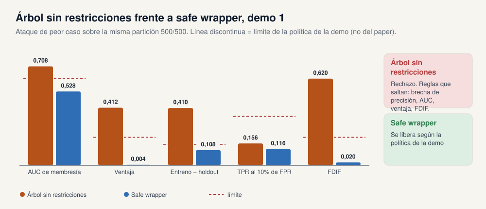

El investigador pide la misma configuración sin restricciones, pero a través de `SafeDecisionTreeClassifier`. El wrapper lee `demo/constraints.json` y la corrige: `min_samples_leaf` de 1 a 20 y `max_depth` de ilimitado a 4. El anexo D del paper muestra el formato del fichero de restricciones con un tamaño mínimo de hoja de 5 como ejemplo (p. 83); la demo es más estricta para que el contraste se vea con unos cientos de filas.

| | Resultado sembrado |
|---|---|
| Precisión de entrenamiento | 0,692 |
| Precisión en holdout | 0,584 |
| Hoja más pequeña | 20 filas de entrenamiento |
| AUC de pertenencia de peor caso | 0,528 |
| Ventaja | 0,004 |
| TPR al 10% de FPR | 0,116 |
| FDIF | 0,020, p = 0,445 |
| Probabilidad a posteriori si se señala | 0,502 con la mitad de miembros; 0,010 con 1 de cada 100 |
| Inferencia de atributos sobre el peso | Se abstiene. Cociente 1,000. |

`request_release()` devuelve "Run file through the next step of the checking procedure": el wrapper solo lleva el fichero a la cola del TRE. Después deciden las cifras de los ataques. No salta ninguna regla de la demo. **Decisión: publicar según la política de la demo.** La precisión en el holdout casi no cambió (de 0,590 a 0,584), lo que indica que la precisión de entrenamiento extra del árbol profundo era memorización, no capacidad.

#### El fallo silencioso (anexo F)

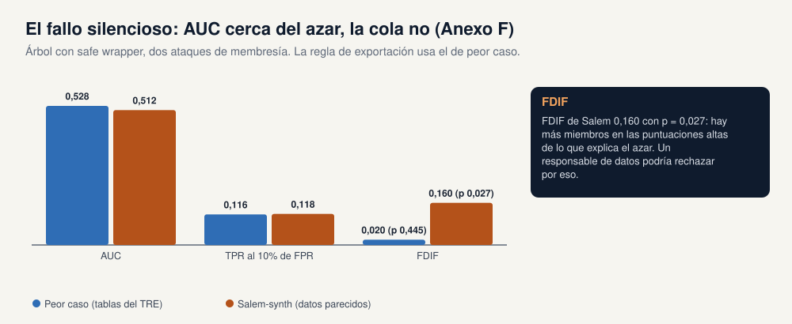

Salem-synth sobre el mismo árbol con wrapper da un AUC de 0,512, cerca del azar, pero FDIF 0,280 con p = 0,003 y TPR al 10% de FPR 0,252. Los miembros se acumulan en las puntuaciones extremas. Es el aviso del anexo F en la práctica: la media dice "azar", la cola no. La regla de exportación de la demo 1 sigue el ataque de peor caso del anexo G, cuya FDIF es 0,020, así que publica. Un responsable de datos al que le preocupe la cola podría rechazarlo. *Ilustra TECH 9, TECH 10, TECH 7, el anexo F y el experimento 2 del anexo A.*

### 5.6 Se rechazan los modelos basados en instancias (sección 6)

* Un modelo de 1 vecino más cercano guarda las 500 filas de entrenamiento. El fichero ocupa 68.677 bytes, 1,010 veces la tabla.
* Un clasificador de vectores soporte con kernel RBF guarda 423 vectores soporte de 500 filas. Cociente de tamaño 0,94.
* Los safe wrappers de ambas clases se niegan a entrenar: `constraints.json` marca `KNeighborsClassifier` y `SVC` como no permitidos.

**Decisión: no publicar** ninguno de los dos. Los motivos son que el modelo guarda filas de entrenamiento y que el fichero supera 0,75 veces la tabla. Las alternativas del paper son entrenar con datos agregados, usar un algoritmo diferencialmente privado o mantener el modelo dentro de un servicio con consultas limitadas (TECH 11, p. 49; §10.1.5, pp. 39-40). Este repositorio no implementa un SVM privado. *Ilustra TECH 11.*

### 5.7 Editar el modelo después de `fit()` (sección 7)

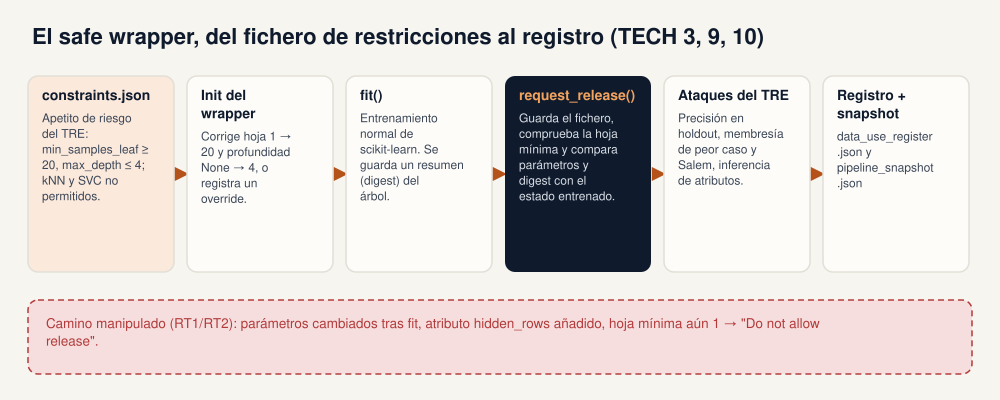

Esta vez el investigador activa `override=True`. El wrapper acepta `min_samples_leaf = 1` y profundidad ilimitada, pero informa de ambas infracciones. Después de entrenar, el investigador vuelve a poner los parámetros en los valores permitidos (`max_depth` 4, `min_samples_leaf` 20) y añade un atributo llamado `hidden_rows`. `request_release()` compara el estado actual con la instantánea tomada en `fit()` y devuelve "Do not allow release", con esta lista:

* `max_depth` cambió de `None` a 4 después de entrenar el modelo;
* `min_samples_leaf` cambió de 1 a 20 después de entrenar el modelo;
* la hoja más pequeña tiene 1 fila de entrenamiento, y las restricciones exigen 20;
* se añadieron atributos después de `fit()`: `hidden_rows`.

Las dos primeras detectan el caso descuidado (RT1: cambiar un parámetro sin reentrenar). La última detecta un intento deliberado de esconder datos (RT2). El paper describe esta comprobación en §10.1.2 (p. 37). Por último, un fichero llamado `not_a_model.txt` se rechaza porque su tipo no es `.joblib` ni `.pkl`. *Ilustra TECH 10 y los tipos de riesgo RT1 y RT2.*

**Por dentro.** En `fit()`, el wrapper guarda los parámetros, un resumen SHA-256 de las matrices del árbol, el k-anonimato de las hojas y la lista de nombres de atributos. `request_release()` vuelve a comprobar las restricciones, compara parámetros y resumen, recalcula la hoja más pequeña y busca atributos nuevos. Escribe `<modelo>.release.json` junto al fichero del modelo.

### 5.8 Un presupuesto de consultas que cuenta filas (sección 8)

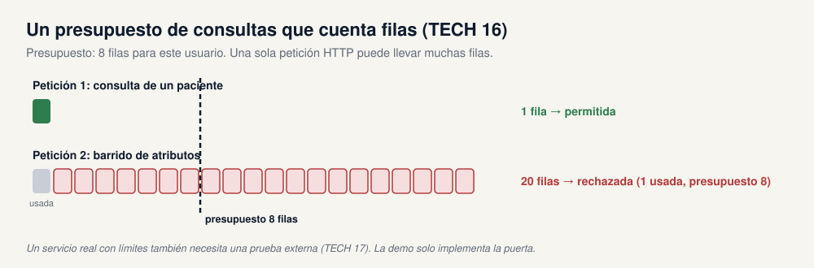

Si el modelo no se publica como fichero sino que se queda en un servidor, el TRE puede limitar las consultas (paper §10.1.7, pp. 40-41). `query_gate.py` da a cada usuario un presupuesto de 8 filas. Una consulta de un solo paciente (1 fila) se permite; las probabilidades de clase devueltas son 0 y 1. Después, el mismo usuario envía el barrido de 20 combinaciones de la sección 5.2 en una sola petición. La puerta lo rechaza: 20 filas pedidas, 1 ya usada, presupuesto de 8.

La unidad importa. Si el presupuesto contara llamadas HTTP, una sola llamada con las 20 filas pasaría. TECH 17 añade que una parte externa debería probar un servicio real con consultas limitadas (p. 53); la demo solo implementa la lógica de control. *Ilustra TECH 16 y TECH 17.*

### 5.9 Entrada en el registro e instantánea del pipeline (sección 9)

`demo/output/data_use_register.json` registra el árbol con wrapper (`safe_tree.joblib`) con la decisión `approved_for_demo_release`, los controles aplicados (holdout, restricciones del wrapper, ataques de pertenencia y de atributos, k-anonimato de las hojas, comprobación de tamaño) y los ficheros rechazados (`unsafe_tree.joblib`, `tampered_tree.joblib`). `demo/output/pipeline_snapshot.json` guarda lo necesario para reproducir el candidato aprobado: la semilla, los identificadores de las filas del investigador y del holdout, la recomendación del wrapper con los parámetros corregidos y la política de la demo. La declaración del investigador está en lenguaje llano (seguir los controles aprobados, aceptar la entrada en el registro, aceptar que el personal del TRE lanzará ataques); el texto de cláusulas del paper se dejó para una revisión legal cualificada. *Ilustra TECH 3 y ELA 4.*

### 5.10 Lado a lado (sección 10)

| Modelo | Entreno | Holdout | AUC peor caso | Ventaja | TPR al 10% FPR | Decisión |
|---|---|---|---|---|---|---|
| Árbol sin restricciones | 1,000 | 0,590 | 0,708 | 0,412 | 0,156 | Rechazar |
| Safe wrapper, hoja 20, profundidad 4 | 0,692 | 0,584 | 0,528 | 0,004 | 0,116 | Publicar según la política de la demo |
| 1 vecino más cercano | | | | | | Rechazar: guarda 500 filas |
| SVC con kernel RBF | | | | | | Rechazar: 423 vectores soporte |
| Árbol manipulado | | | | | | Rechazar: editado tras fit |

---

## 6. Demo 2: el paquete oficial SACRO-ML

> **En pocas palabras.** El segundo script pasa la misma cohorte por `sacroml`, la herramienta mantenida que nació del trabajo AI-SDC del paper. Su safe wrapper es más laxo que el de la demo 1 (hoja mínima de 5 en lugar de 20), nunca aprueba nada por sí mismo y su propia comprobación estructural sigue calificando de arriesgado el árbol con wrapper. Su ataque de pertenencia da un AUC cercano a 0,5 incluso para el árbol que memorizó a todo el mundo, porque mira información distinta.

Punto de entrada: `demo/run_sacroml_demo.py`. Paquete: `sacroml` 2.0.1 de [SACRO-ML](https://github.com/AI-SDC/SACRO-ML). Resumen: `demo/output/sacroml/sacroml_report.txt`. Los `report.json` y `report.pdf` de cada ataque están en `demo/output/sacroml/unconstrained_tree/` y `demo/output/sacroml/safe_wrapper_tree/`, en `worst_case`, `structural` y `attribute`. La ejecución sembrada tardó unos tres minutos y medio.

### 6.1 El safe wrapper del paquete

* Creado con el tamaño de hoja por defecto, `SafeDecisionTreeClassifier` avisa de que `min_samples_leaf = 1` está por debajo del mínimo recomendado de 5 y marca la configuración como reveladora (disclosive).
* Al aplicar las restricciones, cambia `min_samples_leaf` a 5.
* `request_release()` sin un `Target` escribe `safe_release/target.yaml` y recomienda "Proceed to next step of checking". No lanza ataques y no es una aprobación.
* Volver a poner `min_samples_leaf` de 5 a 1 después de `fit()` hace que `posthoc_check()` devuelva disclosive, con el mensaje de que el parámetro cambió después de entrenar el modelo.

Pasar un `Target` a `request_release()` también lanzaría el ataque de razón de verosimilitud del paquete (LiRA); el ejemplo de referencia lo ejecuta con 100 modelos sombra. Esta demo no ejecuta LiRA.

### 6.2 Árbol sin restricciones

Precisión de entrenamiento 1,000, en holdout 0,590, diferencia 0,410.

| Comprobación | Resultado sembrado |
|---|---|
| AUC de pertenencia de peor caso, 3 repeticiones | media 0,500 (mín. 0,500, máx. 0,500); ninguna por encima de la banda nula de 0,377 a 0,623 |
| Estructural | `gen_error_risk`, `unnecessary_risk`, `k_anonymity_risk`, `class_disclosure_risk`, `smallgroup_risk` en true; `dof_risk` en false. Hoja mínima de 1 fila, por debajo del umbral del paquete, 10 |

El AUC de pertenencia de 0,500 necesita explicación, y la sección 7.2 la da con una figura. En resumen: este ataque usa solo las probabilidades predichas, y un árbol de hojas puras da probabilidades extremas tanto a las filas de entrenamiento como a las del holdout. Aquí es el ataque estructural el que detecta la memorización.

### 6.3 Árbol con wrapper (`min_samples_leaf` 5)

Precisión de entrenamiento 0,868, en holdout 0,566, diferencia 0,302. k-anonimato de las hojas: 5.

| Comprobación | Resultado sembrado |
|---|---|
| AUC de pertenencia de peor caso, 3 repeticiones | media 0,494 (mín. 0,471, máx. 0,519); ninguna por encima de la banda nula |
| Estructural | Las mismas alertas en true, incluida `k_anonymity_risk`, porque 5 sigue por debajo de 10. `dof_risk` en false |

Pasar de hoja 1 a hoja 5 es lo que hace el fichero de reglas publicado, y la propia comprobación estructural del paquete sigue calificando de arriesgado ese árbol.

### 6.4 Inferencia de atributos

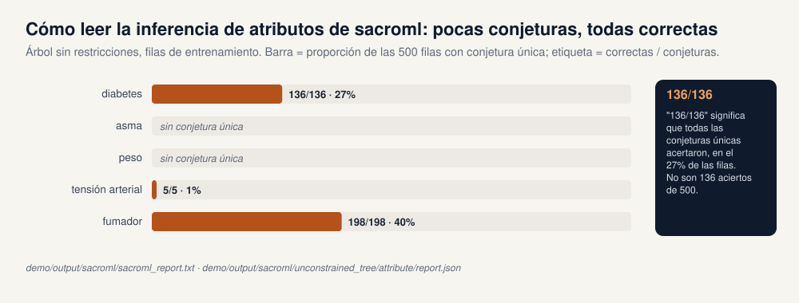

Lee cada celda como **conjeturas únicas correctas / conjeturas únicas hechas, sobre 500 filas**.

| Campo | Sin restricciones, entreno | Sin restricciones, holdout | Con wrapper, entreno | Con wrapper, holdout |
|---|---|---|---|---|
| diabetes | 136/136 | 141/141 | 195/257 | 191/246 |
| asma | sin conjetura única | sin conjetura única | 50/67 | 49/64 |
| peso | sin conjetura única | sin conjetura única | sin conjetura única | sin conjetura única |
| tensión arterial | 5/5 | 3/3 | sin conjetura única | sin conjetura única |
| fumador | 198/198 | 205/205 | 254/327 | 262/330 |
| edad | fracción reconstruida 0,012 | 0,010 | 0,034 | 0,050 |

"136/136" significa que todas las conjeturas únicas acertaron, en las 136 filas (27%) en las que el ataque se atrevió a conjeturar. **No** significa que se acertaran 136 de 500 filas. Una celda "sin conjetura única" significa que el ataque se abstuvo en todas las filas. Las cifras de entrenamiento y de holdout son parecidas, que es justo la comparación que pide el anexo G: un modelo que solo filtrara atributos de sus filas de entrenamiento mostraría una diferencia clara. La edad es numérica, así que el paquete da la fracción de filas cuya edad puede acotar dentro de su tolerancia, no un recuento de conjeturas.

### 6.5 Cómo leer `report.json`

Cada carpeta de ataque contiene un `report.json` y un `report.pdf`. El JSON es un diccionario con una entrada por ejecución, cuya clave es el nombre del ataque más un identificador; si ejecutas el script más de una vez, las ejecuciones nuevas se añaden al final, así que lee la última clave. Dentro de cada ejecución:

* `metadata.attack_params`: la configuración, por ejemplo `n_reps: 3` en el ataque de peor caso o `safe_threshold: 10` en el estructural.
* `metadata.global_metrics`: el resumen. En el ataque de peor caso, `null_auc_3sd_range` es la banda del azar y `n_sig_auc_p_vals` cuenta las repeticiones con un AUC significativamente por encima del azar (0 aquí). En el estructural, las alertas de riesgo citadas arriba.
* `attack_experiment_logger.attack_instance_logger`: una entrada por repetición. En el ataque de peor caso: `TPR`, `FPR`, `AUC`, `Advantage`, la familia FDIF (`FDIF01` es la cola del 10%, con su p-valor en `PDIF01`) y tasas de cola como `TPR@0.1%`. En el ataque de atributos: `categorical` contiene, por campo, listas `train` y `test` de cinco números, `[aciertos, conjeturas únicas, línea base %, número de valores, filas]`, donde la línea base es la proporción del valor más frecuente; `quantitative` contiene la fracción de la edad.

**Por dentro.** Hay dos detalles distintos de la demo 1. El ataque de peor caso del paquete se configura con `include_model_correct_feature: false` y `sort_probs: true`: el modelo de ataque ve las probabilidades predichas ordenadas, no la etiqueta real. Su ataque de atributos solo conserva un valor candidato cuando la etiqueta que predice el modelo para ese candidato coincide con la que predice para la fila original, y exige que la confianza máxima única supere un umbral.

---

## 7. Las dos demos, lado a lado

> **En pocas palabras.** Los dos scripts miran los mismos datos y discrepan a propósito, y la discrepancia enseña mucho. Usan tamaños de hoja distintos, sus ataques "de peor caso" ven información distinta y uno dice "publicar" mientras el otro dice "sigue comprobando".

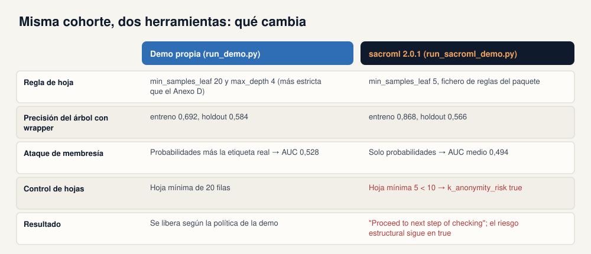

### 7.1 Tres diferencias que importan

| | Demo 1 (escrita a mano) | Demo 2 (`sacroml` 2.0.1) |
|---|---|---|
| **Regla de hoja** | `min_samples_leaf` 20 y `max_depth` 4, más estricta que el ejemplo del anexo D | `min_samples_leaf` 5, del fichero de reglas del paquete |
| **Ataque de pertenencia** | Probabilidades predichas más la etiqueta real | Solo probabilidades predichas |
| **Árbol con wrapper** | entreno 0,692, holdout 0,584, AUC 0,528 | entreno 0,868, holdout 0,566, AUC medio 0,494 |
| **Control de hojas** | hoja mínima 20 | hoja mínima 5 < 10, así que `k_anonymity_risk` es true |
| **Resultado** | se publica según la política de la demo | "Proceed to next step of checking"; el riesgo estructural sigue en true |

### 7.2 Por qué difieren las cifras de pertenencia

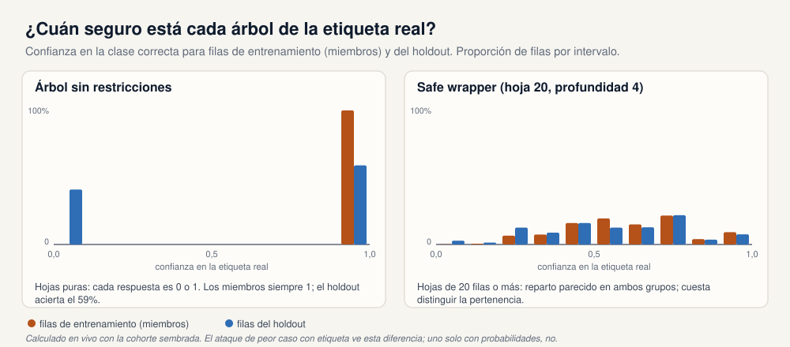

Los dos scripts llaman a su ataque "de peor caso", pero son pruebas distintas.

En el árbol sin restricciones todas las hojas son puras, así que cada predicción es una probabilidad de exactamente 0 o 1. La figura muestra la confianza que cada árbol da a la etiqueta **real**. Las filas de entrenamiento siempre reciben 1. Las del holdout reciben 1 cuando el árbol acierta (el 59% de las veces) y 0 cuando falla.

* **La demo 1** da al ataque la etiqueta real, así que puede distinguir "confianza 1 en la clase correcta" de "confianza 0 en la clase correcta". Los miembros siempre están en el primer grupo; el 41% de los no miembros está en el segundo. AUC 0,708.
* **La demo 2** solo da al ataque las probabilidades ordenadas. Sin la etiqueta, "probabilidad 1 para la clase A" se ve igual tanto si el árbol acierta como si falla. Miembros y no miembros son igual de extremos, así que el AUC es 0,500.

Un AUC cercano a 0,5 del paquete no significa, por tanto, que el árbol no haya memorizado. En la demo 2 la comprobación que lo detecta es el ataque estructural. En el árbol con wrapper y hojas de 20 filas, los dos grupos se reparten en confianzas parecidas, y por eso el AUC de la demo 1 baja a 0,528.

### 7.3 Qué quedarse

Ninguna de las dos demos es un proceso de aprobación. El script escrito a mano publica un árbol solo después de forzar hoja 20 y profundidad 4 y de que su propio ataque con etiqueta caiga dentro de una política local. El paquete recomienda seguir comprobando y sigue marcando el árbol de hoja 5. Un TRE real combinaría ambos tipos de evidencia con un apetito de riesgo acordado con su responsable de datos (ELA 8, ELA 11).

---

## 8. Cómo reproducirlo

La instalación se describe una sola vez, en el [README](../../README.md) del repositorio; el resumen en siete pasos de la demo 1 está en [demo/README.md](../../demo/README.md). En resumen, con [uv](https://docs.astral.sh/uv/) instalado, desde la raíz del repositorio:

```bash
uv venv --python 3.11
uv pip install -r demo/requirements.txt     # numpy, scikit-learn, sacroml (trae PyTorch)

uv run python demo/run_demo.py              # segundos; escribe demo/output/demo_report.txt
uv run python demo/run_sacroml_demo.py      # unos minutos; escribe demo/output/sacroml/
```

En Windows PowerShell, activa el entorno con un punto delante: `. .\.venv\Scripts\Activate.ps1`.

| Salida | La genera |
|---|---|
| `demo/output/demo_report.txt` | demo 1, las diez secciones |
| `demo/output/data_dictionary.json` | demo 1, TECH 8 |
| `demo/output/safe_tree.release.json`, `tampered_tree.release.json` | demo 1, informes de publicación del wrapper |
| `demo/output/data_use_register.json`, `pipeline_snapshot.json` | demo 1, sección 9 |
| `demo/output/sacroml/sacroml_report.txt` | resumen de la demo 2 |
| `demo/output/sacroml/<modelo>/<ataque>/report.json` y `report.pdf` | demo 2, por ataque |
| `demo/output/sacroml/safe_release/target.yaml` | demo 2, `request_release()` |

Las figuras de esta guía y la presentación se generan desde el repositorio:

```bash
pip install -r docs/requirements-docs.txt   # python-pptx, cairosvg
python docs/guide/make_figures.py           # docs/guide/img/en e img/es
python docs/make_deck.py                    # docs/GRAIMATTER.pptx
```

`make_figures.py` calcula dos figuras en vivo con el código de la demo (el barrido del registro plantado y los histogramas de confianza); el resto de cifras se copian de los informes sembrados.

---

## 9. Límites de las demos

* **La cohorte es sintética.** No hay pacientes reales. Semilla 7, 1.000 filas, 500 para el investigador y 500 que guarda el TRE.
* **Los umbrales son una política de demo.** Los límites de `disclosure.py` existen para que el primer script pueda decir sí o no. El paper no publica umbrales universales; ELA 8 describe una aprobación basada en el riesgo y acordada con el responsable de los datos.
* **El wrapper es más estricto que el ejemplo del paper.** La demo 1 usa `min_samples_leaf` 20 y `max_depth` 4; el tamaño mínimo de hoja del ejemplo del anexo D es 5.
* **`sacroml` usa sus propias reglas.** Su fichero de reglas sube `min_samples_leaf` de 1 a 5, y su ataque estructural marca una hoja como arriesgada por debajo de 10 filas de entrenamiento.
* **El paquete oficial no aprueba nada aquí.** `request_release()` registra "Proceed to next step of checking", y el ataque estructural sigue marcando el árbol con wrapper.
* **Los dos ataques de pertenencia son pruebas distintas.** La demo 1 entrena con probabilidades predichas más la etiqueta real; `sacroml` puntúa solo con la probabilidad predicha. Un AUC cercano a 0,5 del paquete no significa que el árbol no haya memorizado.
* **Los recuentos de atributos son conjeturas, no filas.** "136/136 conjeturas únicas correctas sobre 500 filas" significa que todas las conjeturas únicas acertaron, no que se adivinaran 136 de 500 filas. "Sin conjetura única" significa que el ataque se abstuvo.
* **No se ejecuta LiRA.** El ataque de razón de verosimilitud está en el paquete; el ejemplo de referencia usa 100 modelos sombra.
* **No hay SVM privado.** El repositorio solo esboza la privacidad diferencial sobre una media publicada.
* **No hay redacción legal.** La declaración del investigador está en lenguaje llano; el texto de cláusulas del paper se dejó para una revisión legal cualificada.

---

## 10. Glosario

| Término | Significado |
|---|---|
| **TRE** | Trusted research environment, entorno de investigación seguro: un lugar protegido donde investigadores autorizados analizan datos sensibles y los resultados se revisan antes de salir. |
| **Responsable de los datos** | La organización responsable de los datos según la ley de protección de datos (data controller); acuerda el apetito de riesgo (ELA 8, ELA 11). |
| **MDC** | Model disclosure control: comprobación del fichero del modelo antes de exportarlo (TECH 4 a 15). |
| **MQC** | Model query control: límite a cómo se puede consultar un modelo publicado (TECH 16, 17). |
| **Holdout / set-aside** | Filas que el TRE guarda y nunca entrega al investigador (TECH 6). |
| **Safe wrapper** | Versión de una clase de modelo que aplica un fichero de restricciones, guarda su estado en `fit()` y ofrece `request_release()` (TECH 9, 10). |
| **Fichero de restricciones** | Fichero legible con los rangos de hiperparámetros y los tipos de modelo que permite el TRE (anexo D). |
| **Modelo basado en instancias** | Modelo que necesita filas de entrenamiento guardadas para predecir, como vecinos más cercanos o un SVM con kernel (TECH 11). |
| **Inferencia de pertenencia** | Decidir si una fila estaba en el conjunto de entrenamiento. |
| **Inferencia de atributos** | Completar un campo oculto de una persona consultando el modelo (anexo E). |
| **Ataque de peor caso** | Ataque que dispone de las filas de entrenamiento y de las reservadas; una cota superior conservadora (anexo G). |
| **Escenarios Salem** | Ataques en los que el adversario entrena modelos sombra con otros datos (anexo A, tabla 2). |
| **Ataque estructural** | Comprobación de `sacroml` sobre la estructura del modelo: tamaño de hojas, grados de libertad, revelación de clase. |
| **LiRA** | Ataque de pertenencia por razón de verosimilitud con muchos modelos sombra; está en `sacroml`, no se ejecuta aquí. |
| **Privacidad diferencial (epsilon)** | Garantía sobre un mecanismo de publicación; un epsilon menor significa que lo publicado cambia menos al añadir o quitar a una persona (§10.1.3). |
| **AUC, ventaja, TPR, FPR, FDIF, probabilidad a posteriori** | Ver la sección 4. |
| **k-anonimato (de una hoja)** | Número de filas de entrenamiento en la hoja más pequeña. |
| **RT1, RT2, RT3** | Los tipos de riesgo del paper: investigador descuidado, investigador malicioso, atacante externo (sección 1.2). |

---

## 11. Referencias

1. *Green Paper: Recommendations for disclosure control of trained Machine Learning (ML) models from Trusted Research Environments (TREs).* Resultado del proyecto sprint GRAIMatter de DARE UK, septiembre de 2022. `GRAIMATTER Green Paper.pdf` en este repositorio. Una versión anterior: E. Jefferson et al., Zenodo, julio de 2022, doi:10.5281/zenodo.6896214.
2. SACRO-ML (`sacroml` 2.0.1). https://github.com/AI-SDC/SACRO-ML
3. A. Salem, Y. Zhang, M. Humbert, P. Berrang, M. Fritz, M. Backes. *ML-Leaks: Model and Data Independent Membership Inference Attacks and Defenses on Machine Learning Models.* arXiv:1806.01246, 2018 (referencia [37] del paper).
4. F. Ritchie. *The "Five Safes": a framework for planning, designing and evaluating data access solutions.* Zenodo, 2017, doi:10.5281/zenodo.897821 (referencia [2] del paper).
5. Este repositorio: [README.md](../../README.md), [demo/README.md](../../demo/README.md), [docs/brief-for-presentation-and-guide.md](../brief-for-presentation-and-guide.md).

---

## Anexo A: correspondencia entre la guía, las diapositivas y las demos

La guía y la presentación siguen el mismo orden: primero el problema y el paper (secciones 1 a 4, diapositivas 1 a 7), después las demos (secciones 5 a 7, diapositivas 8 a 18) y al final el contexto (secciones 8 y 9, diapositivas 19 a 22). Los títulos de las diapositivas están en inglés.

| Sección de la guía | Diapositivas (orden del deck) | Salida de la demo |
|---|---|---|
| 1. Qué protege un TRE | 1 *Cover*, 2 *The problem*, 3 *TECH 4 · Two families of control* | – |
| 2. Mapa del green paper | 4 *The paper*, 19 *What the paper also asks for* | – |
| 3. Cohorte y holdout | 5 *TECH 6 · TECH 8 · The cohort* | `data_dictionary.json` |
| 4. Métricas | 7 *Appendix F · Reading attack metrics* | – |
| 5.2 Registro plantado | 6 *Appendix E · Attribute inference* | `demo_report.txt` §2 |
| 5.3 Privacidad diferencial | 14 *§10.1.3 · TECH 12* | `demo_report.txt` §3 |
| 5.4 Árbol sin restricciones | 8 *Demo 1 · Unconstrained tree* | `demo_report.txt` §4 |
| 5.5 Safe wrapper y el fallo silencioso | 9 *Demo 1 · Safe wrapper*, 10 *Appendix F · The tail* | `demo_report.txt` §5 |
| 5.6 Modelos basados en instancias | 11 *TECH 11* | `demo_report.txt` §6 |
| 5.7 Edición tras `fit()` | 12 *RT1 · RT2 · TECH 3* | `demo_report.txt` §7, `tampered_tree.release.json` |
| 5.8 Presupuesto de consultas | 13 *TECH 16* | `demo_report.txt` §8 |
| 5.9 Registro e instantánea | 12 (notas) | `data_use_register.json`, `pipeline_snapshot.json` |
| 6.1 a 6.3 Wrapper y ataques de SACRO-ML | 15 *Demo 2 · sacroml 2.0.1* | `sacroml_report.txt` |
| 6.4 y 6.5 Inferencia de atributos, `report.json` | 17 *Demo 2 · Attribute inference* | `sacroml/*/attribute/report.json` |
| 7.1 Diferencias | 18 *Two demos compared* | ambos informes |
| 7.2 Por qué difieren las cifras de pertenencia | 16 *Why the two membership numbers differ* | – |
| 8. Cómo reproducirlo | 21 *Run it yourself* | – |
| 9. Límites | 20 *Limits* | – |
| 10. Glosario, 11. Referencias | 22 *References* | – |

### Agenda propuesta para el taller (unos 75 minutos)

| Tiempo | Bloque | Material |
|---|---|---|
| 0:00 | Por qué un modelo es un resultado nuevo; MDC y MQC; los cinco grupos de recomendaciones | Guía §1 y §2, diapositivas 1 a 4 |
| 0:10 | La cohorte, el holdout y el registro plantado | Guía §3 y §5.2, diapositivas 5 y 6 |
| 0:18 | Cómo leer las métricas de ataque | Guía §4, diapositiva 7 |
| 0:28 | Demo 1: árbol sin restricciones, safe wrapper, el fallo silencioso | Guía §5.4 y §5.5, diapositivas 8 a 10 |
| 0:38 | Demo 1: modelos basados en instancias, manipulación, presupuesto de consultas, privacidad diferencial | Guía §5.3, §5.6 a §5.9, diapositivas 11 a 14 |
| 0:50 | Demo 2 y la comparación | Guía §6 y §7, diapositivas 15 a 18 |
| 1:02 | Qué más pide el paper; límites; ejecutar las demos; preguntas | Guía §8 y §9, diapositivas 19 a 22 |

---

*Las figuras las genera `docs/guide/make_figures.py` (versiones en inglés y español). El barrido del registro plantado y los histogramas de confianza se calculan en vivo con el código de la demo; el resto de cifras viene de los informes sembrados.*
